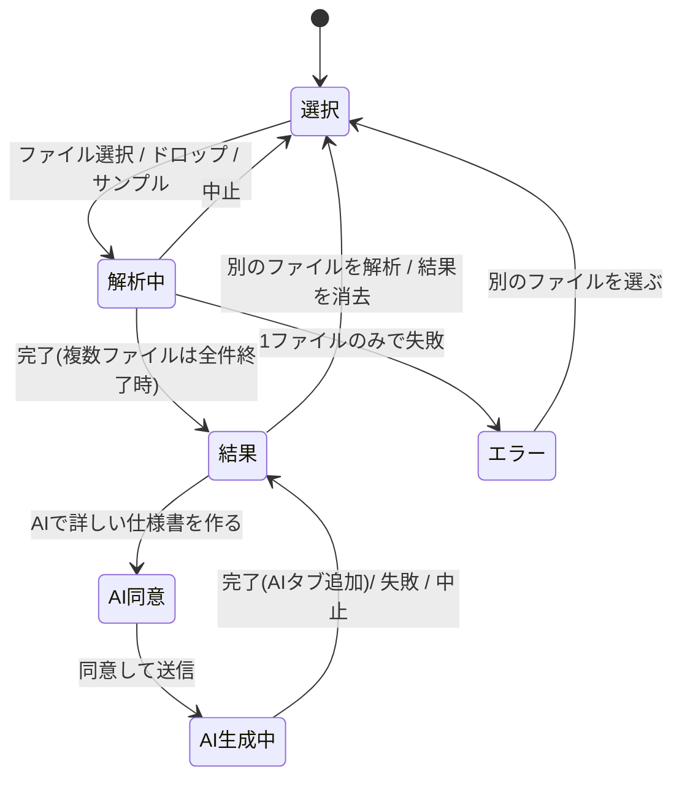

# マクロ棚卸しツール(画面アプリ)設計書

`apps/inventory` の解析エンジンを使い、Excel マクロ・Access ファイルをブラウザの中だけで解析して、仕様書・処理の流れ・依存関係・リスク・移行提案を見せる Next.js アプリ(`apps/inventory-web`)の実装前設計。

- **最大の売り**: 「ファイルはこのブラウザの外に出ません」。標準の仕様書(AIなし)はブラウザ内で完結する。
- AI で詳しい仕様書を作るときだけ、利用者の明示的な同意を得て、抽出済み・伏せ字済みのデータ(コードを含む)を自社サーバー経由で Claude に送る。
- 読み手は、ITに詳しくない中小企業の経営者・担当者と、それを支援するコンサルタント。画面の文言はすべて日本語。
- 構成・UIトークン・テストの書き方は `apps/diagnosis` / `apps/quote-assist` にそろえる(**読むだけ。編集・import はしない**。必要な小さいヘルパーはコピーする)。

> **実装の状況(2026-10-21 更新)**: 設計レビュー(`docs/design-critique.json`、指摘 F01〜F19)を反映し、レビューの段階分けの提案(F18)に沿って**段階1(公開できる最小)**を実装した。本文中の「【段階1】」「【反映 Fxx】」が実装時に変えた点。段階2以降に回したもの(複数ファイルと棚卸し一覧・詳細タブ・送信内容の全文タブ表示・ダーク時の図の描き直しなど)は §8 に「未実装」として明記した。指摘ごとの採用・不採用と理由は末尾の「付録D 設計レビューへの対応」。

---

## 1. 利用シーン

### (a) 見込み客が自社サイトから無料で試す

1. 自社サイト(LP・ブログ・診断ツール)のリンクから `/` を開く。iframe 埋め込みはしない(`frame-ancestors 'none'`)。
2. 見出しの下の3つの約束を読む: 「ファイルはこのブラウザの外に出ません」「無料・登録不要」「Excel マクロ・Access に対応」。
3. まず「サンプルで試す」で架空の会社のマクロを解析し、何が分かるかを見る(自社ファイルを入れる前の不安を下げる)。
4. 自社のファイルをドラッグ&ドロップ → 数秒で結果。概要・リスク・処理の流れ図を見る。
5. 標準の仕様書(Markdown / HTML / 印刷)を保存する。
6. 次の行動の導線: 「詳しい仕様書をAIで作る(送信内容を確認のうえ同意)」※有効な環境のみ/「移行・改修の相談をする」(`NEXT_PUBLIC_CONTACT_URL`。URL に解析結果を一切付けない)。

### (b) コンサルタントが顧客先・自分のPCで使う

1. 顧客先: 顧客のPCのブラウザで公開URLを開く(インストール不要)。ページを開いた後はネットワークを切っても解析・保存まで動く(§3.6)ので、通信制限のある環境や「本当に送っていないのか」と聞かれた場面で、機内モードにして実演できる。
2. 共有フォルダのマクロ・Access を**まとめて(最大10ファイル)**投入 → 「棚卸し一覧」で全体像(規模・高リスク件数・移行難易度)をつかむ。
3. 気になるファイルを開き、流れ図とリスクを画面で説明。その場で HTML/印刷 で渡す。
4. 持ち帰り: 「抽出結果(JSON)」を保存。顧客の書面同意を得たうえで、AI版(アクセスコード付き。§4.5)または CLI(`npx tsx src/cli.ts document report.json`、自分のAPIキー)で詳しい仕様書を作り、移行提案につなげる。
5. 自分のPCで使う場合も同じ。手元で `npm run build && npm start`(ポート 3401)でも動く。

---

## 2. 画面一覧と遷移

ルートは2つだけ。解析の状態はメモリ上のReactの状態で持ち、**URL・localStorage・IndexedDB には何も保存しない**(タブを閉じると消える。画面にその旨を表示)。

| パス | 内容 |
| --- | --- |
| `/` | ツール本体(選択 → 解析中 → 結果。エラー・AI同意はこの中のダイアログ/表示) |
| `/how-it-works` | 「仕組みとデータの扱い」(静的ページ。§4.3) |



### 2.1 選択画面(`/` の初期状態)

- ヘッダー: サービス名「マクロ棚卸し」、右に「仕組みとデータの扱い」リンク。
- ヒーロー: 見出し「辞めた人が作ったマクロ、中身を見える化します」+ 3つの約束(アイコン付きの短文)。
- **ドロップゾーン**: 【段階1】1ファイルずつ(`multiple` なし。複数ファイルは段階2)。【反映 F14】ページのどこに落としても解析し、ブラウザがファイルを開いて結果が消えることを防ぐ(`window` の dragover / drop の既定動作を止める)。`<label>` で包んだ `<input type="file" multiple accept=".xlsm,.xlsb,.xls,.xlsx,.xlam,.xltm,.accdb,.mdb">`。キーボードで フォーカス → Enter/Space で選択ダイアログ。ドラッグ中は枠を強調(`--accent`)。説明文: 対応形式、上限(1ファイル200MB・一度に10ファイル)、「パスワード付きの Access と、開くときにパスワードが必要なブックは解析できません」。
- **サンプルで試す**: `src/generated/samples.json`(§6)からカードを並べる。カード = title、description、highlights(チップ最大6個)、ボタン「このサンプルで試す」。押すと `/samples/<file>` を GET → `File` にして通常と同じ流れへ。マニフェストが空なら節ごと出さない。
- フッター: エンジンのバージョン(`ai-inventory 0.1.0`)、相談リンク(設定時)。

選択時の事前チェック(読み込む前に `File.name` / `File.size` だけで判定。`src/lib/file-types.ts`):

| 条件 | 表示 |
| --- | --- |
| 拡張子が対応外 | 「この形式(.docx)には対応していません。対応: …」→ そのファイルだけ除外 |
| 1ファイル > 200MB | 「ファイルが大きすぎます(上限200MB)」→ 除外 |
| 11ファイル以上 / 合計 > 500MB | 「一度に解析できるのは10ファイル・合計500MBまでです」→ 何も始めない |

### 2.2 解析中

- 「売上管理.xlsm を解析しています(2/5 件目)」、段階表示「読み込み → 解析 → 仕様書の作成」(Worker から `phase` を受けて進める。エンジンは同期処理で進捗率が取れないため、段階+経過秒数で表示)、「最大60秒ほどかかることがあります」。
- 「中止」ボタン: Worker を `terminate()` し、未処理のファイルも取りやめて選択画面へ。複数ファイルで既に終わった分は残して結果画面へ進む。
- 常時表示のバッジ: 「このブラウザの中で解析しています(ファイルは送信しません)」。
- `role="status"` + `aria-live="polite"`。

### 2.3 エラー

1ファイルだけのときは `role="alert"` の枠に「何が起きたか」+「どうすればよいか」+「別のファイルを選ぶ」。複数ファイルのときは棚卸し一覧のその行を「エラー」にして理由を出し、他のファイルの結果は見せる。文言の対応表(`src/lib/errors.ts`。エンジンのメッセージは日本語なので基本はそのまま使い、ヒントを足す):

【反映 F01】Worker はエラーのクラス名(minify で変わる)を返さず、`instanceof` で判定した固定のコード(`unsupported` / `encryptedAccess` / `password` / `corrupt` / `limit` / `readFailed` / `internal`)を返す。画面側の失敗(`timeout` / `crashed` / `loadFailed`)と合わせて `src/lib/errors.ts` が文言にする。【反映 F08・F09・F10】読み込みの失敗(`readFailed`:「ファイルを開けませんでした。共有フォルダの接続や、別のアプリで編集中でないかを確認し、デスクトップにコピーしてから…」)、Worker の起動失敗(`loadFailed`:「解析プログラムを読み込めませんでした。ページを再読み込みしてください」)を分け、上限超過では「zip 爆弾」の語を出さずに「マクロの解析にデータは不要です。データの行を消したコピーを保存してお試しください」と案内する。

| 原因(元の設計: Worker から返る `error.name`。実装はコード) | 表示 |
| --- | --- |
| `UnsupportedFileError`(暗号化 .accdb。メッセージが「パスワードで暗号化された Access」で始まる) | 「パスワード付きの Access ファイルは、この画面では解析できません。Access でパスワードを解除して別名で保存してから読み込むか、ご相談ください。」(エンジンの「コマンドライン版(--password)」の案内は出さない。単体テストでエンジンの文言を固定して判定) |
| `UnsupportedFileError`(その他。暗号化ブックなど) | エンジンのメッセージ + 「Excel でパスワードを外して保存し直すと解析できます」 |
| `CorruptFileError` | エンジンのメッセージ + 「Excel / Access で開いて保存し直すと解析できることがあります」 |
| `LimitExceededError`(`kind`) | エンジンのメッセージ(time / partSize / totalSize / entryCount / inputSize) |
| `PasswordError` | 「パスワードが必要なファイルのため解析できません」 |
| Worker の監視タイマー切れ(§3.5) | 「解析が時間内に終わらなかったため中止しました。ファイルが極端に大きい・複雑な可能性があります。」 |
| Worker の `error` / `messageerror`(メモリ不足でのクラッシュ等) | 「解析中に問題が起きました。ブラウザのメモリが足りない可能性があります。他のタブを閉じるか、ファイルを分けてお試しください。」 |
| その他(想定外) | 「解析できませんでした」+ エラー名のみ(スタックは出さない) |

### 2.4 結果画面

【段階1】タブは「概要」「リスク」「処理の流れ」「仕様書(全文)」の4つ(+AI 版の作成後に「AIによる解説」)。詳細タブ(モジュール・依存関係・シート・Access)は仕様書タブと内容が重なるため段階2。【反映 F14】保存の主ボタンは「レポートを保存(HTML。ブラウザで開けます)」と「印刷・PDF」、Markdown と抽出結果(JSON)は「技術者向けの形式で保存」に畳む(JSON にはソースコードと作成者名が含まれる旨を表示)。SHA-256 は「詳細(技術者向け)」へ。結果があるときは再読み込み・タブを閉じる・同じタブでのサイト内の移動の前に確認する。外部リンクは新しいタブで開く。AI 版のボタンは、ページ表示時に取得した利用可否(ファイル由来の情報を含まない GET)が `available: true` のときだけ出す。

**上部**
- 複数ファイル時: 「棚卸し一覧」表(ファイル名/形式/モジュール/コード行/テーブル/クエリ/リスク高/移行難易度/状態)。行を押すとそのファイルの詳細に切り替わる。1ファイルのときは出さない。
- アクションバー: 「仕様書を保存(Markdown)」「HTMLで保存」「印刷」「抽出結果(JSON)」「AIで詳しい仕様書を作る」、右側に「別のファイルを解析」「結果を消去」。スマホでは「保存」メニューに畳む。
- 注記: 「結果はこのタブを閉じると消えます。必要なら保存してください。」

**タブ**(該当データが無いタブは出さない。スマホではタブ列だけ横スクロール、ページ全体は横スクロールさせない)

| タブ | 中身(すべて InventoryReport と Worker が計算した `derived` から描く) |
| --- | --- |
| 概要 | ファイル情報(名前・形式・サイズ・作成/更新日時・作成者・最終更新者・SHA-256 先頭12桁)、規模のタイル(シート/数式/モジュール/プロシージャ/コード行/テーブル/クエリ/外部依存)、移行難易度(`estimateComplexity` の 低/中/高 と理由)、リスク件数(高/中/低)、起動のきっかけ上位5件、`warnings`(解析の制約) |
| リスク | `findings` を重要度順に。重要度バッジ、タイトル、説明、件数、場所(先頭5件+「ほかN件」を開閉) |
| 処理の流れ | 呼び出し関係図(`callFlowDiagram`。省略数があれば「起動のきっかけに近い60個を表示」と注記)、起動のきっかけ一覧、呼び出し関係の一覧(図の代替テキストを兼ねる) |
| モジュール・プロシージャ | モジュール表(名前・種別・行数・Option Explicit)。行を開くとプロシージャ表(名前・種類・公開範囲・行範囲・行数・引数・エラー処理・呼び出し元/先)と Declare。「ソースを表示」で `<pre>` を遅延描画(伏せ字済み)。200行を超える一覧は「さらに表示」で分割 |
| 依存関係 | `groupDependencies` の種類ごとの表(対象・件数・場所)、参照設定ライブラリ |
| シート(Excel) | シート表(名前・コード名・種類・表示状態・使用範囲・数式数・#REF!)、名前定義、外部リンク、データ接続(伏せ字済み)、ボタンに登録されたマクロ |
| Access | テーブル(件数・列は開閉)、リンクテーブル、クエリ(種類・参照テーブル・SQL は開閉)、クエリとテーブルの関係図、リレーションシップ図、フォーム/レポート/マクロ/モジュール名 |
| 仕様書 | 保存する Markdown を HTML にしたプレビュー(§5.3)。印刷はこの表示を使う |
| AIによる解説 | AI版の作成後に追加: 概要、業務フロー図(AI推定)、リスク評価、移行先候補(適合度・難易度)、おすすめの進め方、ヒアリング事項、AIへの入力の注記 |

**保存ファイル名**(`src/lib/export.ts`。`\/:*?"<>|` と制御文字は `_` に置換)

| ボタン | ファイル名 | 中身 |
| --- | --- | --- |
| Markdown | `<元の名前>_棚卸し.md` | エンジンの `renderMarkdown(report)` そのまま(図は Mermaid のコードブロック。GitHub や VS Code では図として表示されると案内) |
| HTML | `<元の名前>_棚卸し.html` | §5.3 の単体HTML(図はSVGで埋め込み、スクリプトなし) |
| 印刷 | — | 仕様書タブを `window.print()`。印刷用CSSで画面部品を消す(`.no-print`)。PDFはブラウザの「PDFに保存」で |
| 抽出結果(JSON) | `<元の名前>_抽出結果.json` | `report` をそのまま(CLI の `document report.json` で再利用できる) |
| AI版 | `<元の名前>_仕様書_AI.md` / `.html` | `renderMarkdown(report, { ai })` |

ダウンロードは `Blob` + `URL.createObjectURL` + `<a download>`(送信ではない)。

---

## 3. ブラウザ内処理の設計

### 3.1 全体像

```mermaid
flowchart LR
  subgraph Browser[ブラウザ(タブ)]
    UI[画面 React<br>エンジンは型だけ import] -- "File(ハンドル)と上限" --> W[Web Worker<br>inventory-worker-HASH.js]
    W -- "report・markdown・derived" --> UI
    UI -- "Mermaid コード" --> M[mermaid(遅延読み込み)<br>メインスレッドでSVG化]
  end
  UI -. "同意後のみ: 伏せ字済み JSON" .-> API["自社サーバー /api/ai-document"]
  API -. "Claude API" .-> C[(Anthropic)]
```

- **ファイルのバイト列を読むのは Worker だけ**。メインスレッドは `File` オブジェクト(ハンドル)を `postMessage` で渡すだけで、中身を読まない(サンプルは fetch した Blob から `File` を作る)。
- エンジンの実行コードは Worker のバンドルにだけ入れる。メインスレッドは `import type` だけ(ラベル類も Worker から受け取る)。zod(約440KB)を画面のバンドルに入れないため。

### 3.2 Worker のバンドル

- エンジンの `scripts/build-browser.mjs` と**同じ esbuild プラグイン**(mdb-reader の environment の差し替え、Node.js 組み込みモジュールの混入でビルド失敗)を使う。~~重複を避けるため、エンジン側で plugin を切り出す~~ 【実装時に変更】エンジン本体は編集しない方針を優先し、同じ処理を画面アプリの `scripts/engine-plugin.mjs` に写した(パスはファイル自身の場所を基準に解決。【反映 F19】)。エンジンの `build-browser.mjs` の plugin を変えたときは、こちらも合わせる必要がある(重複の代わりにエンジンを無変更に保てる)。【反映 F01】`keepNames: true` も付ける。
- 画面アプリの `scripts/build-worker.mjs`:
  - 入口 `src/worker/engine.worker.ts`、`bundle: true`、`platform: "browser"`、`format: "iife"`、`target: "es2022"`、`minify: true`、`legalComments: "eof"`、tsconfig の `@engine/*` パス(→ `../inventory/src/*`)を解決。エンジンの依存(zod・fflate・mdb-reader・buffer・fast-xml-parser)は `apps/inventory/node_modules` から解決される。
  - 出力 `public/engine/inventory-worker-[hash].js`(出力前に `public/engine/` を空にする)。ファイル名を `src/generated/engine-asset.json`(`{ "workerUrl": "/engine/inventory-worker-XXXX.js", "engineVersion": "0.1.0" }`)に書き、画面はこれを import する。
  - 出力したバンドルに `fetch(` / `XMLHttpRequest` / `sendBeacon` / `WebSocket` / `EventSource` / `importScripts` が含まれないことを確認して、含まれればビルド失敗(依存が持っていた場合は内容を確認して許可リストに理由付きで追加)。
- Worker の入口が import するもの: `@engine/browser`(analyzeBuffer・renderMarkdown・エラー・ラベル・DEFAULT_LIMITS)、`@engine/doc/mermaid`(callFlowDiagram・queryDiagram・relationshipDiagram・businessFlowDiagram)、`@engine/doc/facts`(estimateComplexity・groupDependencies・formatLocation・FORMAT_LABEL)、`@engine/doc/chunk`(buildUnits・batchUnits・estimateTokens)、`@engine/doc/aiSchema`(型)。`@engine/doc/ai`・`document.ts`(Anthropic SDK)は import しない。

### 3.3 Worker とのやり取り(`src/worker/protocol.ts`)

【実装時に変更】依頼と応答に `id` を付ける。エラーは `{ code, message, kind? }`(F01)。`analyze` の結果は `{ report, derived, document }` で、`document` は Markdown と、Worker で markdown-it にかけた HTML・図のコードの配列・プレビュー可否(【反映 F11】画面を固めないよう変換は Worker で行い、画面は DOMPurify と差し込みだけ。Markdown が 2MB を超えたらプレビューを省略して保存を案内)。`aiPayload` は `{ body, bodyBytes, estimate: { inputTokens, batches }, summary, sensitive }`(F03・F06)。Worker の中の CSP 違反は `{ type: "csp" }` で画面に知らせ、画面は件数を `main[data-csp-violations]` に出す(E2E と自己点検用)。以下は元の設計。

```ts
// 画面 → Worker(1つの Worker は1件の依頼だけを処理し、終わったら破棄する)
type WorkerRequest =
  | { type: "analyze"; file: File; limits: Partial<AnalysisLimits> }
  | { type: "render"; report: InventoryReport; ai: AiDocumentJson }            // AI版の Markdown と業務フロー図
  | { type: "aiPayload"; report: InventoryReport; includeSource: boolean };   // 送信内容と要約(§4.4)

// Worker → 画面
type WorkerResponse =
  | { type: "ready"; engineVersion: string }                                   // 起動直後
  | { type: "phase"; phase: "reading" | "analyzing" | "rendering" }
  | { type: "analyzed"; report: InventoryReport; markdown: string; derived: Derived }
  | { type: "rendered"; markdown: string; businessFlow: string | null }
  | { type: "aiPayload"; body: string; summary: AiPayloadSummary }
  | { type: "error"; error: { name: string; message: string; kind?: LimitKind } };

interface Derived {
  complexity: Complexity;                                   // estimateComplexity
  findingCounts: { high: number; medium: number; low: number };
  dependencyGroups: DependencyGroup[];                      // 場所は formatLocation 済みの文字列にする
  diagrams: { callFlow: Diagram | null; queries: Diagram | null; relationships: string | null };
  labels: { format; moduleType; procedureKind; dependencyKind; entryPointKind; severity; queryType }; // schema.ts のラベル表
}
```

- `analyze` の処理: `phase: reading` → `new Uint8Array(await file.arrayBuffer())` → `phase: analyzing` → `analyzeBuffer(bytes, file.name, { limits })` → `phase: rendering` → `renderMarkdown(report)` と `derived` → `analyzed`。例外は `InventoryError` なら name / message / kind を、それ以外は `{ name: "InternalError" }` だけを返す。
- 処理の中身は `src/worker/handle.ts` の純粋な関数にし、`engine.worker.ts` は `onmessage` の配線だけにする(単体テストは handle.ts を Node.js で直接呼ぶ)。
- AI の JSON ⇔ `AiDocument`(Map を含む)の変換は `src/lib/ai-json.ts`(エンジンの `aiDocumentToJson` の逆変換)。

### 3.4 Worker の管理(`src/lib/analysis-controller.ts`)

- **1依頼1Worker**: 依頼ごとに Worker を使い、結果を受けたら `terminate()`(エンジンや mdb-reader が持つメモリを確実に解放する)。
- **予備の Worker を1つ温めておく**: ページ表示後の `requestIdleCallback`(無いブラウザは `setTimeout`)で1つ作り、`ready` を受けたら `<main data-engine-ready="true">` にする。依頼が来たら予備を使い、すぐ次の予備を作る(起動待ちをなくし、オフラインでも動かす。§3.6)。
- 複数ファイルは**1件ずつ順番に**解析する(並列にするとメモリが倍になるため)。
- API: `analyze(file, onPhase) / render(report, ai) / buildAiPayload(report, includeSource) / cancel() / dispose()`。Worker の生成関数とタイマーを差し込めるようにして、単体テストでは偽の Worker を使う。

### 3.5 上限・タイムアウト・中止(`src/lib/browser-limits.ts`)

| 項目 | 値 | 理由・動き |
| --- | --- | --- |
| 1ファイル | 200MB | 選択時に `File.size` で判定(読み込まない)。エンジンにも `maxInputBytes: 200MB` を渡す |
| 一度に選べる数 / 合計 | 10ファイル / 500MB | 順番に処理するが、結果(ソースを含む)をメモリに持つため |
| ~~`maxPartBytes`~~ | ~~128MB~~ → エンジンの既定(256MB) | 【反映 F09】根拠なく下げない。大きなファイルでの計測(未実施)の後に見直す |
| ~~`maxTotalBytes`~~ | ~~512MB~~ → エンジンの既定(1GB) | 同上 |
| ~~`maxModuleSourceBytes`~~ | ~~16MB~~ → エンジンの既定(32MB) | 同上 |
| `timeLimitMs` | 60秒 | エンジンの協調的な時間確認(`LimitExceededError` kind=time) |
| 監視タイマー | `timeLimitMs` + 15秒 | 協調確認が届かない処理(1回の展開・正規表現)に備え、画面側で時間切れなら `terminate()` して §2.3 の文言。【反映 F08】Worker から `phase: analyzing` を受けた時点で数え始める(読み込みの時間を含めない)。SHA-256 は Worker で Web Crypto(`crypto.subtle.digest`)で計算してエンジンの `options.sha256` に渡す |
| 中止 | — | `cancel()` で実行中の Worker を `terminate()`、Promise は `CancelledError` で終わる(エラー表示はしない) |
| Worker の異常終了 | — | `error` / `messageerror` を受けたらその依頼は失敗、Worker を捨てて予備を作り直す |

その他の上限(シート数・一覧件数など)はエンジンの既定値のまま(超えたら警告として `warnings` に出る → 概要タブに表示)。

### 3.6 オフライン動作

- Worker のファイル名に内容のハッシュを入れ、`/engine/*` に `Cache-Control: public, max-age=31536000, immutable` を付ける(`next.config.ts` の `headers()`)。新しい Worker もブラウザのキャッシュから起動できる。
- `mermaid` と仕様書の描画に使う `markdown-it` / `dompurify` は、ページ表示後のアイドル時に動的 import して読み込んでおく(`data-diagram-ready="true"`)。【反映 F05】mermaid 12 は図の種類ごとの実装を初めて描くときに別のチャンクを読み込むため、アイドル時に小さな flowchart を1回描いてから `data-diagram-ready` を立てる。【反映 F10】Worker のスクリプトはページ表示後に1回だけ取得して Blob URL から起動する(HTTP キャッシュや開発者ツールの「キャッシュを無効にする」に左右されず、オフラインでも作り直せる。CSP の `worker-src` に `blob:` を追加。Blob の Worker はページの CSP を引き継ぐ)。markdown-it は Worker のバンドルに入れる。
- これで「ページを開いた後なら、ネットワークを切っても解析・図・保存まで動く(AI版とサンプルの取得を除く)」と案内でき、E2E で確かめる(§7)。Service Worker(PWA)は MVP では入れない。

---

## 4. 機密性の設計

### 4.1 「送らない」を保証する仕組み(多重)

1. **構造**: ファイルを読むのは Worker だけ。Worker のコードには通信APIが無い(§3.2 のビルド時チェック)。
2. **通信を書ける場所を2か所に限定**: `src/lib/samples.ts`(サンプルの GET)と `src/lib/ai-client.ts`(同意後の AI 送信)以外で `fetch` / `XMLHttpRequest` / `WebSocket` / `EventSource` / `navigator.sendBeacon` を使うと ESLint エラー(`no-restricted-globals` / `no-restricted-properties`。`src/app/api/**` のサーバー側は対象外)。クライアント側からエンジンを実行時 import することも ESLint で禁止(`@typescript-eslint/no-restricted-imports` の `allowTypeImports: true`)。
3. **CSP**(`src/lib/security-headers.ts`、`next.config.ts` の `headers()` で全パスに付ける。`apps/diagnosis` と同じ「nonce を使わない静的CSP」方式。Worker のスクリプトにも同じヘッダーが付くので、Worker 内にも同じ制限がかかる):

   ```
   default-src 'self';
   script-src 'self' 'unsafe-inline'            (next dev のときだけ 'unsafe-eval' を追加);
   style-src 'self' 'unsafe-inline'             (React の style 属性と mermaid の SVG 内 <style> のため);
   img-src 'self' data: blob:;
   font-src 'self';
   connect-src 'self';
   worker-src 'self' blob:;                      (【反映 F10】Worker を Blob URL から起動するため)
   frame-src 'none'; object-src 'none'; base-uri 'self'; form-action 'self'; frame-ancestors 'none'
   ```
   外部のオリジンを1つも許可しない。【反映 F12】`connect-src 'self'` なので、fetch などによる第三者のサーバーへの通信はブラウザが止める(画面遷移・リンクは CSP では止まらないため、外部へのリンクは相談ページとプライバシーポリシーだけにし、E2E で外部を指す a[href] を列挙して確かめる)。自社サーバーへの送信は AI ルートだけ(サーバー側で他の POST を持たない)。【反映 F12】Worker の入口(`src/worker/lockdown.ts`)で `fetch` / `XMLHttpRequest` / `WebSocket` / `EventSource` / `importScripts` / `WebTransport` / `navigator.sendBeacon` を使えなくする。【反映 F02】同じモジュールで zod の `jitless` を有効にし(エンジンの schema.ts より先に評価される位置)、zod が `new Function` で eval を試して CSP 違反を出すのを防ぐ。画面側の zod は `src/lib/zod-setup.ts`。
4. **外部に何も読みに行かない**: 【反映 F12】エラー監視SDK(Sentry 等)・`instrumentation-client.ts`・Server Actions・`experimental.useOffline`(オフライン中に HEAD 要求を繰り返す)も使わない(計測・エラー監視のライブラリは ESLint の `no-restricted-imports` で禁止)。Vercel のプレビュー環境で注入される Toolbar はプロジェクト設定で無効にする(README の公開前チェック)。計測タグ(GA・Vercel Analytics・タグマネージャー)・外部フォント・CDN・Turnstile・チャットウィジェットは入れない。フォントはシステムフォント(`apps/diagnosis` の `--font-sans`)。アクセス数はホスティングのアクセスログ(パスのみ)で見る。
5. その他のヘッダー: `Referrer-Policy: no-referrer`、`X-Content-Type-Options: nosniff`、`X-Frame-Options: DENY`、`Permissions-Policy: camera=(), microphone=(), geolocation=()`、`Strict-Transport-Security`、`Cross-Origin-Opener-Policy: same-origin`、`poweredByHeader: false`。API は `Cache-Control: no-store`。
6. **保存しない**: 結果はメモリだけ。localStorage / IndexedDB / Cookie / URL に解析内容を入れない。相談リンクにも何も付けない。
7. **E2E で毎回確かめる**(§7): 解析〜保存の間の全リクエストが同一オリジンの GET のみで、本文が無く、URL にファイル由来の文字列が無いこと。オフラインで解析できること。CSP が外部送信を止めること。

### 4.2 画面での説明

- ヒーローと解析中・結果画面に常時バッジ「このブラウザの中で解析しています(ファイルは送信しません)」→ `/how-it-works` へリンク。
- 誇張しない。言うのは事実だけ:「ファイルはサーバーに送信しません」「解析結果はこのタブの中だけにあり、閉じると消えます」「AI版を使う場合だけ、確認画面で示した内容を送信します」。

### 4.3 `/how-it-works`(仕組みとデータの扱い)

1. 仕組み: 解析プログラムをブラウザに読み込み、その中でファイルを読む図(§3.1 を簡略化した図。SVGで静的に置く)。
2. 送信しないもの: ファイル本体、セルの値、解析結果(AI版を使わない限り)。
3. **自分で確かめる方法**: (1) ページを開いた後に Wi-Fi を切って(機内モードで)解析してみる、(2) ブラウザの開発者ツールの「ネットワーク」タブを見る。手順を画像なしの番号付きリストで。
4. AI版を使うときに送るもの・送らないもの(§4.4 と同じ表)、送り先(運営者のサーバー → Anthropic 社の API)、サーバーに保存しないこと、プライバシーポリシーへのリンク(`NEXT_PUBLIC_PRIVACY_POLICY_URL`)。
5. 注意: 「ブラウザの拡張機能はページの内容を読める場合があります。機密性の高いファイルは、拡張機能を無効にしたウィンドウ(シークレットウィンドウなど)でお使いください」。パスワードの伏せ字はパターンによる検出で、漏れがありうること。
6. 制約: パスワード付き Access 非対応など(エンジンの README「制約・未対応」から利用者向けに抜粋)。

### 4.4 AI版の同意画面と送信内容の見せ方

「AIで詳しい仕様書を作る」を押すと `<dialog>` を開く(その時に初めて `GET /api/ai-document` で利用可否を確かめる。ページ表示時には呼ばない)。

【反映 F14】利用可否はページ表示時に取得する(ファイル由来の情報を含まない GET)。使えない環境では AI 版のボタンを出さない(押して行き止まりにしない)。

**ステップ1 利用可否**: `{ available, mode, requiresAccessCode, maxInputTokens, maxBatches, maxBodyBytes, consentVersion }`(【反映 F06】3つの上限を返す)。`available: false` なら「この環境ではAI版は使えません。詳しい仕様書をご希望の場合はご相談ください」+ 相談リンクで終わり。`mode: "mock"` なら「デモ用の固定文章で動作中」バッジ。

**ステップ2 送信内容の確認**(Worker の `aiPayload` で作る。**プレビュー・保存・送信はすべて同じ文字列 `body`**):

【反映 F03】実装では表を3つに分ける。①**送らないもの**(ファイル本体・セルの値、元のファイル名、SHA-256、作成者・最終更新者・会社名・タイトル、警告)②**伏せ字にして送るもの**(エンジンが検出できたパスワードだけ。箇所数を表示し、検出はパターンによるもので漏れがありうると明記)③**そのまま送るもの**(ソースコード・SQL・シート名・数式・名前定義・テーブル名・列名・コードから取り出した SQL 文・接続文字列・パス・URL・呼び出し関係・リスク、そして**コード・コメント・数式・パスの中に書かれた氏名・メールアドレス・電話番号・会社名・ファイル名・APIキー・トークン・Webhook の URL(伏せ字の対象外)**)。さらに送信内容(伏せ字・除外の後)から、メールアドレス・電話番号・Webhook の URL・キーを含む URL・api_key / token / bearer / sendpassword などの語のある行・長いランダムな文字列・`C:\Users\<名前>` のパスを探し(`src/shared/sensitive-scan.ts`)、**場所付きで一覧表示**する(「伏せ字にされずにそのまま送られます」)。以下は元の設計の表。

| 送るもの(件数を表示) | 送らないもの |
| --- | --- |
| VBA のソースコード(モジュール N 件・M 行) | ファイル本体・セルの値(最初から読んでいない) |
| Access のクエリの SQL(K 件) | ファイル名(`対象ファイル.xlsm` に置き換え)・SHA-256 |
| シート名・数式の例、テーブル名・列名 | 作成者・最終更新者・会社名・タイトル(文書プロパティ) |
| 接続文字列・ファイルパス・URL(パスワードは `****`) | パスワード(取り出した直後に伏せ字。伏せた箇所: `CRED-HARDCODED` の件数) |
| 呼び出し関係・起動のきっかけ・機械検出したリスク | 解析の警告(`warnings`) |

- 【反映 F06】大きさは、本文のバイト数・推定入力トークン(`src/shared/ai-estimate.ts`。エンジンの `buildUnits` + `batchUnits` + `estimateTokens` で、サーバーと同じ計算)・要約の依頼回数の3つを同意前に判定する。~~推定の大きさ「約 X 文字(上限 Y)」~~。上限超えなら送信ボタンを無効にし、「大きすぎるためAI版は作れません。標準の仕様書をお使いいただくか、ご相談ください」。
- 【段階1】「送信内容をすべて表示」のタブ表示は段階2。段階1では「送信内容を保存(JSON。送る文字列そのもの)」と、要注意文字列の一覧で示す。~~「送信内容をすべて表示」: モジュールごとのソース~~(送る文字列そのもの)、クエリの SQL、その他の抽出結果(JSON)をタブで表示(遅延描画)。「送信内容を保存(JSON)」で `body` をそのまま保存できる。
- オプション: 【反映 F03】名前は「ソースコード本文とクエリの SQL を送らない(要約の精度は下がります。コードから取り出した SQL 文・URL・パスなどは送られます)」。~~「ソースコードとSQLは送らない(要約の精度は下がります)」~~→ `module.source` と `query.sql` を `null` にした `body` を作り直す。
- エンジンの `DATA_NOTICE` の文面を表示。「パスワードの伏せ字はパターンによる検出のため、送信前にソースをご確認ください」。

`body` の作り方(`src/worker/handle.ts`):
```json
{ "consentVersion": "2026-10-20", "report": { /* InventoryReport から下記を変えたもの */ } }
```
- `file.name` → `対象ファイル.<format>`、`file.sha256` → `""`
- `properties.creator / lastModifiedBy / company / title` → `null`(作成・更新日時とアプリ名は残す。AI の事実入力で使う)
- `warnings` → `[]`
- 「送らない」選択時は `vba.modules[].source` と `access.queries[].sql` を `null`

**ステップ3 同意**: 【反映 F13】送信先(運営者のサーバー〔Vercel。リージョンは運営者の設定〕を経由して Anthropic 社〔米国〕の API)、保持(運営者のサーバーには保存しない・ログにも内容を残さない、Anthropic 社では同社の規約に従い一定期間保持される場合がある)、「個人情報を含むコードは送らないでください」を表示する。チェックボックス2つ(両方必須)「上に示した内容を、運営者のサーバーを経由して Anthropic 社(米国)の API に送信することに同意します」「このファイルの持ち主(自社または顧客)から、外部の AI サービスへの送信について了承を得ています」(文言は `src/lib/ai-consent.ts`。変えたら `CONSENT_VERSION` も変える)。~~「上の内容を Anthropic 社の API(Claude)に…」「顧客から預かったファイルの場合…」~~アクセスコードが必要な環境では入力欄。ボタン「同意してAI版を作成」。プライバシーポリシーへのリンク。

**ステップ4 生成中**: サーバーからの進捗(「モジュールの要約 2/4」「全体の仕様書を作成中」)、経過時間、「中止」(`AbortController`)。完了したら Worker の `render` で AI版の Markdown を作り、「AIによる解説」タブを追加して開く。失敗時は理由を表示し、標準の結果はそのまま残す。

### 4.5 サーバー側AIルート `src/app/api/ai-document/route.ts`

【反映 F04】GET の先頭で `await connection()`(`next/server`)を呼ぶ。Cache Components 有効時、実行時のデータに触れない GET はビルド時に事前生成されて値が固定されるため。E2E で 3410 は `available: false`、3411 は `mode: "mock"`、3412 は `mode: "claude"` になることを確かめる。【反映 F07】`claude` は API キーに加えて**アクセスコードが既定で必須**(匿名で公開するときだけ `INVENTORY_AI_ALLOW_ANONYMOUS=true`)。Vercel 上(または `INVENTORY_AI_REQUIRE_SHARED_STORE=true`)で共有ストアが無いときは `claude` を無効にし、共有ストアに接続できないときも受け付けない(フェイルクローズ)。1日の上限は回数に加えて推定入力トークン(`INVENTORY_AI_DAILY_INPUT_TOKENS`、既定 200万)でも数える。読み取れない設定値は 0(停止)として扱う。`maxDuration` は 300(デプロイ先の上限に合わせて調整)。

**有効化**: `INVENTORY_AI_MODE`(`off` 既定 / `claude` / `mock`)。`claude` は `ANTHROPIC_API_KEY`(または `ANTHROPIC_AUTH_TOKEN`。エンジンの `hasAnthropicCredentials()`)がそろったときだけ有効。`mock` は E2E・デモ用の固定文章(§4.6)。`maxDuration = 800`(デプロイ先の上限に合わせて調整)。

**GET**: 上の利用可否を返す(本文に秘密を含めない)。

**POST の処理順**(`src/lib/server/ai-document.ts` に純粋な関数として置き、route.ts は配線だけ):

| 順 | 確認 | 失敗時 |
| --- | --- | --- |
| 1 | 有効か | 503「この環境ではAI版は利用できません」 |
| 2 | `INVENTORY_AI_ACCESS_CODE` 設定時、ヘッダー `X-Access-Code` と一致(timingSafeEqual) | 403 |
| 3 | 送信元ごとの回数(`INVENTORY_AI_PER_HOUR`、既定3回/時) | 429 |
| 4 | `Content-Type: application/json` | 415 |
| 5 | 本文 ≤ `INVENTORY_AI_MAX_BODY_BYTES`(【反映 F06】既定 4,000,000 バイト。Vercel の本文の上限 4.5MB より小さく。分割送信も途中で打ち切る) | 413 |
| 6 | JSON として読める、`consentVersion` が現行と一致(画面の zod で外側だけ検証)、`report` が エンジンの `InventoryReportSchema.safeParse` を通る(**画面アプリの zod とエンジンの zod を1つのスキーマに混ぜない**。外側と report を分けて検証する) | 400 |
| 7 | サーバーでも §4.4 の伏せる項目を `null` / 置換し直す | — |
| 8 | 大きさ: `buildUnits` + `batchUnits` + `estimateTokens` で推定。合計 ≤ `INVENTORY_AI_MAX_INPUT_TOKENS`(既定 200,000)かつ 要約の依頼 ≤ 8 回 | 413「大きすぎるため…」 |
| 9 | 1日の上限(`INVENTORY_AI_DAILY_LIMIT`、**未設定なら20**、0ならAI停止。日本時間で区切る。失敗も数える)。入力の検証の後に数える | 429「本日のAI版の受付は終了しました」 |
| 10 | 生成(下記) | 進捗の途中で error イベント |

**生成**: エンジンの `generateAiDocument(report, client, { concurrency: 3, onProgress })` をそのまま使う。`client` は `createClaudeClient()`(`claude-opus-5-5`、thinking を送らない、`output_config.effort`、`beta.messages.stream` + `server-side-fallback-2026-07-01` + `fallbacks: "default"` + `betaZodOutputFormat`、`stop_reason` / `parsed_output` の確認。**ai.ts の呼び出し方は変えない**)。中止への対応はエンジンを変えずに、`StructuredClient` を包んで `generate()` の前に `request.signal.aborted` を確かめる薄いラッパーで行う(実行中の1件は終わるまで走るが、新しい依頼は出さない)。

【反映 F15】統合の依頼は数分間イベントが出ないことがあるため、15秒ごとに `{"type":"heartbeat"}` を送る。ストリームの処理全体を try/catch で包み、想定外の例外のメッセージ(入力の一部を含みうる)は返さない。同意の版の不一致は 409(`consent_outdated`)で「ページを再読み込みしてください」。画面(`src/lib/ai-client.ts`)は、行の途中での分割・最後に改行が無い行・JSON でない応答(プラットフォームの 413 / 504 の HTML)・途中切断を扱い、`done` の中身は画面の zod で検証してから使う。E2E でサーバーの標準出力・標準エラーをファイルに取り、目印の文字列が出ていないことを確かめる。

**応答**: `Content-Type: application/x-ndjson`、`Cache-Control: no-store` のストリーム。1行1イベント:
```
{"type":"accepted","batches":3}
{"type":"progress","message":"モジュールの要約 1/3"}
{"type":"done","ai":{ /* aiDocumentToJson(ai) */ }}
{"type":"error","message":"APIに接続できませんでした"}   // describeAiError の結果
```
仕様書の Markdown はサーバーでは作らない(作成者名などを含む完全な report は手元にしかないため、画面の Worker で `renderMarkdown(report, { ai })` する)。

**回数の数え方**: `apps/diagnosis` の `rate-limit.ts` / `ai-quota.ts` / `kv/upstash.ts` を**コピー**して名前と環境変数を変える(Upstash があればインスタンス共通、なければメモリ)。サーバーレスでは Upstash を必須とする旨を README に書く。

**ログの方針**(`src/lib/server/log.ts`): 1リクエスト1行の JSON だけを `console.info` で出す。
- 出す: 時刻、`outcome`(ok / disabled / forbidden / rate_limited / invalid / too_large / daily_limit / ai_error / aborted)、処理時間、本文のバイト数、モジュール数、プロシージャ数、推定トークン、依頼回数、`mode`、AI エラーのクラス名と HTTP ステータス。
- 出さない: 本文・report の中身・ファイル名・モジュール名・SQL・AI の出力・IPアドレス・User-Agent・アクセスコード・エラーオブジェクト全体(`console.error(error)` をしない)。
- データはリクエストの処理中のメモリだけに置き、保存しない(`after()` やキャッシュも使わない)。

### 4.6 モックモード(`src/lib/server/mock-client.ts`)

`StructuredClient` の偽実装。要約の依頼ではプロンプトの `<module name="…">` と「要約するプロシージャ:」行を読んで、全モジュール・全プロシージャに「(デモ用の固定文章)…」を返す。統合の依頼では固定の概要・業務フロー(3ステップ)・リスク・移行先・ヒアリング事項を返す。1回300msほど待って進捗が見えるようにする。本番で誤って有効にしても分かるよう、文章とGETの `mode` で明示する。

---

## 5. 処理の流れ図(Mermaid)の描画

### 5.1 方針

- 図のコードはエンジンが作る(`callFlowDiagram` / `queryDiagram` / `relationshipDiagram` / `businessFlowDiagram`。すべて `flowchart`、ラベルは無害化済み、ノードは最大60)。仕様書の Markdown と画面で**同じコード**を使う。
- 画面では npm の `mermaid`(12 系の最新を `^` なしで固定。確認時点 12.2.0)を**自前で配信**し、ブラウザ(メインスレッド。DOM が必要なため Worker では不可)で SVG にする。CDN は使わない。~~`mermaid.min.js` に `eval` / `new Function` が無いことは確認済み~~ 【反映 F02】確認の対象は配信されるもの(Next の本番ビルドの出力)にする。E2E で、本番ビルドの画面で図を描いても画面・Worker の CSP 違反が0件であることを毎回確かめる(CSP に `'unsafe-eval'` は不要)。
- 表示できないとき(読み込み失敗・構文エラー・大きすぎ)はコードを `<pre>` で出し、「図を表示できませんでした(仕様書の Markdown には図のコードが入っています)」+「コードをコピー」。

### 5.2 `src/components/MermaidDiagram.tsx`

```ts
const mermaid = (await import("mermaid")).default;   // 図のあるタブを開いたとき(アイドル時に先読み済み)
mermaid.initialize({
  startOnLoad: false, securityLevel: "strict", htmlLabels: false, deterministicIds: true,
  suppressErrorRendering: true, maxTextSize: 100_000, theme: dark ? "dark" : "default",
  fontFamily: "<globals.css の --font-sans と同じ>", flowchart: { useMaxWidth: true },
});
const { svg } = await mermaid.render(`mmd-${id}`, code);
```
- `render` は同時に呼ぶと壊れることがあるため、モジュール内の Promise キューで1つずつ。
- `htmlLabels: false`(foreignObject を使わない)で、印刷・HTML保存でも崩れない SVG にする。
- ~~ダークモード: `matchMedia("(prefers-color-scheme: dark)")` の変化で描き直す。~~ 【段階1・反映 F16・F18】図は画面のテーマに関係なく、常にライトの配色で白い枠の中に描く(画面・印刷・HTML 保存で同じ SVG。ダーク時の描き直しは段階2)。`render` の id には用途(flow / document / print / export)を含め、同じ図を2回描いても SVG の中の `<style>` がぶつからないようにする。印刷用の仕様書は結果を表示した後に印刷専用の領域へ用意しておき、Ctrl+P でもそれが印刷される。単体 HTML も結果の表示後に用意しておき、押したときにすぐ保存する(押してから図を描くと時間がかかり、ブラウザが連続した保存を止めることがあるため)。mermaid の `maxEdges`(500)を超える図は描けず、コードの表示に切り替わる。
- `<figure>` + `<figcaption>`(図の名前と「起動のきっかけに近い60個を表示」などの注記)、SVG に `role="img"` と `aria-label`。図の下に同じ内容の一覧(代替テキスト)。
- 横に長い図は枠内でスクロール。「拡大して見る」で全画面の `<dialog>`。

### 5.3 仕様書プレビュー・印刷・HTML保存(`src/lib/markdown-html.ts`)

- `markdown-it`(15 系固定)で `html: true`、`linkify: false`、`link` / `image` ルールは無効。```` ```mermaid ```` のフェンスは `<div class="mermaid-src" data-mermaid-index="i">` に置き換え、コードは別の配列で持つ。
- `html: true` にするのは、エンジンが表のセル内の改行に生の `<br>` を使っているため。ファイル由来の文字列と AI の文章はエンジンが `&lt;` などにエスケープ済み。出力は `DOMPurify`(3 系固定)で許可リストだけ通す: タグ `h1-h6 p br hr ul ol li blockquote pre code table thead tbody tr th td strong em del div`、属性 `class data-mermaid-index start`。
- その後プレースホルダーに SVG を差し込む(画面は現在のテーマ、印刷とHTML保存は常にライトテーマで描く)。
- 単体HTML: `<!doctype html><html lang="ja"><meta charset="utf-8"><meta name="viewport" …><meta http-equiv="Content-Security-Policy" content="default-src 'none'; style-src 'unsafe-inline'; img-src data:"><title>棚卸しレポート: …</title><style>(印刷向けの最小CSS)</style><body><main>…</main>`。スクリプトなし。開いても外部に何も読みに行かない。

---

## 6. デモ用サンプルとの契約

**サンプル担当が置くもの**(`apps/inventory/samples/`)
- 架空の中小企業のマクロ付きブック(`.xlsm` 等。対応形式なら `.accdb` も歓迎)。実在の会社名・個人名・実データは入れない。
- `samples/manifest.json`:
  ```json
  [
    {
      "file": "売上管理_山田商事.xlsm",
      "title": "売上管理(卸売業)",
      "description": "受注の転記から月次集計、取引先へのメール送信までをマクロで行うブック。",
      "highlights": ["ハードコードされた共有フォルダのパス", "64bit版で動かないAPI宣言", "パスワードの伏せ字"]
    }
  ]
  ```

**画面アプリ側の取り込み**(`scripts/sync-samples.mjs`、`predev` / `prebuild` で実行)
- zod で検証し、違反があればビルド失敗:
  - 配列、最大12件、`file` の重複なし
  - `file`: ファイル名だけ(`/` `\` `..` 制御文字を含まない)、拡張子が対応形式、実在し、1件20MB以下
  - `title`: 1〜40文字、`description`: 1〜200文字、`highlights`: 文字列(各30文字以内)0〜6個
- 合格したら `public/samples/` を空にしてからファイルと `manifest.json` をコピーし、画面用に `src/generated/samples.json` を書く(サンプルのカードは静的に描画し、表示時に通信しない)。
- `apps/inventory/samples/` が無い・`manifest.json` が無いときは警告を出して空の配列にする(「サンプルで試す」を出さない)。ビルドは止めない。
- `public/samples/`・`public/engine/`・`src/generated/` は生成物として `.gitignore` に入れる。
- 画面からの取得は `fetch("/samples/" + encodeURIComponent(file))` → `new File([blob], file)`。日本語のファイル名を許す。

**サンプル担当へのお願い**(必須ではないが、デモの見栄えのため): VBA に日本語のコメント・プロシージャ名、ボタンや `Workbook_Open` などの起動のきっかけ、ハードコードされたパス・`On Error Resume Next`・PtrSafe のない Declare・ダミーのパスワード(`Const DB_PASS = "sample123"` → 伏せ字の実演)など、`highlights` に書いたリスクが実際に検出される内容にする。E2E では全サンプルがエラーなく解析できることを確かめる。

---

## 7. 成功の基準(テスト観点)

`npm run lint` / `npm run typecheck` / `npm test` / `npm run test:e2e` がすべて通ること。加えてエンジンの `npm test` と `npm run test:browser` も通ること(plugin 切り出しの確認)。

### 7.1 単体テスト(vitest、`src/**/*.test.ts`)

| 対象 | 観点 |
| --- | --- |
| `file-types` / `browser-limits` | 対応拡張子(大文字小文字)、200MB・10ファイル・500MBの境界 |
| `errors` | 各エラー → 文言。暗号化 .accdb の判定はエンジンの `mdbEnvironment.ts` の文言で固定 |
| `worker/handle` | エンジンのテスト用ヘルパー(`apps/inventory/test/helpers/workbooks.ts` の `buildXlsm` 等)で作ったブック → report・markdown・derived。壊れたファイル → CorruptFileError を直列化。上限を渡すと効く(`timeLimitMs: 0` で kind=time) |
| `analysis-controller` | 偽の Worker で: 順番に処理、1依頼ごとに terminate、予備の再利用、中止で terminate と CancelledError、監視タイマー切れで terminate とエラー、Worker の error で失敗と作り直し |
| `ai-payload` | 作成者・会社名・タイトル・ファイル名・SHA-256・warnings が消える、「送らない」で source / sql が null、件数の要約が正しい、結果が `InventoryReportSchema` を通る、ダミーのパスワードが含まれない |
| `ai-json` | `aiDocumentToJson` との往復で一致 |
| `markdown-html` | エンジンの security.test と同種の入力(`` のシート名、`[x](javascript:…)`、```` ``` ```` を含む SQL)がタグ・リンクにならない、`<br>` は残る、mermaid フェンスがプレースホルダーになる、`script` / `on*` 属性が無い |
| `export` | ファイル名の置換(日本語は残す)、単体HTMLに CSP の meta があり `<script` が無い |
| `security-headers` | 本番の CSP が §4.1 の通り(外部オリジンなし、`connect-src 'self'`、`worker-src 'self'`)、`'unsafe-eval'` は dev のときだけ |
| AI ルート | 無効 → 503、アクセスコード違い → 403、回数超過 → 429、Content-Type 違い → 415、大きすぎる本文 / 推定トークン超過 → 413、壊れた JSON・consentVersion 違い・スキーマ違反 → 400、1日の上限 → 429、mock で accepted→progress→done、AI エラーで error イベント、中止で新しい依頼を出さない、**ログに目印の文字列(ソース・ファイル名・モジュール名)が出ない**(console をスパイ) |
| `sync-samples` | パストラバーサル・存在しないファイル・対応外の拡張子・長すぎる title で失敗、samples が無いと空配列 |
| Worker バンドル | ビルド後のファイルに通信APIの文字列が無い(§3.2) |

### 7.2 E2E(Playwright 1.56.1、Chromium、本番ビルド)

- サーバー3台(同じビルドを環境変数を変えて起動。`apps/diagnosis` の `playwright.config.ts` と同じ形。ANTHROPIC_* などは空にして手元の設定に左右されないようにする):
  - **3410**: 既定(AI off)。`NEXT_PUBLIC_CONTACT_URL=https://example.com/contact`、`NEXT_PUBLIC_PRIVACY_POLICY_URL=https://example.com/privacy`
  - **3411**: `INVENTORY_AI_MODE=mock`、`INVENTORY_AI_ACCESS_CODE=e2e-code`、回数・1日上限は緩める
  - 【反映 F04】`NEXT_PUBLIC_*` はビルド時に埋め込まれるため、3台で値を変えられない(相談・プライバシーポリシーのリンクは1台目のビルド時の値)。
  - **3412**: `INVENTORY_AI_MODE=claude`、`INVENTORY_AI_ACCESS_CODE=e2e-code`(【反映 F07】claude はアクセスコードが既定で必須)、`ANTHROPIC_API_KEY=sk-ant-e2e-dummy`、`ANTHROPIC_BASE_URL=http://127.0.0.1:9`(接続を拒否される手元のポート。外部に接続しない・費用ゼロ)、`INVENTORY_AI_DAILY_LIMIT=1`
- テスト用ファイルは `e2e/global-setup.ts` でエンジンのヘルパーから作る(`e2e/.fixtures/`、gitignore): 目印 `機密マーカー7f3a` を含むモジュールとダミーのパスワード `Const DB_PASS = "e2e-secret-9b1d"` を足した .xlsm、それを途中で切った壊れた .xlsm、ランダムなバイト列の `.xlsm`、空の `.docx`。Access はエンジンの `test/fixtures/access/`(`queryTestV2010.accdb`、`V2010_with-password.accdb`)。

| 観点 | 確認すること |
| --- | --- |
| サンプル | マニフェストの全件がカードに出る。1件を「このサンプルで試す」→ 解析中 → 結果。各タブに中身、処理の流れタブに SVG。Markdown・HTML・JSON を保存して中身を確認(題名に元のファイル名、`## ` の節、HTML に `<script` なし、CSP meta あり)。印刷(`emulateMedia({ media: "print" })`)で `.no-print` が消える。全サンプルがエラーなく解析できる |
| 自分のファイル | `setInputFiles` とドラッグ&ドロップ(`DataTransfer` を dispatch)の両方。.accdb で Access タブ・関係図。3ファイル同時 → 棚卸し一覧 → 切り替え |
| エラー | 壊れた .xlsm → 壊れている旨とヒント。ランダムバイト列 → エラー表示。.docx → 読み込まずに対応外の表示。パスワード付き .accdb → 専用の文言(「--password」を出さない)。エラー後に「別のファイルを選ぶ」で戻れる |
| **ネットワーク** | `context.on("request")`(Worker 発のものも含む。取りこぼす場合は `page.on("worker")` と CDP の Network イベントで補う)で、ページ表示〜解析〜全保存の間の全リクエストが同一オリジンの GET で本文なし、URL に目印・ファイル名が無い。Worker スクリプトの応答に CSP ヘッダーがある。`page.evaluate` で外部への `fetch` が失敗し `securitypolicyviolation`(connect-src)が起きる。HTML に外部オリジンの script / link が無い |
| **オフライン** | `data-engine-ready` と `data-diagram-ready` を待って `context.setOffline(true)` → ファイルを解析 → 結果・図・Markdown 保存まで成功(2件続けて、予備の Worker の作り直しも確認) |
| AI(3410) | 「AIで詳しい仕様書を作る」→ 使えない旨と相談リンク。POST は発生しない |
| AI(3411 mock) | 同意のチェック2つが揃うまで送信不可。アクセスコード違い → エラー表示。送信内容の表示に目印のソースが出る、「送らないもの」の表。**送信された POST 本文**に目印のソースはある(同意した内容)が、ダミーのパスワード・作成者名・元のファイル名・SHA-256 は無い。「ソースとSQLを送らない」で本文から目印が消える。進捗 → 「AIによる解説」タブ → AI版 Markdown 保存。生成中の「中止」で元の結果に戻る。同意前には POST が1件も無い |
| AI(3412) | 1回目: 接続できない旨のエラーを表示し、標準の結果は残る。2回目: 1日の上限の文言 |
| スマホ幅 | 375×812(Chromium + isMobile/hasTouch): 選択・解析中・結果・AI同意の各画面でページの横スクロールなし(`expectNoHorizontalScroll` をコピー)。表と図は枠内でスクロール。タブ切り替えができる |
| ダークモード | `emulateMedia({ colorScheme: "dark" })`: body の背景がダークのトークン、図の `data-theme="dark"`、`findLowContrastText`(コピー)で低コントラストの文字なし。ライトでも同じ確認 |
| キーボード | ドロップゾーンに Tab で移動 → Enter でファイル選択(`filechooser` イベント)、ダイアログは Esc で閉じる、フォーカスが戻る |

【反映 F17・実装時の変更】追加・変更した確認: ①**ビルド済み・minify 済みの Worker バンドルそのもの**を Node で動かす単体テスト(`scripts/build-worker.test.ts`。壊れたファイル → `corrupt`、パスワード付き .accdb → `encryptedAccess`、解析中に `new Function` を一度も試さない、通信の API が使えない、1MB 未満)②通常の操作(解析・図・保存・AI 同意)の間、画面と Worker の `securitypolicyviolation` が0件(Worker の違反は lockdown が画面に知らせ、`main[data-csp-violations]` に出る。検知の仕組みそのものも E2E で確かめる)③読み込みの失敗・Worker の起動失敗・ドロップゾーンの外へのドロップ・0バイトや拡張子なし ④AI: 画面の事前判定とサーバーの 413 が同じ計算、JSON でない応答、`done` の検証、古い同意の版、サーバーログ(webServer の出力をファイルに取る)⑤スマホ幅は 390px。Playwright のブラウザは Chromium だけなので、Safari 等は手動確認(README の公開前チェック)。未実施: 大きなファイルでの計測(F09)、大きな結果で画面が固まらないことの E2E(F11)、図の `maxEdges` 超えの表示の確認(F16)。

**目安**: サンプル1件の選択から結果表示まで5秒以内(E2E のタイムアウトで担保)。Worker バンドル 1MB 以下(圧縮前)。

---

## 8. MVP でやること / やらないこと

【段階1の境界(反映 F18)】段階1(実装済み): 1ファイルずつの解析、タブ4つ(概要・リスク・処理の流れ・仕様書の全文)、保存(HTML・印刷・Markdown・JSON)、オフライン動作とネットワークの E2E、図は常にライトの配色、AI 版は mock と claude(アクセスコード必須が既定)で、同意画面は要約・要注意文字列の一覧・送信内容の保存・ソースを送らない選択。
**段階2(未実装)**: 複数ファイル(10件)と棚卸し一覧、詳細タブ(モジュール・プロシージャ / 依存関係 / シート / Access)、同意画面での送信内容の全文のタブ表示、ダーク時の図の描き直し、図の「拡大して見る」、大きなファイルでの計測と上限の見直し(F09)、大きな結果(モジュール300・依存5,000件程度)で画面が固まらないことの E2E(F11)。匿名で使える AI 版は環境変数で切り替えられるが、既定は無効。

以下は元の設計の「やること」(段階1・段階2を含む)。

**やること**
- `/`(選択・解析中・結果・エラー・AI同意)と `/how-it-works`
- ファイル選択・ドラッグ&ドロップ・複数ファイル(10件まで順番に)・棚卸し一覧・サンプルで試す
- Web Worker での解析(1依頼1Worker・予備1つ・上限・監視タイマー・中止)、オフライン動作
- 結果のタブ(概要・リスク・処理の流れ・モジュール/プロシージャ・依存関係・シート・Access・仕様書)
- Mermaid の図(自前配信・strict・ダーク対応・失敗時はコード表示)
- 保存: Markdown・HTML(単体・スクリプトなし)・印刷・抽出結果 JSON
- 機密性: 静的CSP、通信箇所の限定(ESLint)、計測タグなし、保存しない、E2E での確認
- AI版: 同意画面(送信内容のプレビュー・保存・ソースを送らない選択)、`/api/ai-document`(off/claude/mock、アクセスコード、回数制限、1日上限、大きさの上限、NDJSON の進捗、ログ方針)
- README(起動方法・環境変数・デプロイの注意)と `.env.example`

**やらないこと(後回し)**
- ブラウザでのパスワード付き .accdb(エンジンが未対応。案内のみ)
- PWA / Service Worker でのインストール、ネットに出られない環境向けの静的配布パッケージ
- PDF の直接生成(ブラウザの印刷で代用)、Word 出力
- 相談の申し込みフォーム・CRM 連携(当面は外部の相談ページへのリンク)
- アカウント・履歴・共有リンク・サーバーへの保存
- Turnstile などのボット対策(外部オリジンが増えるため。回数制限・1日上限・アクセスコードで代用)
- 棚卸し一覧の CSV、複数ファイルの ZIP 一括保存
- AI に送るモジュールを個別に選ぶ機能、AI の文章の編集
- 計測(ファネル分析)。必要になったら、ファイル由来の情報を一切含まない形でサーバー側の集計として別途設計する
- Word / PowerPoint のマクロ、フォルダごとの投入

---

## 付録A ディレクトリ構成

```
apps/inventory-web/
  package.json            name "inventory-web"、engines node 22.x(依存は §付録C)
  next.config.ts          §付録B
  tsconfig.json           diagnosis と同じ + target "ES2022"、paths { "@/*": ["./src/*"], "@engine/*": ["../inventory/src/*"] }
  eslint.config.mjs       next の設定 + 通信APIとエンジン import の制限(§4.1)、生成物は対象外
  vitest.config.mts       resolve.tsconfigPaths: true、include src/**/*.test.ts と scripts/**/*.test.ts
  playwright.config.ts    §7.2
  .env.example / .gitignore(/public/engine/ /public/samples/ /src/generated/ /e2e/.fixtures/ を追加)
  README.md / docs/design.md
  scripts/
    prepare.mjs           ① ../inventory/node_modules が無ければ npm ci ② build-worker ③ sync-samples
    build-worker.mjs      §3.2
    sync-samples.mjs      §6
  src/
    app/
      layout.tsx  page.tsx  globals.css(quote-assist のトークン一式をコピー: critical/warning/good の soft 色を含む)
      how-it-works/page.tsx
      api/ai-document/route.ts
    components/
      InventoryApp.tsx(状態管理)  FilePicker.tsx  SampleList.tsx  AnalyzingView.tsx  ErrorView.tsx  PrivacyBadge.tsx
      MermaidDiagram.tsx  AiConsentDialog.tsx  AiPayloadPreview.tsx
      result/ ResultView.tsx  InventoryTable.tsx  OverviewTab.tsx  RisksTab.tsx  FlowTab.tsx  ModulesTab.tsx
              DependenciesTab.tsx  SheetsTab.tsx  AccessTab.tsx  DocumentTab.tsx  AiTab.tsx  ExportActions.tsx
    worker/   engine.worker.ts  handle.ts  protocol.ts
    lib/
      analysis-controller.ts  browser-limits.ts  file-types.ts  errors.ts  export.ts  markdown-html.ts
      ai-json.ts  ai-consent.ts(CONSENT_VERSION と文言。画面とサーバーで共有)  ai-client.ts  samples.ts  security-headers.ts
      server/  ai-document.ts  mock-client.ts  rate-limit.ts  ai-quota.ts  kv/upstash.ts  http.ts  log.ts
    generated/  engine-asset.json  samples.json   (生成物)
  e2e/  global-setup.ts  helpers.ts  analyze.spec.ts  errors.spec.ts  privacy.spec.ts  responsive.spec.ts  ai.spec.ts  ai-guard.spec.ts
```

## 付録B `next.config.ts` の要点

- `turbopack.root` と `outputFileTracingRoot` を**どちらも** `path.join(__dirname, "..")`(= `apps/`)にする。サーバーの AI ルートが `../inventory/src` を import し、その依存(`@anthropic-ai/sdk`・`zod`)を `apps/inventory/node_modules` から解決するため(`node_modules/next/dist/docs/01-app/03-api-reference/05-config/01-next-config-js/turbopack.md`「Root directory」、`output.md` の `outputFileTracingRoot`)。`next.config.ts` は CommonJS に変換して読み込まれるので `__dirname` が使える。広すぎる root は監視が重くなるため `apps/` より上にはしない。開発時に重い場合は `experimental.turbopackAdditionalRoots` + シンボリックリンクを検討。
- 画面側はエンジンを型でしか import しないので、クライアントのバンドルにはエンジンが入らない(Worker は esbuild で別に作る)。
- `cacheComponents: true`、`partialPrefetching: true`、`poweredByHeader: false`、`turbopack.rules` の Tailwind 設定は兄弟アプリと同じ。
- `headers()`: 全パスに §4.1 のヘッダー、`/engine/:path*` に immutable の Cache-Control、`/api/:path*` に `no-store`。
- 画面アプリ自身は `@anthropic-ai/sdk` に依存しない(SDK はエンジン経由の1つだけにする)。

## 付録C 依存・スクリプト・ポート・環境変数

- dependencies: `next` 16.4.2、`react` / `react-dom` 19.3.0、`zod` ^4.6.7(画面アプリ自身の検証用。エンジンのスキーマと混ぜない)、`mermaid` 12.2.0、`markdown-it` 15.0.3、`dompurify` 3.4.17(いずれも `^` なし。実装時に最新の安定版を確認)
- devDependencies: 兄弟アプリと同じ(`@playwright/test` 1.56.1 固定、tailwind v4、eslint、vitest、typescript)+ `esbuild`(エンジンと同じ版)、`@types/markdown-it`
- scripts: `"dev": "next dev -p 3400"`、`"start": "next start -p 3401"`、`"build": "next build"`、`predev` / `prebuild` / `pretypecheck`: `node scripts/prepare.mjs`、`"build:worker"`、`"dev:worker"`(esbuild の watch。エンジンを直しながら開発するとき)、`lint` / `test` / `test:e2e` / `typecheck`
- ポート: 開発 3400、手元の本番起動 3401、E2E 3410〜3412

| 環境変数 | 既定 | 内容 |
| --- | --- | --- |
| `INVENTORY_AI_MODE` | `off` | `off` / `claude` / `mock` |
| `ANTHROPIC_API_KEY` | — | `claude` のとき必須(エンジンの `new Anthropic()` が読む) |
| `INVENTORY_AI_ACCESS_CODE` | — | 設定するとAI版にアクセスコードが必要(コンサルタント専用にする) |
| `INVENTORY_AI_PER_HOUR` | 3 | 送信元ごとの1時間の回数 |
| `INVENTORY_AI_DAILY_LIMIT` | 20 | サイト全体の1日の回数。0でAI停止 |
| `INVENTORY_AI_MAX_INPUT_TOKENS` | 200000 | 推定入力の上限 |
| `INVENTORY_AI_MAX_BODY_BYTES` | ~~8388608~~ 4000000 | 本文の上限(【反映 F06】) |
| `INVENTORY_AI_ALLOW_ANONYMOUS` | `false` | 【反映 F07】`true` でアクセスコードなしの claude を許す |
| `INVENTORY_AI_DAILY_INPUT_TOKENS` | 2000000 | 【反映 F07】サイト全体の1日の推定入力トークン |
| `INVENTORY_AI_MAX_BATCHES` | 8 | 【反映 F06】1回の要約の依頼回数の上限(GET で画面にも返す) |
| `INVENTORY_AI_REQUIRE_SHARED_STORE` | `false` | 【反映 F07】Vercel 以外でも共有ストアを必須にする(Vercel 上では常に必須) |
| `INVENTORY_AI_MOCK_DELAY_MS` | 300 | mock の1回の応答の待ち時間 |
| `INVENTORY_SAMPLES_DIR` | `../inventory/samples` | 「サンプルで試す」の取り込み元 |
| `UPSTASH_REDIS_REST_URL` / `_TOKEN`(`KV_REST_API_URL` / `_TOKEN`) | — | 回数を共有ストアで数える(サーバーレスでは必須) |
| `NEXT_PUBLIC_CONTACT_URL` | — | 相談の導線(未設定なら出さない) |
| `NEXT_PUBLIC_PRIVACY_POLICY_URL` | — | 同意画面・仕組みページのリンク |

**デプロイの注意**(詳細は後続の公開手順書で): Vercel のルートディレクトリは `apps/inventory-web`、「ルートディレクトリ外のファイルをビルドに含める」を有効、インストールコマンドは `npm ci && npm ci --prefix ../inventory`。Anthropic Console 側でも月の利用上限を設定する(最後の歯止め)。

## 付録D 設計レビューへの対応(`docs/design-critique.json`)

| ID | 重要度 | 対応 | 内容・理由 |
| --- | --- | --- | --- |
| F01 | high | 採用 | Worker で `instanceof` により判定した固定のコードを返す(`src/worker/handle.ts`)。保険に `keepNames: true`。minify 済みバンドルでコードを確かめる単体テストと、エラー表示の E2E を追加 |
| F02 | high | 採用 | Worker の入口の `lockdown.ts` で zod の `jitless` を設定(エンジンの zod にも効く)、画面は `zod-setup.ts`。バンドルが `new Function` を試さないことを単体テストで、CSP 違反0件を E2E で確認。§5.1 の確認対象を本番ビルドの出力に変更 |
| F03 | high | 採用 | 同意画面と /how-it-works を「送らない / 伏せ字にして送る / そのまま送る」の3区分にし、APIキー・Webhook・コード中の氏名やメールは送られると明記。送信内容から要注意の文字列を場所付きで一覧表示。「送らない」の選択肢名に、コードから取り出した SQL 文・URL・パスは送られると明記。E2E のテスト用ファイルに APIキー・メール・Webhook を入れて表示を確認。「送らない」選択時に dependencies の target も伏せる案は不採用(移行提案の質が大きく下がるため。代わりに送られることを明示) |
| F04 | high | 採用 | GET で `await connection()`。E2E の3台で利用可否が異なることを確認。`NEXT_PUBLIC_*` がビルド時固定であることを §7.2 に記載 |
| F05 | high | 採用 | アイドル時に小さな flowchart を1回描いてから `data-diagram-ready`。オフライン E2E は「ready の後にオフライン → 初めて図のタブを開く」順で確認 |
| F06 | medium | 採用 | 本文の上限の既定を 4,000,000 バイトに。GET で3つの上限を返し、Worker で同じ計算をして同意前に判定。ai-client は JSON でない応答も文言にする |
| F07 | medium | 採用 | claude はアクセスコード必須が既定、Vercel 上は共有ストア必須、ストア障害時は拒否(フェイルクローズ)、1日の推定入力トークンの上限を追加、README に1回あたりの費用の目安(最大で約7ドル)と Anthropic Console の月上限の設定を記載 |
| F08 | medium | 採用 | 監視タイマーは `phase: analyzing` から。読み込み失敗の専用文言。Web Crypto の SHA-256 をエンジンに渡す |
| F09 | medium | 一部採用 | 上限は根拠なく下げず、エンジンの既定に戻した。上限超過の文言から「zip 爆弾」を除き、データの行を消したコピーを案内。**大きなファイルでの計測は未実施**(合成ファイルの作成と計測に時間がかかるため段階2。README と §8 に未実装と記載)。VBA だけを解析するモードはエンジン側の今後の課題 |
| F10 | medium | 採用 | 起動前のエラーは「解析プログラムを読み込めませんでした。ページを再読み込みしてください」。Worker はスクリプトを1回取得して Blob URL から起動(案 b)。`worker-src` に `blob:` を追加 |
| F11 | medium | 一部採用 | markdown-it の変換を Worker に移し、プレビューは 2MB まで(超えたら保存を案内)、一覧は共通の「さらに表示」(200件ずつ)。大きな結果の E2E は未実施(段階2) |
| F12 | medium | 採用 | CSP の説明を「fetch などによる第三者のサーバーへの通信はブラウザが止める」に弱め、外部リンクは2つだけと E2E で確認。Worker の通信 API を消す。禁止リスト(エラー監視SDK・useOffline・Vercel Toolbar 等)を追加し、計測・エラー監視のライブラリは ESLint で禁止 |
| F13 | medium | 採用 | 送信先の国(米国)と保持の扱い・「個人情報を含むコードは送らないでください」を同意画面と /how-it-works に表示。顧客許可のチェックを「このファイルの持ち主(自社または顧客)から…了承を得ています」の1文に。法務確認を README の公開前チェックに追加。運営者サーバーの所在地は「Vercel。リージョンは運営者の設定による」と書き、具体的な地域は公開時に運営者が決める |
| F14 | medium | 採用 | 保存の主ボタンを HTML と印刷に、Markdown・JSON は「技術者向け」に畳む。専門語に言い換え(プロシージャ=マクロの処理の単位 等)、SHA-256 は詳細へ。ページ全体のドロップを止める。beforeunload と同じタブでのサイト内移動の確認。外部リンクは新しいタブ。AI が使えない環境ではボタンを出さない。JSON 保存時の注意書き |
| F15 | low | 採用 | heartbeat(15秒)、ストリーム全体の try/catch、ai-client の分割行・JSON でない応答・途中切断の処理、`done` の zod 検証、同意の版の不一致(409)で再読み込みを案内、E2E でサーバーログに目印が出ないことを確認 |
| F16 | low | 一部採用 | render の id に用途を含める、印刷用の仕様書を結果表示後に用意、DOMPurify に details / summary を許可、単体 HTML の title をエスケープ(単体テスト)。関係図の上限・省略の注記はエンジン担当への依頼事項(エンジン本体は編集しない方針)。`maxEdges` 超えの表示の確認テストは未実施 |
| F17 | medium | 一部採用 | ビルド済みバンドルの単体テスト、CSP 違反0件、読み込み失敗・起動失敗・ドロップゾーン外、AI の各経路とサーバーログを追加。大きなファイルの計測テストは未実施(F09)。Safari 等は README の公開前チェックで手動確認 |
| F18 | medium | 採用 | 提案どおり段階1を実装し、段階2を §8 と README に未実装として明記。ただし AI 同意画面には要注意文字列の一覧(F03)を段階1で入れた |
| F19 | low | 採用(一部変更) | plugin はファイル自身の場所を基準にパスを解決(エンジンに切り出さず、画面アプリ側に写した。上の §3.2)。開発時の Worker のファイル名は固定(`dev:worker`)。Worker の `self` は `src/worker/scope.ts` で局所的に型付け。アクセスコードは両方を SHA-256 にしてから timingSafeEqual。`pretest` は不採用: 単体テストは生成物(`src/generated/`)を import せず、Worker のバンドルもテストの中でメモリ上に作るため不要 |

