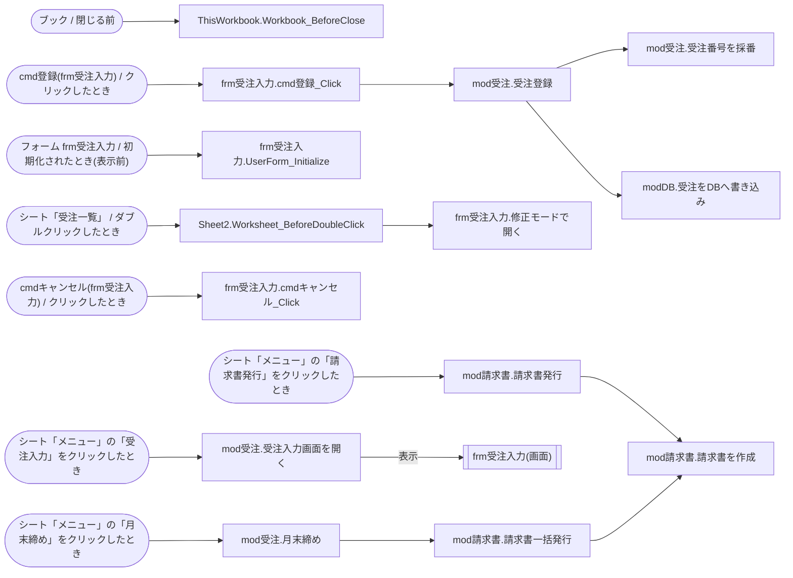

# 棚卸しレポート: 受注管理.xlsm

> 生成日時: 2026-10-20T00:00:00.000Z / ai-inventory 0.1.0
> AIを使わず、解析結果だけで作成した標準レポートです。

## 1. 概要

このファイルはExcel マクロ有効ブック(.xlsm)です。シート 6 枚、数式 95 個を含みます。VBAはモジュール 11 個、プロシージャ 16 個(コード 172 行)です。起動のきっかけは 8 件、外部依存は 19 件、機械的に検出したリスクは 高 0・中 2・低 2 件です。

| 項目 | 内容 |
| --- | --- |
| ファイル名 | 受注管理.xlsm |
| 形式 | Excel マクロ有効ブック(.xlsm) |
| サイズ | 17.0 KB |
| SHA-256 | `2b46bec3038f7ca4f031c83ecab8a79c2daa617f929b19aa8a0f3d3c1c1d0cac` |
| 作成者 / 最終更新者 | 山田太郎 / 佐藤花子 |
| 作成日時 / 最終更新日時 | 2014-04-01T09:12:00Z / 2022-03-28T17:45:00Z |
| アプリケーション | Microsoft Excel 16.0300 |
| 会社名(文書プロパティ) | 株式会社サンプル精工 |

### 規模

| シート | 数式 | VBAモジュール | プロシージャ | コード行(全行) | テーブル | クエリ | 外部依存 |
| --- | --- | --- | --- | --- | --- | --- | --- |
| 6 | 95 | 11 | 16 | 172(208) | 0 | 0 | 19 |

移行難易度の機械的な目安: **中**(コード 172 行(規模 S) / 外部とのやり取りが 4 種類(ファイルパス(ハードコード)、ファイル入出力、COMオブジェクト(CreateObject等)、DB接続文字列) / 入力画面(フォーム)が 1 個)

## 2. 処理の流れ

### 起動のきっかけ

| 種類 | きっかけ | 実行されるプロシージャ |
| --- | --- | --- |
| イベント | ブック / 閉じる前 | ThisWorkbook.Workbook_BeforeClose |
| イベント | シート「受注一覧」 / ダブルクリックしたとき | Sheet2.Worksheet_BeforeDoubleClick |
| イベント | フォーム frm受注入力 / 初期化されたとき(表示前) | frm受注入力.UserForm_Initialize |
| イベント | cmd登録(frm受注入力) / クリックしたとき | frm受注入力.cmd登録_Click |
| イベント | cmdキャンセル(frm受注入力) / クリックしたとき | frm受注入力.cmdキャンセル_Click |
| ボタン・図形 | シート「メニュー」の「受注入力」をクリックしたとき | mod受注.受注入力画面を開く |
| ボタン・図形 | シート「メニュー」の「月末締め」をクリックしたとき | mod受注.月末締め |
| ボタン・図形 | シート「メニュー」の「請求書発行」をクリックしたとき | mod請求書.請求書発行 |

### 呼び出し関係図

## 3. シート構成

| # | シート名 | コード名 | 種類 | 表示 | 使用範囲 | 数式 | 代表的な数式 |
| --- | --- | --- | --- | --- | --- | --- | --- |
| 1 | メニュー | Sheet1 | ワークシート | 表示 | A1:B16 | 0 |  |
| 2 | 受注一覧 | Sheet2 | ワークシート | 表示 | A1:I24 | 60 | E5: `IFERROR(VLOOKUP(D5,商品マスタ!$A:$C,3,FALSE),"")` G5: `IF(E5="","",E5*F5)` H5: `IF(G5="","",ROUNDDOWN(G5*(1+消費税率),0))` |
| 3 | 顧客マスタ | Sheet3 | ワークシート | 表示 | A1:D16 | 15 | D2: `顧客の未請求額(A2)` |
| 4 | 商品マスタ | Sheet4 | ワークシート | 表示 | A1:C4 | 0 |  |
| 5 | 請求書 | Sheet5 | ワークシート | 非表示 | A1:G29 | 20 | B5: `IFERROR(VLOOKUP(B4,顧客マスタ!$A:$B,2,FALSE),"")` C8: `G29` G12: `IF(E12="","",E12*F12)` G27: `SUM(G12:G26)` G28: `ROUNDDOWN(G27*消費税率,0)` |
| 6 | 設定 | Sheet6 | ワークシート | 非表示 | A1:B4 | 0 |  |

### 名前定義

| 名前 | 範囲 | 参照先 | 非表示 |
| --- | --- | --- | --- |
| 最終受注番号 | ブック | `設定!$B$2` |  |
| 消費税率 | ブック | `設定!$B$3` |  |

このほか、印刷範囲などの組み込みの名前が 1 件あります。

### ボタン・図形に登録されたマクロ

| シート | コントロール | 表示文字 | マクロ |
| --- | --- | --- | --- |
| メニュー | Button 1 | 受注入力 | 受注入力画面を開く |
| メニュー | Button 2 | 月末締め | 月末締め |
| メニュー | 角丸四角形 1 | 請求書発行 | 請求書発行 |

## 4. VBAモジュール

VBAプロジェクト「VBAProject」/ 文字コード cp932(コードページ 932)

| モジュール | 種別 | 行数 | プロシージャ | Option Explicit | 概要 |
| --- | --- | --- | --- | --- | --- |
| ThisWorkbook | ドキュメント(ブック/シート) | 6 | 1 | あり |  |
| Sheet1 | ドキュメント(ブック/シート) | 0 | 0 | なし |  |
| Sheet2 | ドキュメント(ブック/シート) | 9 | 1 | あり |  |
| Sheet3 | ドキュメント(ブック/シート) | 0 | 0 | なし |  |
| Sheet4 | ドキュメント(ブック/シート) | 0 | 0 | なし |  |
| Sheet5 | ドキュメント(ブック/シート) | 0 | 0 | なし |  |
| Sheet6 | ドキュメント(ブック/シート) | 0 | 0 | なし |  |
| frm受注入力 | フォーム | 44 | 4 | あり |  |
| mod受注 | 標準モジュール | 55 | 4 | あり |  |
| modDB | 標準モジュール | 33 | 2 | あり |  |
| mod請求書 | 標準モジュール | 61 | 4 | なし |  |

### 参照設定

| 名前 | ライブラリ | パス |
| --- | --- | --- |
| stdole | OLE Automation | `C:\Windows\System32\stdole2.tlb` |
| ADODB | Microsoft ActiveX Data Objects 6.1 Library | `C:\Program Files\Common Files\System\ado\msado15.dll` |
| MSForms | Microsoft Forms 2.0 Object Library | `C:\Windows\System32\FM20.DLL` |

### プロシージャ一覧

#### ThisWorkbook(ドキュメント(ブック/シート))

| プロシージャ | 種類 | スコープ | 行 | 引数 | エラー処理 | 呼び出し先 | 呼び出し元 |
| --- | --- | --- | --- | --- | --- | --- | --- |
| Workbook_BeforeClose(イベント: ブック / 閉じる前) | Sub | Private | 3〜6 | Cancel As Boolean | なし |  |  |

#### Sheet2(ドキュメント(ブック/シート))

| プロシージャ | 種類 | スコープ | 行 | 引数 | エラー処理 | 呼び出し先 | 呼び出し元 |
| --- | --- | --- | --- | --- | --- | --- | --- |
| Worksheet_BeforeDoubleClick(イベント: シート「受注一覧」 / ダブルクリックしたとき) | Sub | Private | 3〜9 | Target As Range, Cancel As Boolean | なし | frm受注入力.修正モードで開く |  |

#### frm受注入力(フォーム)

| プロシージャ | 種類 | スコープ | 行 | 引数 | エラー処理 | 呼び出し先 | 呼び出し元 |
| --- | --- | --- | --- | --- | --- | --- | --- |
| UserForm_Initialize(イベント: フォーム frm受注入力 / 初期化されたとき(表示前)) | Sub | Private | 5〜15 |  | なし |  |  |
| 修正モードで開く | Sub | Public | 17〜27 | 行 As Long | なし |  | Sheet2.Worksheet_BeforeDoubleClick |
| cmd登録_Click(イベント: cmd登録(frm受注入力) / クリックしたとき) | Sub | Private | 29〜40 |  | なし | mod受注.受注登録 |  |
| cmdキャンセル_Click(イベント: cmdキャンセル(frm受注入力) / クリックしたとき) | Sub | Private | 42〜44 |  | なし |  |  |

#### mod受注(標準モジュール)

| プロシージャ | 種類 | スコープ | 行 | 引数 | エラー処理 | 呼び出し先 | 呼び出し元 |
| --- | --- | --- | --- | --- | --- | --- | --- |
| 受注入力画面を開く | Sub | Public | 6〜8 |  | なし | frm受注入力 |  |
| 受注登録 | Sub | Public | 10〜31 | 顧客コード As String, 商品コード As String, 数量 As Long, 受注日 As Date, Optional 修正行 As Long | なし | mod受注.受注番号を採番 modDB.受注をDBへ書き込み | frm受注入力.cmd登録_Click |
| 受注番号を採番 | Function → String | Private | 33〜38 |  | なし |  | mod受注.受注登録 |
| 月末締め | Sub | Public | 40〜55 |  | なし | mod請求書.請求書一括発行 |  |

#### modDB(標準モジュール)

| プロシージャ | 種類 | スコープ | 行 | 引数 | エラー処理 | 呼び出し先 | 呼び出し元 |
| --- | --- | --- | --- | --- | --- | --- | --- |
| 受注をDBへ書き込み | Sub | Public | 7〜21 | 受注番号 As String, 受注日 As Date, 顧客コード As String, 商品コード As String, 数量 As Long, 単価 As Currency | なし |  | mod受注.受注登録 |
| 顧客の未請求額 | Function → Currency | Public | 24〜33 | 顧客コード As String | なし |  |  |

#### mod請求書(標準モジュール)

| プロシージャ | 種類 | スコープ | 行 | 引数 | エラー処理 | 呼び出し先 | 呼び出し元 |
| --- | --- | --- | --- | --- | --- | --- | --- |
| 請求書発行 | Sub | Public | 4〜13 |  | なし | mod請求書.請求書を作成 |  |
| 請求書一括発行 | Sub | Public | 15〜26 |  | なし | mod請求書.請求書を作成 | mod受注.月末締め |
| 請求書を作成 | Sub | Private | 28〜56 | 顧客コード | なし |  | mod請求書.請求書発行 mod請求書.請求書一括発行 |
| 旧_請求書発行 | Sub | Private | 58〜61 |  | なし |  |  |

## 5. 外部依存

### ファイルパス(ハードコード)(5件)

| 対象 | 区分 | 箇所 |
| --- | --- | --- |
| `D:\バックアップ\受注管理\受注管理_` | ローカルドライブ | ThisWorkbook.Workbook_BeforeClose (5行目) |
| `.xlsm` | ファイル名 | ThisWorkbook.Workbook_BeforeClose (5行目) |
| `\\fileserver01\営業部\受注管理\受注DB.accdb` | ネットワーク共有 | modDB (5行目) |
| `C:\Users\yamada\Desktop\請求書\` | ローカルドライブ | mod請求書.請求書を作成 (31行目) |
| `.pdf` | ファイル名 | mod請求書.請求書を作成 (50行目) |

### ファイル入出力(3件)

| 対象 | 区分 | 箇所 |
| --- | --- | --- |
| `D:\バックアップ\受注管理\受注管理_` | SaveCopyAs | ThisWorkbook.Workbook_BeforeClose (5行目) |
| `(変数で指定)` | MkDir | mod請求書.請求書を作成 (32行目) |
| `.pdf` | ExportAsFixedFormat | mod請求書.請求書を作成 (50行目) |

### COMオブジェクト(CreateObject等)(3件)

| 対象 | 区分 | 箇所 |
| --- | --- | --- |
| `ADODB.Connection` | データベース接続 | modDB.受注をDBへ書き込み (11行目)、modDB.顧客の未請求額 (27行目) |
| `Scripting.Dictionary` | Scripting Runtime(Dictionary) | mod請求書.請求書一括発行 (18行目) |

### DB接続文字列(2件)

| 対象 | 区分 | 箇所 |
| --- | --- | --- |
| `Provider=Microsoft.ACE.OLEDB.12.0;Data Source=` |  | modDB.受注をDBへ書き込み (12行目)、modDB.顧客の未請求額 (28行目) |

### SQL文(3件)

| 対象 | 区分 | 箇所 |
| --- | --- | --- |
| `DELETE FROM T_受注 WHERE 受注番号 = '` |  | modDB.受注をDBへ書き込み (14行目) |
| `INSERT INTO T_受注 (受注番号, 受注日, 顧客コード, 商品コード, 数量, 単価, 登録者) VALUES ('` |  | modDB.受注をDBへ書き込み (15行目) |
| `SELECT SUM(数量 * 単価) FROM T_受注 WHERE 顧客コード = '` |  | modDB.顧客の未請求額 (29行目) |

### 印刷(2件)

| 対象 | 区分 | 箇所 |
| --- | --- | --- |
| `PrintOut` |  | mod請求書.請求書を作成 (51行目)、mod請求書.旧_請求書発行 (60行目) |

### 参照設定ライブラリ(3件)

| 対象 | 区分 | 箇所 |
| --- | --- | --- |
| `OLE Automation` | 標準 | VBA参照設定 |
| `Microsoft ActiveX Data Objects 6.1 Library` | 追加 | VBA参照設定 |
| `Microsoft Forms 2.0 Object Library` | 標準 | VBA参照設定 |

## 6. リスク

### 機械的に検出したリスク

| 重要度 | 内容 | 件数 | 主な該当箇所 | 説明 |
| --- | --- | --- | --- | --- |
| 中 | ファイルパスがコードに直接書かれている(HARDCODED-PATH) | 3 | ThisWorkbook.Workbook_BeforeClose (5行目)、modDB (5行目)、mod請求書.請求書を作成 (31行目) | 特定のPCやフォルダ構成に依存しています。担当者の異動やPC入れ替えで動かなくなる典型的な原因です。 |
| 中 | 外部とやり取りするのにエラー処理がない(NO-ERROR-HANDLING) | 6 | ThisWorkbook.Workbook_BeforeClose (3行目)、modDB.受注をDBへ書き込み (7行目)、modDB.顧客の未請求額 (24行目)、mod請求書.請求書一括発行 (15行目)、mod請求書.請求書を作成 (28行目) ほか1件 | ファイルが無い・接続できない等のときにマクロが途中で止まり、作業が中途半端な状態で残ります。 |
| 低 | Option Explicit が宣言されていないモジュール(NO-OPTION-EXPLICIT) | 1 | mod請求書 | 変数名の打ち間違いがエラーにならず、不具合の原因になります。 |
| 低 | どこからも呼ばれていない Private プロシージャ(UNUSED-PRIVATE) | 1 | mod請求書.旧_請求書発行 (58行目) | 使われていない可能性があるコードです(文字列で呼び出している場合は検出できません)。 |

## 7. 移行先候補

> AIを使わない場合は、抽出結果の特徴からルールで選んだ目安を示します。

| 移行先 | 適合度 | 難易度 | 理由 | 進め方 | 注意点 |
| --- | --- | --- | --- | --- | --- |
| Python(pandas 等によるデータ処理) | 高 | 中 | 集計・データ加工のロジックがコードとしてまとまっており、テストしやすい形で書き直せます。 | まず入出力のファイルとDBを確定し、処理ごとに関数へ分けて移植します。既存の出力と突き合わせて結果を確認します。 | 利用者がボタンで実行していた操作の代わり(画面・実行スケジュール)を別途用意する必要があります。 |
| ノーコード業務アプリ(kintone 等) | 中 | 中 | 入力画面 1 個があり、データの登録・一覧・検索が中心であれば、ノーコードの業務アプリに置き換えやすい構成です。 | テーブルごとにアプリを作り、既存データをCSVで移します。集計・帳票は標準機能かプラグインで代替できるか確認します。 | 複雑な計算やバッチ処理は、別の仕組み(連携サービスやスクリプト)が必要になることがあります。 |
| Power Automate(クラウドフロー / デスクトップフロー) | 中 | 低 | ファイルの読み書き・受け渡しなど、決まった手順の繰り返しを自動化している部分があります。 | 手順を一つずつ書き出し、ファイル操作とメール送信はクラウドフロー、画面操作が必要な部分はデスクトップフローに移します。 | 共有フォルダのパスや、操作対象のシステムの画面が変わると止まるため、保存場所を整理してから移すのが安全です。 |
| 業務SaaS(販売管理・会計・勤怠など) | 中 | 中 | 業務が一般的な販売・会計・勤怠などに当てはまるなら、作り直すより既製のサービスに合わせる方が保守の負担が減ります。 | 現在の業務フローと帳票を書き出し、候補のサービスで代替できる範囲と、運用を変える部分を整理します。 | 自社独自のルールが多い場合は、カスタマイズ費用や運用変更の負担を見積もってください。 |

## 8. 現場に確認すること

- このファイルを使っている部署・人数と、止まった場合に困る業務は何ですか?
- コードに書かれているパス「D:\バックアップ\受注管理\受注管理_」は今も使われていますか?移行後はどこに置きますか?
- コードに書かれているパス「\\fileserver01\営業部\受注管理\受注DB.accdb」は今も使われていますか?移行後はどこに置きますか?
- コードに書かれているパス「C:\Users\yamada\Desktop\請求書\」は今も使われていますか?移行後はどこに置きますか?
- ボタン操作(シート「メニュー」の「受注入力」をクリックしたとき)は、誰が・どのくらいの頻度で行っていますか?
- ボタン操作(シート「メニュー」の「月末締め」をクリックしたとき)は、誰が・どのくらいの頻度で行っていますか?
- ボタン操作(シート「メニュー」の「請求書発行」をクリックしたとき)は、誰が・どのくらいの頻度で行っていますか?
- 最後にこのファイルを修正したのは誰で、いつ頃ですか?

## 付録

### 解析の制約・警告

- シートのセルの値(データ本体)は読み取っていません。数式・構造・コードのみを対象にしています。
- 呼び出し関係は静的な解析です。文字列を組み立てて実行するマクロ名や、オブジェクト変数経由のクラスメソッド呼び出しは検出できないことがあります。
