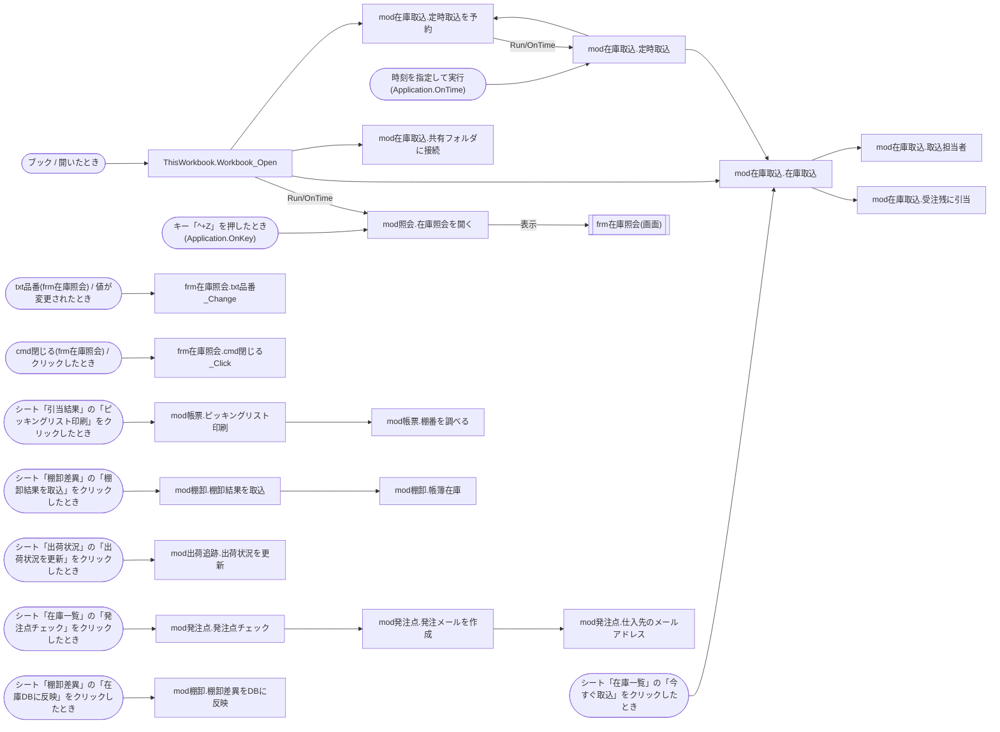

# 棚卸しレポート: 在庫引当マクロ.xlsm

> 生成日時: 2026-10-20T00:00:00.000Z / ai-inventory 0.1.0
> AIを使わず、解析結果だけで作成した標準レポートです。

## 1. 概要

このファイルはExcel マクロ有効ブック(.xlsm)です。シート 6 枚、数式 101 個を含みます。VBAはモジュール 14 個、プロシージャ 19 個(コード 319 行)です。起動のきっかけは 11 件、外部依存は 32 件、機械的に検出したリスクは 高 3・中 5・低 3 件です。

| 項目 | 内容 |
| --- | --- |
| ファイル名 | 在庫引当マクロ.xlsm |
| 形式 | Excel マクロ有効ブック(.xlsm) |
| サイズ | 23.4 KB |
| SHA-256 | `7292738bec646e097d5774aab13b0162a1b7a37b78864d0b273a98c02c5102c0` |
| 作成者 / 最終更新者 | 鈴木次郎 / 鈴木次郎 |
| 作成日時 / 最終更新日時 | 2018-09-03T08:30:00Z / 2020-11-16T12:05:00Z |
| アプリケーション | Microsoft Excel 16.0300 |
| 会社名(文書プロパティ) | 株式会社サンプル精工 |

### 規模

| シート | 数式 | VBAモジュール | プロシージャ | コード行(全行) | テーブル | クエリ | 外部依存 |
| --- | --- | --- | --- | --- | --- | --- | --- |
| 6 | 101 | 14 | 19 | 319(368) | 0 | 0 | 32 |

移行難易度の機械的な目安: **高**(コード 319 行(規模 M) / 外部とのやり取りが 8 種類(外部データ接続、DB接続文字列、COMオブジェクト(CreateObject等)、ファイルパス(ハードコード)、ファイル入出力、外部プログラム実行(Shell)、Windows API(Declare)、URL) / 入力画面(フォーム)が 1 個 / 環境依存の強い処理(Declare 文に PtrSafe がない、Internet Explorer を自動操作している))

## 2. 処理の流れ

### 起動のきっかけ

| 種類 | きっかけ | 実行されるプロシージャ |
| --- | --- | --- |
| イベント | ブック / 開いたとき | ThisWorkbook.Workbook_Open |
| ショートカットキー(OnKey) | キー「^+Z」を押したとき(Application.OnKey) | mod照会.在庫照会を開く |
| イベント | txt品番(frm在庫照会) / 値が変更されたとき | frm在庫照会.txt品番_Change |
| イベント | cmd閉じる(frm在庫照会) / クリックしたとき | frm在庫照会.cmd閉じる_Click |
| 時刻指定(OnTime) | 時刻を指定して実行(Application.OnTime) | mod在庫取込.定時取込 |
| ボタン・図形 | シート「在庫一覧」の「今すぐ取込」をクリックしたとき | mod在庫取込.在庫取込 |
| ボタン・図形 | シート「在庫一覧」の「発注点チェック」をクリックしたとき | mod発注点.発注点チェック |
| ボタン・図形 | シート「引当結果」の「ピッキングリスト印刷」をクリックしたとき | mod帳票.ピッキングリスト印刷 |
| ボタン・図形 | シート「出荷状況」の「出荷状況を更新」をクリックしたとき | mod出荷追跡.出荷状況を更新 |
| ボタン・図形 | シート「棚卸差異」の「棚卸結果を取込」をクリックしたとき | mod棚卸.棚卸結果を取込 |
| ボタン・図形 | シート「棚卸差異」の「在庫DBに反映」をクリックしたとき | mod棚卸.棚卸差異をDBに反映 |

### 呼び出し関係図

## 3. シート構成

| # | シート名 | コード名 | 種類 | 表示 | 使用範囲 | 数式 | 代表的な数式 |
| --- | --- | --- | --- | --- | --- | --- | --- |
| 1 | 在庫一覧 | Sheet1 | ワークシート | 表示 | A1:J54 | 50 | F5: `D5-E5` |
| 2 | 受注残 | Sheet2 | ワークシート | 表示 | A1:G34 | 30 | G5: `E5-F5` |
| 3 | 引当結果 | Sheet3 | ワークシート | 表示 | A1:D4 | 0 |  |
| 4 | 出荷状況 | Sheet4 | ワークシート | 表示 | A1:E4 | 0 |  |
| 5 | 棚卸差異 | Sheet6 | ワークシート | 表示 | A1:F24 | 20 | F5: `IFERROR(E5*VLOOKUP(A5,単価,2,FALSE),"")` |
| 6 | 接続設定 | Sheet5 | ワークシート | 完全に非表示 | A1:B5 | 1 | B5: `IF(B1="","未設定","設定済")` |

### 名前定義

| 名前 | 範囲 | 参照先 | 非表示 |
| --- | --- | --- | --- |
| 取込先 | ブック | `在庫一覧!$A$5:$E$5000` |  |
| 単価 | ブック | `接続設定!$D$1:$E$500` |  |

### データ接続

| 名前 | 種類 | 接続文字列(パスワードは伏せ字) | コマンド |
| --- | --- | --- | --- |
| 在庫DB | ODBC | `DSN=ZAIKO;UID=zaiko_app;PWD=****;APP=Microsoft Office;DATABASE=在庫管理` | `SELECT 品番, 品名, 倉庫コード, 在庫数 FROM dbo.V_在庫一覧` |

### ボタン・図形に登録されたマクロ

| シート | コントロール | 表示文字 | マクロ |
| --- | --- | --- | --- |
| 在庫一覧 | Button 1 | 今すぐ取込 | 在庫取込 |
| 在庫一覧 | Button 2 | 発注点チェック | 発注点チェック |
| 引当結果 | 角丸四角形 1 | ピッキングリスト印刷 | ピッキングリスト印刷 |
| 出荷状況 | 角丸四角形 1 | 出荷状況を更新 | 出荷状況を更新 |
| 棚卸差異 | Button 1 | 棚卸結果を取込 | 棚卸結果を取込 |
| 棚卸差異 | Button 2 | 在庫DBに反映 | 棚卸差異をDBに反映 |

## 4. VBAモジュール

VBAプロジェクト「VBAProject」/ 文字コード cp932(コードページ 932) / 表示用にロックされています(解析は可能)

| モジュール | 種別 | 行数 | プロシージャ | Option Explicit | 概要 |
| --- | --- | --- | --- | --- | --- |
| ThisWorkbook | ドキュメント(ブック/シート) | 13 | 1 | あり |  |
| Sheet1 | ドキュメント(ブック/シート) | 0 | 0 | なし |  |
| Sheet2 | ドキュメント(ブック/シート) | 0 | 0 | なし |  |
| Sheet3 | ドキュメント(ブック/シート) | 0 | 0 | なし |  |
| Sheet4 | ドキュメント(ブック/シート) | 0 | 0 | なし |  |
| Sheet5 | ドキュメント(ブック/シート) | 0 | 0 | なし |  |
| Sheet6 | ドキュメント(ブック/シート) | 0 | 0 | なし |  |
| frm在庫照会 | フォーム | 18 | 2 | あり |  |
| mod在庫取込 | 標準モジュール | 110 | 6 | あり |  |
| mod出荷追跡 | 標準モジュール | 24 | 1 | あり |  |
| mod照会 | 標準モジュール | 5 | 1 | あり |  |
| mod発注点 | 標準モジュール | 63 | 3 | あり |  |
| mod棚卸 | 標準モジュール | 76 | 3 | あり |  |
| mod帳票 | 標準モジュール | 59 | 2 | あり |  |

### 参照設定

| 名前 | ライブラリ | パス |
| --- | --- | --- |
| stdole | OLE Automation | `C:\Windows\System32\stdole2.tlb` |
| ADODB | Microsoft ActiveX Data Objects 6.1 Library | `C:\Program Files\Common Files\System\ado\msado15.dll` |
| MSForms | Microsoft Forms 2.0 Object Library | `C:\Windows\System32\FM20.DLL` |

### プロシージャ一覧

#### ThisWorkbook(ドキュメント(ブック/シート))

| プロシージャ | 種類 | スコープ | 行 | 引数 | エラー処理 | 呼び出し先 | 呼び出し元 |
| --- | --- | --- | --- | --- | --- | --- | --- |
| Workbook_Open(イベント: ブック / 開いたとき) | Sub | Private | 3〜13 |  | なし | mod在庫取込.共有フォルダに接続 mod在庫取込.在庫取込 mod在庫取込.定時取込を予約 mod照会.在庫照会を開く |  |

#### frm在庫照会(フォーム)

| プロシージャ | 種類 | スコープ | 行 | 引数 | エラー処理 | 呼び出し先 | 呼び出し元 |
| --- | --- | --- | --- | --- | --- | --- | --- |
| txt品番_Change(イベント: txt品番(frm在庫照会) / 値が変更されたとき) | Sub | Private | 3〜14 |  | なし |  |  |
| cmd閉じる_Click(イベント: cmd閉じる(frm在庫照会) / クリックしたとき) | Sub | Private | 16〜18 |  | なし |  |  |

#### mod在庫取込(標準モジュール)

| プロシージャ | 種類 | スコープ | 行 | 引数 | エラー処理 | 呼び出し先 | 呼び出し元 |
| --- | --- | --- | --- | --- | --- | --- | --- |
| 在庫取込 | Sub | Public | 15〜40 |  | Resume Next | mod在庫取込.取込担当者 mod在庫取込.受注残に引当 | ThisWorkbook.Workbook_Open mod在庫取込.定時取込 |
| 受注残に引当 | Sub | Private | 42〜82 |  | なし |  | mod在庫取込.在庫取込 |
| 定時取込を予約 | Sub | Public | 84〜88 |  | なし | mod在庫取込.定時取込 | ThisWorkbook.Workbook_Open mod在庫取込.定時取込 |
| 定時取込 | Sub | Public | 90〜93 |  | なし | mod在庫取込.在庫取込 mod在庫取込.定時取込を予約 | mod在庫取込.定時取込を予約 |
| 共有フォルダに接続 | Sub | Public | 95〜99 |  | なし |  | ThisWorkbook.Workbook_Open |
| 取込担当者 | Function → String | Private | 101〜110 |  | なし |  | mod在庫取込.在庫取込 |

#### mod出荷追跡(標準モジュール)

| プロシージャ | 種類 | スコープ | 行 | 引数 | エラー処理 | 呼び出し先 | 呼び出し元 |
| --- | --- | --- | --- | --- | --- | --- | --- |
| 出荷状況を更新 | Sub | Public | 7〜24 |  | なし |  |  |

#### mod照会(標準モジュール)

| プロシージャ | 種類 | スコープ | 行 | 引数 | エラー処理 | 呼び出し先 | 呼び出し元 |
| --- | --- | --- | --- | --- | --- | --- | --- |
| 在庫照会を開く | Sub | Public | 3〜5 |  | なし | frm在庫照会 | ThisWorkbook.Workbook_Open |

#### mod発注点(標準モジュール)

| プロシージャ | 種類 | スコープ | 行 | 引数 | エラー処理 | 呼び出し先 | 呼び出し元 |
| --- | --- | --- | --- | --- | --- | --- | --- |
| 発注点チェック | Sub | Public | 6〜37 |  | なし | mod発注点.発注メールを作成 |  |
| 発注メールを作成 | Sub | Private | 39〜49 | 仕入先 As String, 本文 As String | なし | mod発注点.仕入先のメールアドレス | mod発注点.発注点チェック |
| 仕入先のメールアドレス | Function → String | Private | 51〜63 | 仕入先 As String | なし |  | mod発注点.発注メールを作成 |

#### mod棚卸(標準モジュール)

| プロシージャ | 種類 | スコープ | 行 | 引数 | エラー処理 | 呼び出し先 | 呼び出し元 |
| --- | --- | --- | --- | --- | --- | --- | --- |
| 棚卸結果を取込 | Sub | Public | 6〜42 |  | なし | mod棚卸.帳簿在庫 |  |
| 帳簿在庫 | Function → Long | Private | 44〜52 | 品番 As String | なし |  | mod棚卸.棚卸結果を取込 |
| 棚卸差異をDBに反映 | Sub | Public | 54〜76 |  | なし |  |  |

#### mod帳票(標準モジュール)

| プロシージャ | 種類 | スコープ | 行 | 引数 | エラー処理 | 呼び出し先 | 呼び出し元 |
| --- | --- | --- | --- | --- | --- | --- | --- |
| ピッキングリスト印刷 | Sub | Public | 4〜44 |  | なし | mod帳票.棚番を調べる |  |
| 棚番を調べる | Function → String | Private | 46〜59 | 品番 As String | なし |  | mod帳票.ピッキングリスト印刷 |

## 5. 外部依存

### 外部データ接続(1件)

| 対象 | 区分 | 箇所 |
| --- | --- | --- |
| `DSN=ZAIKO;UID=zaiko_app;PWD=****;APP=Microsoft Office;DATABASE=在庫管理` | ODBC | データ接続「在庫DB」 |

### 環境変数(3件)

| 対象 | 区分 | 箇所 |
| --- | --- | --- |
| `COMPUTERNAME` |  | ThisWorkbook.Workbook_Open (5行目) |
| `USERNAME` |  | mod在庫取込.取込担当者 (108行目)、mod棚卸.棚卸差異をDBに反映 (61行目) |

### DB接続文字列(2件)

| 対象 | 区分 | 箇所 |
| --- | --- | --- |
| `Provider=SQLOLEDB;Data Source=SV-ZAIKO01;Initial Catalog=在庫管理;User ID=zaiko_app;Password=****;` | 認証情報を含む | mod在庫取込 (10行目)、mod棚卸.棚卸差異をDBに反映 (64行目) |

### COMオブジェクト(CreateObject等)(6件)

| 対象 | 区分 | 箇所 |
| --- | --- | --- |
| `ADODB.Connection` | データベース接続 | mod在庫取込.在庫取込 (21行目)、mod在庫取込.受注残に引当 (53行目)、mod棚卸.棚卸差異をDBに反映 (62行目) |
| `InternetExplorer.Application` | Internet Explorer 自動操作(サポート終了) | mod出荷追跡.出荷状況を更新 (12行目) |
| `Scripting.Dictionary` | Scripting Runtime(Dictionary) | mod発注点.発注点チェック (15行目) |
| `Outlook.Application` | メール送信 | mod発注点.発注メールを作成 (42行目) |

### SQL文(4件)

| 対象 | 区分 | 箇所 |
| --- | --- | --- |
| `SELECT 品番, 品名, 倉庫コード, 在庫数, 引当済数 FROM dbo.T_在庫 WHERE 倉庫コード IN ('01', '02') ORDER BY 品番` |  | mod在庫取込.在庫取込 (30行目) |
| `UPDATE dbo.T_受注残 SET 引当数 = 引当数 +` |  | mod在庫取込.受注残に引当 (69行目) |
| `UPDATE dbo.T_在庫 SET 在庫数 =` |  | mod棚卸.棚卸差異をDBに反映 (68行目) |
| `INSERT INTO dbo.T_棚卸履歴 (品番, 棚卸日, 帳簿数, 実数, 担当) VALUES ('` |  | mod棚卸.棚卸差異をDBに反映 (69行目) |

### ファイルパス(ハードコード)(5件)

| 対象 | 区分 | 箇所 |
| --- | --- | --- |
| `Z:\出荷\引当結果_` | ローカルドライブ | mod在庫取込.受注残に引当 (80行目) |
| `.xlsx` | ファイル名 | mod在庫取込.受注残に引当 (80行目) |
| `\\SV-FILE01\倉庫` | ネットワーク共有 | mod在庫取込.共有フォルダに接続 (97行目) |
| `C:\HANDY\DATA\` | ローカルドライブ | mod棚卸 (4行目) |
| `TANA*.csv` | ファイル名 | mod棚卸.棚卸結果を取込 (14行目) |

### ファイル入出力(4件)

| 対象 | 区分 | 箇所 |
| --- | --- | --- |
| `Z:\出荷\引当結果_` | SaveAs | mod在庫取込.受注残に引当 (80行目) |
| `(変数で指定)` | Open ... For Input | mod棚卸.棚卸結果を取込 (23行目) |
| `(変数で指定)` | FileCopy | mod棚卸.棚卸結果を取込 (39行目) |
| `(変数で指定)` | Kill | mod棚卸.棚卸結果を取込 (40行目) |

### 外部プログラム実行(Shell)(1件)

| 対象 | 区分 | 箇所 |
| --- | --- | --- |
| `cmd /c net use Z: \\SV-FILE01\倉庫 /user:soko ****` |  | mod在庫取込.共有フォルダに接続 (97行目) |

### Windows API(Declare)(3件)

| 対象 | 区分 | 箇所 |
| --- | --- | --- |
| `kernel32: Sleep` | PtrSafe なし | mod在庫取込 (7行目) |
| `advapi32.dll: GetUserNameA` | PtrSafe なし | mod在庫取込 (8行目) |
| `user32: FindWindowA` | PtrSafe なし | mod出荷追跡 (3行目) |

### URL(1件)

| 対象 | 区分 | 箇所 |
| --- | --- | --- |
| `https://tracking.example.com/search?no=` |  | mod出荷追跡.出荷状況を更新 (15行目) |

### 印刷(1件)

| 対象 | 区分 | 箇所 |
| --- | --- | --- |
| `PrintOut` |  | mod帳票.ピッキングリスト印刷 (39行目) |

### 参照設定ライブラリ(3件)

| 対象 | 区分 | 箇所 |
| --- | --- | --- |
| `OLE Automation` | 標準 | VBA参照設定 |
| `Microsoft ActiveX Data Objects 6.1 Library` | 追加 | VBA参照設定 |
| `Microsoft Forms 2.0 Object Library` | 標準 | VBA参照設定 |

## 6. リスク

### 機械的に検出したリスク

| 重要度 | 内容 | 件数 | 主な該当箇所 | 説明 |
| --- | --- | --- | --- | --- |
| 高 | Declare 文に PtrSafe がない(VBA-API-64BIT) | 3 | mod在庫取込 (7行目)、mod在庫取込 (8行目)、mod出荷追跡 (3行目) | 64ビット版のOfficeではコンパイルエラーになり、マクロ全体が動きません。PtrSafe と LongPtr への書き換えが必要です。 |
| 高 | パスワードが接続文字列やコードに直接書かれている(CRED-HARDCODED) | 6 | mod在庫取込 (10行目)、mod棚卸.棚卸差異をDBに反映 (64行目)、mod在庫取込.在庫取込 (31行目)、mod在庫取込.在庫取込 (39行目)、mod在庫取込.共有フォルダに接続 (97行目) ほか1件 | ファイルを開ける人なら誰でも認証情報(DBの接続、シートやブックの保護など)を読めます。移行時は資格情報の管理方法を見直してください(出力では伏せ字にしています)。 |
| 高 | Internet Explorer を自動操作している(IE-AUTOMATION) | 1 | mod出荷追跡.出荷状況を更新 (12行目) | IE はサポートが終了しており、Windows の更新で動かなくなる可能性が高い処理です。 |
| 中 | 外部プログラムを起動している(Shell)(SHELL) | 1 | mod在庫取込.共有フォルダに接続 (97行目) | 起動するプログラムが他のPCにもあるか、実行権限があるかに依存します。 |
| 中 | ファイルパスがコードに直接書かれている(HARDCODED-PATH) | 3 | mod在庫取込.受注残に引当 (80行目)、mod在庫取込.共有フォルダに接続 (97行目)、mod棚卸 (4行目) | 特定のPCやフォルダ構成に依存しています。担当者の異動やPC入れ替えで動かなくなる典型的な原因です。 |
| 中 | On Error Resume Next でエラーを握りつぶしている(RESUME-NEXT) | 1 | mod在庫取込.在庫取込 (15行目) | 失敗しても処理が続くため、誤ったデータのまま完了したように見える恐れがあります。 |
| 中 | 外部とやり取りするのにエラー処理がない(NO-ERROR-HANDLING) | 10 | ThisWorkbook.Workbook_Open (3行目)、mod在庫取込.受注残に引当 (42行目)、mod在庫取込.共有フォルダに接続 (95行目)、mod在庫取込.取込担当者 (101行目)、mod出荷追跡.出荷状況を更新 (7行目) ほか5件 | ファイルが無い・接続できない等のときにマクロが途中で止まり、作業が中途半端な状態で残ります。 |
| 中 | 外部データ接続がある(DATA-CONNECTION) | 1 | ODBC: 在庫DB | 接続先(DB・Web・ファイル)と認証方法を確認してください。 |
| 低 | Windows API を直接呼び出している(WIN-API) | 3 | mod在庫取込 (7行目)、mod在庫取込 (8行目)、mod出荷追跡 (3行目) | Windows 以外(Mac版Excel・クラウド)では動きません。移行時は代替手段が必要です。 |
| 低 | 完全に非表示(xlSheetVeryHidden)のシートがある(VERY-HIDDEN-SHEET) | 1 | シート「接続設定」 | Excelの画面からは再表示できないシートです。設定値やマスタが隠されていることがあります。 |
| 低 | VBAプロジェクトが表示用にロックされている(VBA-LOCKED) | 1 | VBAプロジェクト | パスワードを知っている人しかVBEでコードを見られません。パスワードの管理者を確認してください(本ツールはロックされていても解析できます)。 |

## 7. 移行先候補

> AIを使わない場合は、抽出結果の特徴からルールで選んだ目安を示します。

| 移行先 | 適合度 | 難易度 | 理由 | 進め方 | 注意点 |
| --- | --- | --- | --- | --- | --- |
| Power Automate(クラウドフロー / デスクトップフロー) | 高 | 中 | ファイルの読み書き・受け渡し・メール送信・画面操作など、決まった手順の繰り返しを自動化している部分があります。 | 手順を一つずつ書き出し、ファイル操作とメール送信はクラウドフロー、画面操作が必要な部分はデスクトップフローに移します。 | 共有フォルダのパスや、操作対象のシステムの画面が変わると止まるため、保存場所を整理してから移すのが安全です。 |
| Python(pandas 等によるデータ処理) | 高 | 高 | 集計・データ加工のロジックがコードとしてまとまっており、テストしやすい形で書き直せます。 | まず入出力のファイルとDBを確定し、処理ごとに関数へ分けて移植します。既存の出力と突き合わせて結果を確認します。 | 利用者がボタンで実行していた操作の代わり(画面・実行スケジュール)を別途用意する必要があります。 |
| ノーコード業務アプリ(kintone 等) | 中 | 高 | 入力画面 1 個があり、データの登録・一覧・検索が中心であれば、ノーコードの業務アプリに置き換えやすい構成です。 | テーブルごとにアプリを作り、既存データをCSVで移します。集計・帳票は標準機能かプラグインで代替できるか確認します。 | 複雑な計算やバッチ処理は、別の仕組み(連携サービスやスクリプト)が必要になることがあります。 |
| 業務SaaS(販売管理・会計・勤怠など) | 中 | 中 | 業務が一般的な販売・会計・勤怠などに当てはまるなら、作り直すより既製のサービスに合わせる方が保守の負担が減ります。 | 現在の業務フローと帳票を書き出し、候補のサービスで代替できる範囲と、運用を変える部分を整理します。 | 自社独自のルールが多い場合は、カスタマイズ費用や運用変更の負担を見積もってください。 |

## 8. 現場に確認すること

- このファイルを使っている部署・人数と、止まった場合に困る業務は何ですか?
- コードに書かれているパス「Z:\出荷\引当結果_」は今も使われていますか?移行後はどこに置きますか?
- コードに書かれているパス「\\SV-FILE01\倉庫」は今も使われていますか?移行後はどこに置きますか?
- コードに書かれているパス「C:\HANDY\DATA\」は今も使われていますか?移行後はどこに置きますか?
- データ接続「在庫DB」の接続先と、認証情報の管理者は誰ですか?
- ボタン操作(シート「在庫一覧」の「今すぐ取込」をクリックしたとき)は、誰が・どのくらいの頻度で行っていますか?
- ボタン操作(シート「在庫一覧」の「発注点チェック」をクリックしたとき)は、誰が・どのくらいの頻度で行っていますか?
- ボタン操作(シート「引当結果」の「ピッキングリスト印刷」をクリックしたとき)は、誰が・どのくらいの頻度で行っていますか?
- ボタン操作(シート「出荷状況」の「出荷状況を更新」をクリックしたとき)は、誰が・どのくらいの頻度で行っていますか?
- ボタン操作(シート「棚卸差異」の「棚卸結果を取込」をクリックしたとき)は、誰が・どのくらいの頻度で行っていますか?
- VBAプロジェクトのパスワードを知っている人はいますか?
- 最後にこのファイルを修正したのは誰で、いつ頃ですか?

## 付録

### 解析の制約・警告

- シートのセルの値(データ本体)は読み取っていません。数式・構造・コードのみを対象にしています。
- 呼び出し関係は静的な解析です。文字列を組み立てて実行するマクロ名や、オブジェクト変数経由のクラスメソッド呼び出しは検出できないことがあります。
