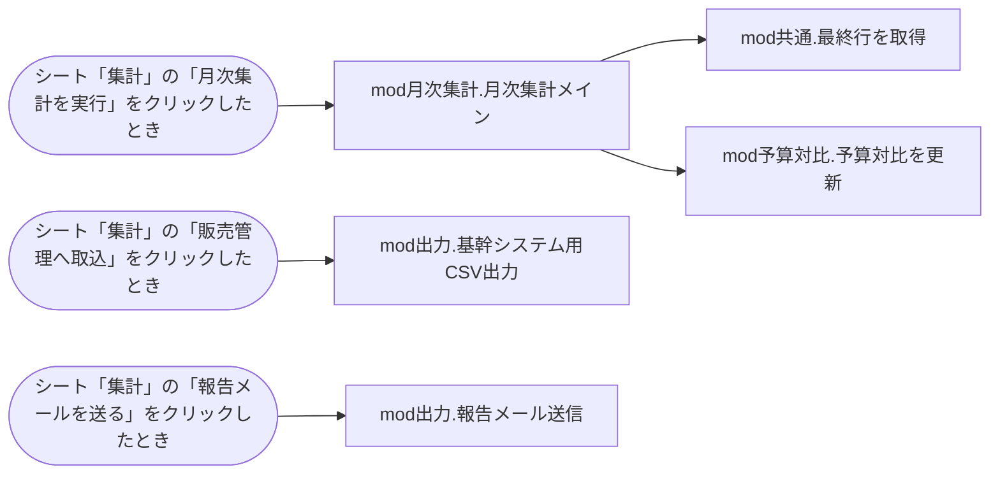

# 棚卸しレポート: 月次売上集計.xlsm

> 生成日時: 2026-10-20T00:00:00.000Z / ai-inventory 0.1.0
> AIを使わず、解析結果だけで作成した標準レポートです。

## 1. 概要

このファイルはExcel マクロ有効ブック(.xlsm)です。シート 6 枚、数式 44 個を含みます。VBAはモジュール 11 個、プロシージャ 6 個(コード 255 行)です。起動のきっかけは 3 件、外部依存は 24 件、機械的に検出したリスクは 高 0・中 7・低 2 件です。

| 項目 | 内容 |
| --- | --- |
| ファイル名 | 月次売上集計.xlsm |
| 形式 | Excel マクロ有効ブック(.xlsm) |
| サイズ | 19.2 KB |
| SHA-256 | `1206ab6cd4052bfa58e06e398edc63c86900bdbcbb03cc3f8f4ff00dc0e36864` |
| 作成者 / 最終更新者 | 田中一郎 / 田中一郎 |
| 作成日時 / 最終更新日時 | 2016-05-10T10:03:00Z / 2024-04-08T19:20:00Z |
| アプリケーション | Microsoft Excel 16.0300 |
| 会社名(文書プロパティ) | 株式会社サンプル精工 |

### 規模

| シート | 数式 | VBAモジュール | プロシージャ | コード行(全行) | テーブル | クエリ | 外部依存 |
| --- | --- | --- | --- | --- | --- | --- | --- |
| 6 | 44 | 11 | 6 | 255(311) | 0 | 0 | 24 |

移行難易度の機械的な目安: **中**(コード 255 行(規模 S) / 外部とのやり取りが 7 種類(外部ブック参照(数式リンク)、ファイルパス(ハードコード)、他ブックの操作、キー送信(SendKeys)、ファイル入出力、外部プログラム実行(Shell)、COMオブジェクト(CreateObject等)) / 環境依存の強い処理(SendKeys でキー操作を送っている))

## 2. 処理の流れ

### 起動のきっかけ

| 種類 | きっかけ | 実行されるプロシージャ |
| --- | --- | --- |
| ボタン・図形 | シート「集計」の「月次集計を実行」をクリックしたとき | mod月次集計.月次集計メイン |
| ボタン・図形 | シート「集計」の「販売管理へ取込」をクリックしたとき | mod出力.基幹システム用CSV出力 |
| ボタン・図形 | シート「集計」の「報告メールを送る」をクリックしたとき | mod出力.報告メール送信 |

### 呼び出し関係図

## 3. シート構成

| # | シート名 | コード名 | 種類 | 表示 | 使用範囲 | 数式 | 代表的な数式 |
| --- | --- | --- | --- | --- | --- | --- | --- |
| 1 | 集計 | Sheet1 | ワークシート | 表示 | A1:I20 | 9 | H6: `IF($F$9=0,0,F6/$F$9)` I6: `IFERROR(F6/予算対比!B6,"-")` H9: `SUM(H6:H8)` F20: `SUM(#REF!)` |
| 2 | 東京 | Sheet2 | ワークシート | 表示 | A1:H4 | 1 | H2: `SUM(H5:H1000)` |
| 3 | 大阪 | Sheet3 | ワークシート | 表示 | A1:H4 | 1 | H2: `SUM(H5:H1000)` |
| 4 | 名古屋 | Sheet4 | ワークシート | 表示 | A1:H4 | 1 | H2: `SUM(H5:H1000)` |
| 5 | 予算対比 | Sheet5 | ワークシート | 表示 | A1:M12 | 32 | B6: `[1]予算!$C5` C6: `集計!F6` D6: `IF(B6=0,"-",C6/B6)` E6: `[2]前年!F6` F6: `IF(E6=0,"-",C6/E6)` |
| 6 | 作業用 | Sheet6 | ワークシート | 非表示 | A1:C1 | 0 |  |

### 名前定義

| 名前 | 範囲 | 参照先 | 非表示 |
| --- | --- | --- | --- |
| 集計範囲 | ブック | `集計!$B$5:$G$9` |  |
| 旧名古屋2課 | ブック | `#REF!$A$5:$H$500` |  |

### 外部リンク(他ブックの参照)

| # | 種類 | 参照先 | シート |
| --- | --- | --- | --- |
| 1 | workbook | `file:///\\fileserver01\経営企画\予算\2024年度予算.xlsx` | 予算 |
| 2 | workbook | `file:///C:\Users\tanaka\Documents\月次\前年実績.xlsx` | 前年 |

### ボタン・図形に登録されたマクロ

| シート | コントロール | 表示文字 | マクロ |
| --- | --- | --- | --- |
| 集計 | Button 1 | 月次集計を実行 | 月次集計メイン |
| 集計 | Button 2 | 販売管理へ取込 | 基幹システム用CSV出力 |
| 集計 | 角丸四角形 1 | 報告メールを送る | 報告メール送信 |

## 4. VBAモジュール

VBAプロジェクト「VBAProject」/ 文字コード cp932(コードページ 932)

| モジュール | 種別 | 行数 | プロシージャ | Option Explicit | 概要 |
| --- | --- | --- | --- | --- | --- |
| ThisWorkbook | ドキュメント(ブック/シート) | 0 | 0 | なし |  |
| Sheet1 | ドキュメント(ブック/シート) | 0 | 0 | なし |  |
| Sheet2 | ドキュメント(ブック/シート) | 0 | 0 | なし |  |
| Sheet3 | ドキュメント(ブック/シート) | 0 | 0 | なし |  |
| Sheet4 | ドキュメント(ブック/シート) | 0 | 0 | なし |  |
| Sheet5 | ドキュメント(ブック/シート) | 0 | 0 | なし |  |
| Sheet6 | ドキュメント(ブック/シート) | 0 | 0 | なし |  |
| mod月次集計 | 標準モジュール | 245 | 1 | なし |  |
| mod出力 | 標準モジュール | 44 | 2 | あり |  |
| mod予算対比 | 標準モジュール | 9 | 1 | あり |  |
| mod共通 | 標準モジュール | 13 | 2 | なし |  |

### 参照設定

| 名前 | ライブラリ | パス |
| --- | --- | --- |
| stdole | OLE Automation | `C:\Windows\System32\stdole2.tlb` |
| ADODB | Microsoft ActiveX Data Objects 6.1 Library | `C:\Program Files\Common Files\System\ado\msado15.dll` |
| MSForms | Microsoft Forms 2.0 Object Library | `C:\Windows\System32\FM20.DLL` |

### プロシージャ一覧

#### mod月次集計(標準モジュール)

| プロシージャ | 種類 | スコープ | 行 | 引数 | エラー処理 | 呼び出し先 | 呼び出し元 |
| --- | --- | --- | --- | --- | --- | --- | --- |
| 月次集計メイン | Sub | Public | 5〜245 |  | Resume Next | mod共通.最終行を取得 mod予算対比.予算対比を更新 |  |

#### mod出力(標準モジュール)

| プロシージャ | 種類 | スコープ | 行 | 引数 | エラー処理 | 呼び出し先 | 呼び出し元 |
| --- | --- | --- | --- | --- | --- | --- | --- |
| 基幹システム用CSV出力 | Sub | Public | 6〜28 |  | なし |  |  |
| 報告メール送信 | Sub | Public | 31〜44 |  | なし |  |  |

#### mod予算対比(標準モジュール)

| プロシージャ | 種類 | スコープ | 行 | 引数 | エラー処理 | 呼び出し先 | 呼び出し元 |
| --- | --- | --- | --- | --- | --- | --- | --- |
| 予算対比を更新 | Sub | Public | 5〜9 |  | なし |  | mod月次集計.月次集計メイン |

#### mod共通(標準モジュール)

| プロシージャ | 種類 | スコープ | 行 | 引数 | エラー処理 | 呼び出し先 | 呼び出し元 |
| --- | --- | --- | --- | --- | --- | --- | --- |
| 最終行を取得 | Function → Long | Public | 3〜5 | ws As Worksheet, Optional 列 As Long | なし |  | mod月次集計.月次集計メイン |
| 営業日を数える | Function → Long | Public | 7〜13 | 開始日 As Date, 終了日 As Date | なし |  |  |

## 5. 外部依存

### 外部ブック参照(数式リンク)(2件)

| 対象 | 区分 | 箇所 |
| --- | --- | --- |
| `file:///\\fileserver01\経営企画\予算\2024年度予算.xlsx` | workbook | 外部リンク |
| `file:///C:\Users\tanaka\Documents\月次\前年実績.xlsx` | workbook | 外部リンク |

### ファイルパス(ハードコード)(9件)

| 対象 | 区分 | 箇所 |
| --- | --- | --- |
| `\\fileserver01\営業部\月次報告\` | ネットワーク共有 | mod月次集計.月次集計メイン (15行目) |
| `東京営業所_売上.xlsx` | ファイル名 | mod月次集計.月次集計メイン (22行目) |
| `大阪営業所_売上.xlsx` | ファイル名 | mod月次集計.月次集計メイン (88行目) |
| `名古屋営業所_売上.xlsx` | ファイル名 | mod月次集計.月次集計メイン (155行目) |
| `D:\HANBAI\IMPORT\` | ローカルドライブ | mod出力 (3行目) |
| `.csv` | ファイル名 | mod出力.基幹システム用CSV出力 (12行目) |
| `C:\HANBAI\HanbaiMenu.exe` | ローカルドライブ | mod出力.基幹システム用CSV出力 (21行目) |
| `\\fileserver01\経営企画\予算\2024年度予算.xlsx` | ネットワーク共有 | mod予算対比.予算対比を更新 (6行目) |
| `C:\Users\tanaka\Documents\月次\前年実績.xlsx` | ローカルドライブ | mod予算対比.予算対比を更新 (7行目) |

### 他ブックの操作(3件)

| 対象 | 区分 | 箇所 |
| --- | --- | --- |
| `東京営業所_売上.xlsx` | Workbooks.Open | mod月次集計.月次集計メイン (22行目) |
| `大阪営業所_売上.xlsx` | Workbooks.Open | mod月次集計.月次集計メイン (88行目) |
| `名古屋営業所_売上.xlsx` | Workbooks.Open | mod月次集計.月次集計メイン (155行目) |

### キー送信(SendKeys)(6件)

| 対象 | 区分 | 箇所 |
| --- | --- | --- |
| `{ENTER}` |  | mod月次集計.月次集計メイン (24行目)、mod月次集計.月次集計メイン (90行目)、mod月次集計.月次集計メイン (157行目)、mod出力.基幹システム用CSV出力 (27行目) |
| `%F` |  | mod出力.基幹システム用CSV出力 (24行目) |
| `I` |  | mod出力.基幹システム用CSV出力 (25行目) |

### ファイル入出力(1件)

| 対象 | 区分 | 箇所 |
| --- | --- | --- |
| `(変数で指定)` | Open ... For Output | mod出力.基幹システム用CSV出力 (14行目) |

### 外部プログラム実行(Shell)(1件)

| 対象 | 区分 | 箇所 |
| --- | --- | --- |
| `C:\HANBAI\HanbaiMenu.exe` |  | mod出力.基幹システム用CSV出力 (21行目) |

### COMオブジェクト(CreateObject等)(1件)

| 対象 | 区分 | 箇所 |
| --- | --- | --- |
| `Outlook.Application` | メール送信 | mod出力.報告メール送信 (34行目) |

### 参照設定ライブラリ(3件)

| 対象 | 区分 | 箇所 |
| --- | --- | --- |
| `OLE Automation` | 標準 | VBA参照設定 |
| `Microsoft ActiveX Data Objects 6.1 Library` | 追加 | VBA参照設定 |
| `Microsoft Forms 2.0 Object Library` | 標準 | VBA参照設定 |

## 6. リスク

### 機械的に検出したリスク

| 重要度 | 内容 | 件数 | 主な該当箇所 | 説明 |
| --- | --- | --- | --- | --- |
| 中 | SendKeys でキー操作を送っている(SENDKEYS) | 6 | mod月次集計.月次集計メイン (24行目)、mod月次集計.月次集計メイン (90行目)、mod月次集計.月次集計メイン (157行目)、mod出力.基幹システム用CSV出力 (24行目)、mod出力.基幹システム用CSV出力 (25行目) ほか1件 | 画面の状態やタイミングに依存するため、環境が変わると誤動作しやすい処理です。 |
| 中 | 外部プログラムを起動している(Shell)(SHELL) | 1 | mod出力.基幹システム用CSV出力 (21行目) | 起動するプログラムが他のPCにもあるか、実行権限があるかに依存します。 |
| 中 | ファイルパスがコードに直接書かれている(HARDCODED-PATH) | 5 | mod月次集計.月次集計メイン (15行目)、mod出力 (3行目)、mod出力.基幹システム用CSV出力 (21行目)、mod予算対比.予算対比を更新 (6行目)、mod予算対比.予算対比を更新 (7行目) | 特定のPCやフォルダ構成に依存しています。担当者の異動やPC入れ替えで動かなくなる典型的な原因です。 |
| 中 | On Error Resume Next でエラーを握りつぶしている(RESUME-NEXT) | 1 | mod月次集計.月次集計メイン (5行目) | 失敗しても処理が続くため、誤ったデータのまま完了したように見える恐れがあります。 |
| 中 | 外部とやり取りするのにエラー処理がない(NO-ERROR-HANDLING) | 3 | mod出力.基幹システム用CSV出力 (6行目)、mod出力.報告メール送信 (31行目)、mod予算対比.予算対比を更新 (5行目) | ファイルが無い・接続できない等のときにマクロが途中で止まり、作業が中途半端な状態で残ります。 |
| 中 | 200行を超える長いプロシージャ(LONG-PROCEDURE) | 1 | mod月次集計.月次集計メイン (5行目) | 処理が1か所に集中しており、読み解き・修正の難易度が高い部分です。 |
| 中 | 他のブックを数式で参照している(EXTERNAL-LINK) | 2 | file:///\\fileserver01\経営企画\予算\2024年度予算.xlsx、file:///C:\Users\tanaka\Documents\月次\前年実績.xlsx | 参照先ファイルの移動・改名でリンク切れになります。参照先も棚卸しの対象です。 |
| 低 | Option Explicit が宣言されていないモジュール(NO-OPTION-EXPLICIT) | 2 | mod月次集計、mod共通 | 変数名の打ち間違いがエラーにならず、不具合の原因になります。 |
| 低 | #REF! を含む数式・名前定義がある(BROKEN-REF) | 2 | 名前定義「旧名古屋2課」、シート「集計」(1件) | 参照先が削除された跡です。使われていない名前定義は整理の候補です。 |

## 7. 移行先候補

> AIを使わない場合は、抽出結果の特徴からルールで選んだ目安を示します。

| 移行先 | 適合度 | 難易度 | 理由 | 進め方 | 注意点 |
| --- | --- | --- | --- | --- | --- |
| Power Automate(クラウドフロー / デスクトップフロー) | 高 | 中 | ファイルの読み書き・受け渡し・メール送信・画面操作など、決まった手順の繰り返しを自動化している部分があります。 | 手順を一つずつ書き出し、ファイル操作とメール送信はクラウドフロー、画面操作が必要な部分はデスクトップフローに移します。 | 共有フォルダのパスや、操作対象のシステムの画面が変わると止まるため、保存場所を整理してから移すのが安全です。 |
| 業務SaaS(販売管理・会計・勤怠など) | 中 | 中 | 業務が一般的な販売・会計・勤怠などに当てはまるなら、作り直すより既製のサービスに合わせる方が保守の負担が減ります。 | 現在の業務フローと帳票を書き出し、候補のサービスで代替できる範囲と、運用を変える部分を整理します。 | 自社独自のルールが多い場合は、カスタマイズ費用や運用変更の負担を見積もってください。 |

## 8. 現場に確認すること

- このファイルを使っている部署・人数と、止まった場合に困る業務は何ですか?
- コードに書かれているパス「\\fileserver01\営業部\月次報告\」は今も使われていますか?移行後はどこに置きますか?
- コードに書かれているパス「D:\HANBAI\IMPORT\」は今も使われていますか?移行後はどこに置きますか?
- コードに書かれているパス「C:\HANBAI\HanbaiMenu.exe」は今も使われていますか?移行後はどこに置きますか?
- コードに書かれているパス「\\fileserver01\経営企画\予算\2024年度予算.xlsx」は今も使われていますか?移行後はどこに置きますか?
- コードに書かれているパス「C:\Users\tanaka\Documents\月次\前年実績.xlsx」は今も使われていますか?移行後はどこに置きますか?
- 参照先のブック「file:///\\fileserver01\経営企画\予算\2024年度予算.xlsx」は誰が管理していますか?
- 参照先のブック「file:///C:\Users\tanaka\Documents\月次\前年実績.xlsx」は誰が管理していますか?
- ボタン操作(シート「集計」の「月次集計を実行」をクリックしたとき)は、誰が・どのくらいの頻度で行っていますか?
- ボタン操作(シート「集計」の「販売管理へ取込」をクリックしたとき)は、誰が・どのくらいの頻度で行っていますか?
- ボタン操作(シート「集計」の「報告メールを送る」をクリックしたとき)は、誰が・どのくらいの頻度で行っていますか?
- 最後にこのファイルを修正したのは誰で、いつ頃ですか?

## 付録

### 解析の制約・警告

- シートのセルの値(データ本体)は読み取っていません。数式・構造・コードのみを対象にしています。
- 呼び出し関係は静的な解析です。文字列を組み立てて実行するマクロ名や、オブジェクト変数経由のクラスメソッド呼び出しは検出できないことがあります。
