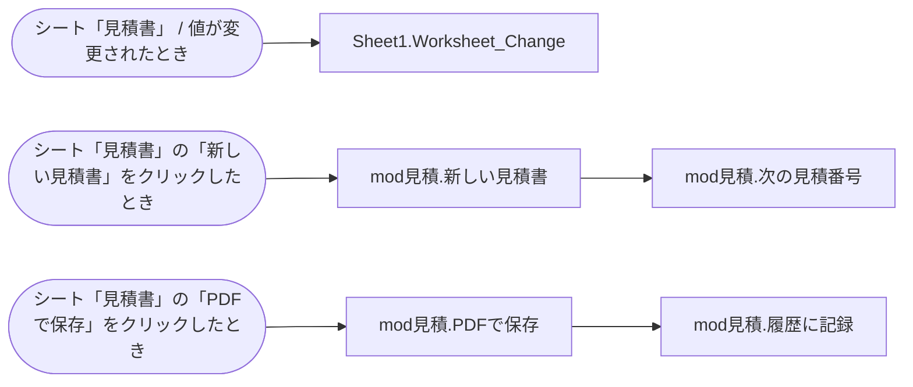

# 棚卸しレポート: 見積書作成.xlsm

> 生成日時: 2026-10-20T00:00:00.000Z / ai-inventory 0.1.0
> AIを使わず、解析結果だけで作成した標準レポートです。

## 1. 概要

このファイルはExcel マクロ有効ブック(.xlsm)です。シート 3 枚、数式 144 個を含みます。VBAはモジュール 5 個、プロシージャ 5 個(コード 54 行)です。起動のきっかけは 3 件、外部依存は 4 件、機械的に検出したリスクは 高 0・中 0・低 1 件です。

| 項目 | 内容 |
| --- | --- |
| ファイル名 | 見積書作成.xlsm |
| 形式 | Excel マクロ有効ブック(.xlsm) |
| サイズ | 11.2 KB |
| SHA-256 | `08be8e8c128af4c972cf8434851d8f5eaa51d3b355cf447d21ff1f0b031fb504` |
| 作成者 / 最終更新者 | 佐藤花子 / 佐藤花子 |
| 作成日時 / 最終更新日時 | 2021-06-14T13:00:00Z / 2023-11-02T16:40:00Z |
| アプリケーション | Microsoft Excel 16.0300 |
| 会社名(文書プロパティ) | 株式会社サンプル精工 |

### 規模

| シート | 数式 | VBAモジュール | プロシージャ | コード行(全行) | テーブル | クエリ | 外部依存 |
| --- | --- | --- | --- | --- | --- | --- | --- |
| 3 | 144 | 5 | 5 | 54(63) | 0 | 0 | 4 |

移行難易度の機械的な目安: **低**(コード 54 行(規模 S))

## 2. 処理の流れ

### 起動のきっかけ

| 種類 | きっかけ | 実行されるプロシージャ |
| --- | --- | --- |
| イベント | シート「見積書」 / 値が変更されたとき | Sheet1.Worksheet_Change |
| ボタン・図形 | シート「見積書」の「新しい見積書」をクリックしたとき | mod見積.新しい見積書 |
| ボタン・図形 | シート「見積書」の「PDFで保存」をクリックしたとき | mod見積.PDFで保存 |

### 呼び出し関係図

## 3. シート構成

| # | シート名 | コード名 | 種類 | 表示 | 使用範囲 | 数式 | 代表的な数式 |
| --- | --- | --- | --- | --- | --- | --- | --- |
| 1 | 見積書 | Sheet1 | ワークシート | 表示 | A1:H40 | 84 | C10: `TEXT(G40,"#,##0")&"円(税込)"` C15: `IF(B15="","",IFERROR(VLOOKUP(B15,単価表!$A$5:$D$200,2,FALSE),"品番なし"))` D15: `IF(B15="","",IFERROR(VLOOKUP(B15,単価表!$A$5:$D$200,3,FALSE),""))` F15: `IF(B15="","",IFERROR(ROUND(VLOOKUP(B15,単価表!$A$5:$D$200,4,FALSE)*掛率,0),0))` G15: `IF(OR(E15="",F15=""),"",E15*F15)` |
| 2 | 単価表 | Sheet2 | ワークシート | 表示 | A1:G64 | 60 | D5: `IF(E5="","",ROUND(E5*(1+利益率),-1))` |
| 3 | 見積履歴 | Sheet3 | ワークシート | 表示 | A1:E1 | 0 |  |

### 名前定義

| 名前 | 範囲 | 参照先 | 非表示 |
| --- | --- | --- | --- |
| 掛率 | ブック | `見積書!$H$8` |  |
| 利益率 | ブック | `単価表!$G$2` |  |
| 消費税率 | ブック | `0.1` |  |

このほか、印刷範囲などの組み込みの名前が 1 件あります。

### ボタン・図形に登録されたマクロ

| シート | コントロール | 表示文字 | マクロ |
| --- | --- | --- | --- |
| 見積書 | Button 1 | 新しい見積書 | 新しい見積書 |
| 見積書 | Button 2 | PDFで保存 | PDFで保存 |

## 4. VBAモジュール

VBAプロジェクト「VBAProject」/ 文字コード cp932(コードページ 932)

| モジュール | 種別 | 行数 | プロシージャ | Option Explicit | 概要 |
| --- | --- | --- | --- | --- | --- |
| ThisWorkbook | ドキュメント(ブック/シート) | 0 | 0 | なし |  |
| Sheet1 | ドキュメント(ブック/シート) | 10 | 1 | なし |  |
| Sheet2 | ドキュメント(ブック/シート) | 0 | 0 | なし |  |
| Sheet3 | ドキュメント(ブック/シート) | 0 | 0 | なし |  |
| mod見積 | 標準モジュール | 53 | 4 | あり |  |

### 参照設定

| 名前 | ライブラリ | パス |
| --- | --- | --- |
| stdole | OLE Automation | `C:\Windows\System32\stdole2.tlb` |
| ADODB | Microsoft ActiveX Data Objects 6.1 Library | `C:\Program Files\Common Files\System\ado\msado15.dll` |
| MSForms | Microsoft Forms 2.0 Object Library | `C:\Windows\System32\FM20.DLL` |

### プロシージャ一覧

#### Sheet1(ドキュメント(ブック/シート))

| プロシージャ | 種類 | スコープ | 行 | 引数 | エラー処理 | 呼び出し先 | 呼び出し元 |
| --- | --- | --- | --- | --- | --- | --- | --- |
| Worksheet_Change(イベント: シート「見積書」 / 値が変更されたとき) | Sub | Private | 1〜10 | Target As Range | なし |  |  |

#### mod見積(標準モジュール)

| プロシージャ | 種類 | スコープ | 行 | 引数 | エラー処理 | 呼び出し先 | 呼び出し元 |
| --- | --- | --- | --- | --- | --- | --- | --- |
| 新しい見積書 | Sub | Public | 7〜14 |  | なし | mod見積.次の見積番号 |  |
| PDFで保存 | Sub | Public | 16〜35 |  | あり | mod見積.履歴に記録 |  |
| 次の見積番号 | Function → String | Private | 37〜41 |  | なし |  | mod見積.新しい見積書 |
| 履歴に記録 | Sub | Private | 43〜53 | ファイル名 As String | なし |  | mod見積.PDFで保存 |

## 5. 外部依存

### ファイル入出力(2件)

| 対象 | 区分 | 箇所 |
| --- | --- | --- |
| `(変数で指定)` | MkDir | mod見積.PDFで保存 (21行目) |
| `(変数で指定)` | ExportAsFixedFormat | mod見積.PDFで保存 (28行目) |

### ファイルパス(ハードコード)(1件)

| 対象 | 区分 | 箇所 |
| --- | --- | --- |
| `.pdf` | ファイル名 | mod見積.PDFで保存 (27行目) |

### 参照設定ライブラリ(3件)

| 対象 | 区分 | 箇所 |
| --- | --- | --- |
| `OLE Automation` | 標準 | VBA参照設定 |
| `Microsoft ActiveX Data Objects 6.1 Library` | 追加 | VBA参照設定 |
| `Microsoft Forms 2.0 Object Library` | 標準 | VBA参照設定 |

## 6. リスク

### 機械的に検出したリスク

| 重要度 | 内容 | 件数 | 主な該当箇所 | 説明 |
| --- | --- | --- | --- | --- |
| 低 | Option Explicit が宣言されていないモジュール(NO-OPTION-EXPLICIT) | 1 | Sheet1 | 変数名の打ち間違いがエラーにならず、不具合の原因になります。 |

## 7. 移行先候補

> AIを使わない場合は、抽出結果の特徴からルールで選んだ目安を示します。

| 移行先 | 適合度 | 難易度 | 理由 | 進め方 | 注意点 |
| --- | --- | --- | --- | --- | --- |
| Excel のまま整理(テーブル・関数・Office スクリプト) | 高 | 低 | 処理の中心が数式で、マクロは補助的です。作り直すより整理する方が費用対効果が高い可能性があります。 | 数式をテーブル機能と名前付き範囲で読みやすくし、マクロの処理は関数や Office スクリプトに置き換えます。 | ファイルの置き場所と編集できる人を決めないと、再び属人化します。 |
| Power Automate(クラウドフロー / デスクトップフロー) | 中 | 低 | ファイルの読み書き・受け渡しなど、決まった手順の繰り返しを自動化している部分があります。 | 手順を一つずつ書き出し、ファイル操作とメール送信はクラウドフロー、画面操作が必要な部分はデスクトップフローに移します。 | 共有フォルダのパスや、操作対象のシステムの画面が変わると止まるため、保存場所を整理してから移すのが安全です。 |
| 業務SaaS(販売管理・会計・勤怠など) | 中 | 中 | 業務が一般的な販売・会計・勤怠などに当てはまるなら、作り直すより既製のサービスに合わせる方が保守の負担が減ります。 | 現在の業務フローと帳票を書き出し、候補のサービスで代替できる範囲と、運用を変える部分を整理します。 | 自社独自のルールが多い場合は、カスタマイズ費用や運用変更の負担を見積もってください。 |

## 8. 現場に確認すること

- このファイルを使っている部署・人数と、止まった場合に困る業務は何ですか?
- ボタン操作(シート「見積書」の「新しい見積書」をクリックしたとき)は、誰が・どのくらいの頻度で行っていますか?
- ボタン操作(シート「見積書」の「PDFで保存」をクリックしたとき)は、誰が・どのくらいの頻度で行っていますか?
- 最後にこのファイルを修正したのは誰で、いつ頃ですか?

## 付録

### 解析の制約・警告

- シートのセルの値(データ本体)は読み取っていません。数式・構造・コードのみを対象にしています。
- 呼び出し関係は静的な解析です。文字列を組み立てて実行するマクロ名や、オブジェクト変数経由のクラスメソッド呼び出しは検出できないことがあります。
