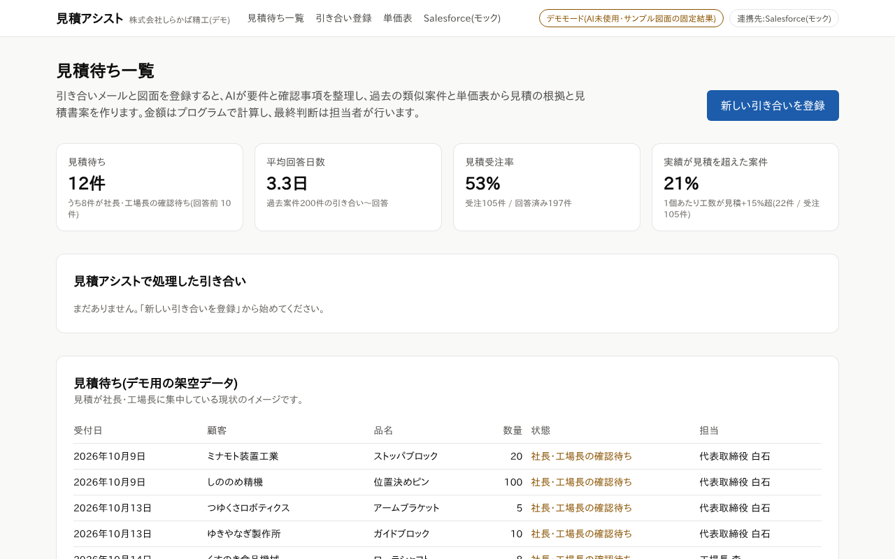
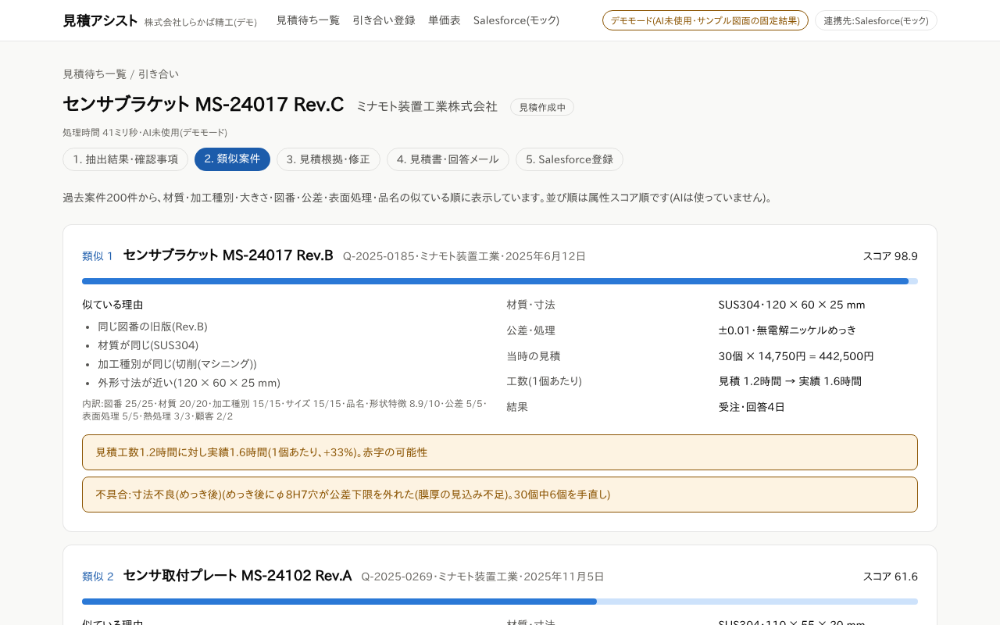
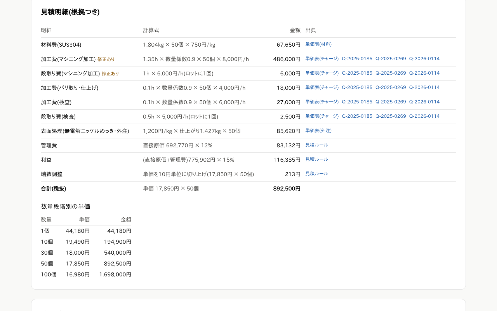

# 想定事例(デモシナリオ):株式会社しらかば精工(架空)の見積業務

> **ご注意:これは架空の会社による想定事例であり、実在の導入実績ではありません。**
> 会社名・人名・お客様の名前・図面・画面の数値は、すべて見積アシストのデモ用に作った合成データです。実在の企業・人物とは関係ありません。
> 「想定される効果」の数値は仮説と試算であり、成果を保証するものではありません。

> **社内メモ(お客様に渡す前に削除)**
> - 初回面談で、デモ画面と一緒に見せる資料です。提案書の付録にも使えます。
> - 画面は「デモモード」(AIを使わず、サンプル図面に対する固定の読み取り結果を表示)で撮ったものです。画面に出る処理時間(ミリ秒単位)やAI費用0円は、実際にAIを使ったときの値ではありません。見せるときは毎回そう伝えます。
> - スクリーンショットは [../demo/screens/](../demo/screens/) にあります(デモ担当が `npm run demo:record` で撮り直せます)。撮り直すと、画面の日付(発行日・希望納期)は撮影日に合わせて変わります。
> - 本文には社内資料の名前やリンクを書いていません。数値の根拠(社内)は、作業時間の仮説が use-cases.md 5.1、価格と試算が pricing.md 4章、KPIが use-cases.md 5.8、会社の設定が apps/quote-assist/data/company.json です。

---

## 1. 会社のプロフィール(架空)

| 項目 | 内容(架空) |
|---|---|
| 会社 | 株式会社しらかば精工 |
| 従業員 | 45名 |
| 事業 | マシニングセンタとNC旋盤による金属部品加工(小物の板金を含む)。表面処理と熱処理は外注 |
| 主な設備 | 立形マシニングセンタ3台、横形マシニングセンタ1台、NC旋盤3台、複合加工機1台、平面・円筒研削盤、ワイヤー放電加工機、ファイバーレーザー加工機、ベンディングマシン、三次元測定機(計10種) |
| 見積の担当 | 代表取締役 白石、工場長 森 の2名だけ |
| 営業 | 営業3名(窓口は営業部 青木)。商談の管理にSalesforceを利用 |
| 主なお客様 | 省力化装置・搬送装置・食品機械・半導体製造装置部品などのメーカー(架空の20社) |
| 今回の引き合い元 | ミナモト装置工業株式会社(架空の省力化装置メーカー)。図面とメールで引き合いを送ってくる |

(すべてデモ用の架空の設定です)

---

## 2. 導入前の課題

### 2.1 数字で見る現状(デモの合成データ)

| 指標 | 値(合成データ) | 意味 |
|---|---|---|
| 見積待ち | 12件。うち8件が社長・工場長の確認待ち | 見積が2人に集中し、その人の手が空くまで回答できない |
| 平均回答日数 | 3.3日 | 引き合いから回答まで(過去案件200件から計算) |
| 見積受注率 | 53%(受注105件 ÷ 回答197件) | 半分近くは受注に至っていない |
| 実績が見積を超えた案件 | 21%(受注105件のうち22件) | 1個あたりの実績工数が見積を15%以上超えた。赤字の可能性がある案件 |

デモの過去案件200件は、2024年4月〜2026年9月の見積から選んだ**抜粋という設定**で、全件ではありません(月の引き合い件数はデモのデータでは決めていません。5.2を参照)。

画面:[01-dashboard.png](../demo/screens/01-dashboard.png)、[02-backlog.png](../demo/screens/02-backlog.png)



### 2.2 見積1件にかかる時間(仮説)

図面1〜3枚・単品〜小ロットの見積1件を想定した**仮説**です。公的な統計はなく、実際の値は導入前の記録(ベースライン計測)で確かめます。

| 担当 | 作業 | 時間(仮説) |
|---|---|---|
| 営業・事務 | 引き合い内容の整理、お客様への不明点の確認 | 10〜20分 |
| 社長・工場長 | 図面の確認、似た過去品探し、工程・工数の見積、金額計算 | 45〜90分 |
| 事務 | 見積書の作成、Salesforceへの登録、回答メールの作成 | 10〜15分 |
| 合計 | | **65〜125分** |
| お客様から見た回答 | 引き合いから回答まで | 2〜5営業日 |

根拠:当社の仮説です(公的な統計や導入実績にもとづく数値ではありません)。

### 2.3 課題のまとめ

| 課題 | しらかば精工(架空)での例 |
|---|---|
| 見積が特定の人に集中している | 12件中8件が社長・工場長の確認待ち |
| 過去の苦労が次の見積に活かされない | 同じ図番の旧版(Rev.B)は、見積工数1.2時間に対して実績1.6時間かかり、めっき後の寸法不良で30個中6個を手直ししていた。探さなければ気づかない |
| 不明点に受注後に気づく | 図面に「熱処理:要否は別途指示」とあり、検査成績書の要否も書かれていない。確認しないまま見積を出すと、受注後に手戻りや追加費用が起きやすい |
| 見積の根拠が残らない | 前回より単価を上げたいときに、どの工程に時間がかかっているかを説明する材料がない |

---

## 3. 導入の進め方(想定)

しらかば精工で導入するとしたら、という想定の進め方です。期間は目安です。

| 段階 | 期間の目安 | しらかば精工でやること(想定) | 使う資料 |
|---|---|---|---|
| 1. 無料診断 | 1〜2週間 | 見積の件数・作業時間・データの所在を確認する。データの整い具合を判定する(想定:Excelの見積台帳とSalesforceの商談があり、日報で実績工数も取っている=レベル2〜3) | 聞き取りシート |
| 2. ベースライン計測 | 2〜4週間 | 引き合いごとに、社長・工場長と営業の作業時間、回答日時を記録する | PoC計画書(ベースライン計測) |
| 3. PoC(試験導入) | 4〜6週間 | 過去の見積30〜50件(リピート品・新規品・情報不足・短納期を混ぜる)で、読み取りの正確さ、計算の再現度、類似検索の的中率、作業時間を測る。合格ラインは開始前に決める | PoC計画書 |
| 4. 判断 | 報告会から2週間以内 | 結果を見て、本導入・範囲を絞って導入・追加検証・見送りから選ぶ | PoC計画書(判断の進め方) |
| 5. 初期導入 | 2〜3か月 | 社長への聞き取り(2時間×2回程度)で単価表と見積ルールを作る。過去の見積を取り込む。Salesforceと連携する。研修 | 提案書 |
| 6. 運用・改善 | 月単位 | 月1回の改善ミーティングで、社長の修正の記録とKPIを振り返り、単価表・ルールを見直す | 提案書(効果測定) |

無料診断から本番での利用開始までは、合計で約5〜7か月が目安です。PoC期間中に社長・工場長にお願いする時間は、合計で約15時間前後(6週間の場合の目安)です。

デモで使っている単価表(架空)の主な設定:工程チャージ9種(例:マシニング加工 8,000円/時間、段取り 6,000円/時間)、材料10種(例:SUS304 750円/kg)、外注8種(例:無電解ニッケルめっき 1,200円/kg)、管理費率12%、利益率の初期値15%、数量による加工時間の係数(30〜99個は0.90)、特急料金は加工費と段取り費の25%、単価は10円単位で切り上げ。

---

## 4. 画面での変化(デモシナリオ:改訂品の見積)

**引き合いの内容(架空):** ミナモト装置工業から、センサブラケット(図番 MS-24017 Rev.C)を50個。材質SUS304、無電解ニッケルめっき。図面PDF 2枚とメールで依頼。前回のRev.Bから穴の位置を変えた改訂品。希望納期は登録日の約6週間後(画面の日付は撮影日によって変わります)。

### 4.1 流れの比較

| # | 場面 | 今のやり方(想定) | 見積アシストでの変化(デモ画面) | 画面 |
|---|---|---|---|---|
| 1 | 受付 | 営業がメールと図面を印刷して社長の机に置き、手が空くのを待つ | 営業がメール本文を貼り付け、図面PDF 2枚を登録する | [03](../demo/screens/03-register.png) |
| 2 | 読み取り | 社長が図面を読み、材質・数量・公差・処理を確かめる | 顧客・品名・図番・版・材質・数量・外形寸法・最小公差(±0.01)・表面処理などを、確からしさと「図面のどこに書いてあったか」つきで表示する | [04](../demo/screens/04-extraction-summary.png)、[05](../demo/screens/05-extraction-fields.png) |
| 3 | 確認事項 | 不明点に気づくのが受注後になることがある | 「熱処理の要否」「検査成績書の要否」の2件を不足として挙げ、お客様への確認メールの案を作る(送信は人) | [06](../demo/screens/06-questions.png) |
| 4 | 類似案件 | 社長の記憶とファイルサーバを頼りに探す | 過去案件200件から似た順に表示。1位は同じ図番の旧版(Rev.B、スコア98.9)で、「見積1.2時間に対し実績1.6時間(+33%)。赤字の可能性」「めっき後の寸法不良」を警告。3位には、同じ材質・大きさで価格を理由に失注した案件も出る | [07](../demo/screens/07-similar.png)、[08](../demo/screens/08-similar-more.png)、[09](../demo/screens/09-past-case.png) |
| 5 | 見積の根拠 | 社長が頭の中やExcelで計算し、根拠は残らない | 材料費・工程ごとの加工費と段取り費・外注費・管理費・利益を、計算式と出典(単価表・過去案件)つきで表示する。工数の案は、似た過去案件の実績から計算する | [10](../demo/screens/10-quote-summary.png)、[11](../demo/screens/11-quote-lines.png)、[14](../demo/screens/14-rates.png) |
| 6 | 社長の修正 | — | 社長役が、旧版の実績(マシニング加工は1個あたり1.35時間かかり、赤字の可能性)を見て、「今回は実績に合わせて見ておく」と判断し、案の1.15時間を1.35時間に直す。合計がすぐに再計算され、出典が「人が修正」になる | [12](../demo/screens/12-quote-edit.png)、[13](../demo/screens/13-quote-recalculated.png) |
| 7 | 承認 | — | 未確認の項目(熱処理・検査書類)が残っているため、「確認したうえで承認する」にチェックを入れ、承認者(代表取締役 白石)を選んで承認する。チェックがないと承認できず、未確認のまま進めたことは記録に残る | [15](../demo/screens/15-approve.png) |
| 8 | 見積書・回答メール | 事務がExcelで見積書を作り、メールを書く | 見積書の案と、確認事項2件を添えた回答メールの案ができる。前提(熱処理なしで計算)も備考に入る。送信は担当者が行う | [16](../demo/screens/16-document.png)、[17](../demo/screens/17-reply-email.png) |
| 9 | Salesforce登録 | 事務が商談と見積を手入力する | 承認済みの見積だけを、商談と見積として登録する(デモではモックのSalesforce) | [18](../demo/screens/18-crm-before.png)、[19](../demo/screens/19-crm-registered.png)、[20](../demo/screens/20-crm-mock.png) |
| 10 | 記録 | — | 社長の修正(1.15→1.35時間)、未確認のまま進めた項目、承認者が記録に残る。工数の案の採用率(この例では3工程中2工程を修正なしで採用=67%)も記録される | [21](../demo/screens/21-metrics.png)、[22](../demo/screens/22-dashboard-after.png) |



### 4.2 見積明細の変化(社長の修正の前後)

金額はAIではなく、単価表にもとづいてプログラムが計算しています。同じ入力なら同じ金額になり、明細の計算式どおりに手計算で確かめられます。

| 明細 | 計算式 | 修正前(工数の案) | 社長の修正後 |
|---|---|---|---|
| 材料費(SUS304) | 1.804kg × 50個 × 750円/kg | 67,650円 | 67,650円 |
| 加工費(マシニング加工) | 1個あたり時間 × 数量係数0.9 × 50個 × 8,000円/時間 | 414,000円(1.15時間) | **486,000円(1.35時間)** |
| 段取り費(マシニング加工) | 1時間 × 6,000円/時間(ロットに1回) | 6,000円 | 6,000円 |
| 加工費(バリ取り・仕上げ) | 0.1時間 × 0.9 × 50個 × 4,000円/時間 | 18,000円 | 18,000円 |
| 加工費(検査) | 0.1時間 × 0.9 × 50個 × 6,000円/時間 | 27,000円 | 27,000円 |
| 段取り費(検査) | 0.5時間 × 5,000円/時間 | 2,500円 | 2,500円 |
| 表面処理(無電解ニッケルめっき・外注) | 1,200円/kg × 仕上がり1.427kg × 50個 | 85,620円 | 85,620円 |
| 直接原価 | 上の合計 | 620,770円 | 692,770円 |
| 管理費 | 直接原価 × 12% | 74,492円 | 83,132円 |
| 利益 | (直接原価+管理費)× 15% | 104,289円 | 116,385円 |
| 端数調整 | 単価を10円単位に切り上げ | 449円 | 213円 |
| **合計(税抜)** | 単価 × 50個 | **800,000円(単価16,000円)** | **892,500円(単価17,850円)** |

数量段階別の単価(社長の修正後):1個 44,180円 / 10個 19,490円 / 30個 18,000円 / 50個 17,850円 / 100個 16,980円。段取り費と最低料金の按分で、少量ほど単価が上がることが根拠つきで分かります。

確認ポイント(画面に表示される警告):熱処理の要否が未確定のため熱処理なしで計算していること、希望納期まで営業日で約28日・標準リードタイムは10営業日であること、旧版の赤字の可能性、旧版の不具合。



### 4.3 この場面で伝えたいこと

| 伝えたいこと | 画面での見え方 |
|---|---|
| 受注後の手戻りを、見積の段階で防ぐ | 熱処理・検査成績書の要否を、見積を出す前に確認メールで聞ける |
| 過去の失敗を次の見積に活かす | 旧版の赤字と不具合が、見積を作る画面で自動的に目に入る。社長はそれを見て、工数を旧版の実績に合わせて直せる |
| 根拠のある見積で、価格の説明がしやすくなる | 旧版の単価(30個で14,750円)より上がる理由を、工程ごとの時間と単価で説明できる |
| 最終判断は社長 | AIが出すのは案と根拠。工数を直すのも、承認するのも社長。直した内容は記録に残る |

---

## 5. 想定される効果(仮説・試算)

**ここに書く数値は、すべて仮説と試算です。** しらかば精工は架空の会社で、実際に導入した結果ではありません。実在のお客様では、ベースライン計測とPoCで実測した値に置き換えます。

### 5.1 1件あたりの作業時間(仮説)

| 担当 | 現状(仮説) | 導入後(仮説) | 変わる理由 |
|---|---|---|---|
| 営業・事務(整理・確認) | 10〜20分 | 3〜5分 | AIが要件と確認事項を整理し、人が確認する |
| 社長・工場長(見積) | 45〜90分 | 10〜20分 | 似た過去案件と工数の案が出て、人は確認と修正をする |
| 事務(見積書・登録・メール) | 10〜15分 | 2〜5分 | 見積書案・メール案・Salesforce登録が用意される |
| **合計** | **65〜125分** | **15〜30分** | |
| 回答までの日数 | 2〜5営業日(デモデータの平均は3.3日) | 当日〜翌営業日 | 主な理由は、社長・工場長の手が空くのを待つ時間が減ること |

根拠:当社の仮説です(公的な統計や導入実績にもとづく数値ではありません)。

### 5.2 月あたりの試算

しらかば精工の月の引き合い件数は、デモのデータでは決めていません(過去案件200件は抜粋という設定)。そのため、**月60件と月120件の2通りを仮定**して試算します。

```
月の削減時間 = 月の引き合い件数 × 1件あたりの削減時間 ÷ 60
月の削減額   = 月の削減時間 × 時間単価(3,000円と仮定)
```

1件あたりの削減時間は、5.1の仮説の削減幅(35〜110分)の中から控えめに置いた60分と、その半分の30分の2通りです。

| 月の引き合い件数(仮定) | 削減60分/件のとき | 削減30分/件のとき(効果が半分) |
|---|---|---|
| 60件 | 60時間 → 月18万円相当 | 30時間 → 月9万円相当 |
| 120件 | 120時間 → 月36万円相当 | 60時間 → 月18万円相当 |

**初期費用の回収期間の試算**(価格の仮説:PoC 30〜50万円、初期導入 100〜250万円、月額 5〜10万円)

```
回収期間 = (PoC費用 + 初期導入費) ÷ (月の削減額 − 月額)
```

| 月の件数(仮定) | 削減/件 | 価格の中央値で計算(一時費用215万円、月額7.5万円) | 価格の下限で計算(一時費用130万円、月額5万円) |
|---|---|---|---|
| 60件 | 30分 | 約143か月 | 約33か月 |
| 60件 | 60分 | 約20か月 | 約10か月 |
| 120件 | 30分 | 約20か月 | 約10か月 |
| 120件 | 60分 | 約8か月 | 約4か月 |

- 金額換算は「その時間を別の仕事に回せる」という意味で、人件費が直接減るとは限りません。
- 時間単価3,000円は、当社のAI導入診断ツールの初期値です。社長・工場長の時間をいくらと見るかは、各社の経営判断で置き換えます。
- 引き合いが少ない場合や効果が仮説より小さい場合は、作業時間の削減だけでは初期費用の回収に長い期間がかかる試算になります。特に**月60件未満では回収が難しい試算**です。無料診断で件数をうかがい、見合わない場合はそうお伝えします。

根拠:当社の価格の仮説と試算です(販売実績はまだありません)。

### 5.3 金額にしにくい効果(導入後にKPIで追う)

| 効果 | KPI | デモの合成データでの今の値 | 測り方 |
|---|---|---|---|
| 回答が速くなる | 見積回答リードタイム(中央値) | 平均3.3日(中央値は導入前の計測で出す) | 見積アシストの記録、Salesforce |
| 受注が増える | 見積受注率、失注理由の構成 | 53% | Salesforce |
| 赤字案件を早く見つける | 見積と実績原価の差、赤字案件の割合 | 実績が見積を15%以上超えた案件 21% | 生産管理・日報の実績工数 |
| 手戻りが減る | 受注後の仕様確認・手戻りの件数 | (デモデータなし) | 営業の記録 |
| 見積が社長以外でも進む | 見積担当者以外が一次案を作った割合 | (デモデータなし) | 見積アシストの記録 |
| AIの案が役に立っている | 工数の案の採用率・修正幅 | この引き合いでは67%(3工程中2工程を修正なし) | 修正の記録 |

目標値は、PoCの結果を見てお客様と一緒に決めます。

### 5.4 この試算の限界

- しらかば精工・ミナモト装置工業・画面の数値はすべて架空の合成データです。
- 作業時間の数値は公的な統計のない仮説で、まだどのお客様でも実測していません。
- デモ画面はAIを使わない「デモモード」です。実際のAIでの読み取りの正確さ・処理時間・費用は、PoCで測ります。
- AIは読み間違えることがあります。見積の最終判断と送信は人が行う前提で、効果もその前提で見積もっています。

---

## 関連資料(ご希望に応じてお渡しします)

| 資料 | 内容 |
|---|---|
| 見積アシストのご紹介(1枚もの) | 課題・仕組み・期待される効果(仮説)・進め方・費用の目安 |
| 聞き取りシート | 無料診断でうかがう内容 |
| PoC(試験導入)計画書 | 期間・対象データ・評価の方法・合格基準の決め方・機密情報の扱い |
