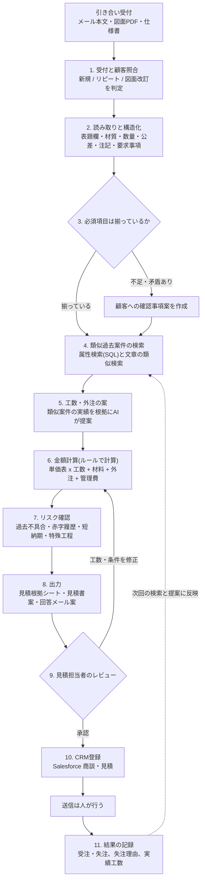
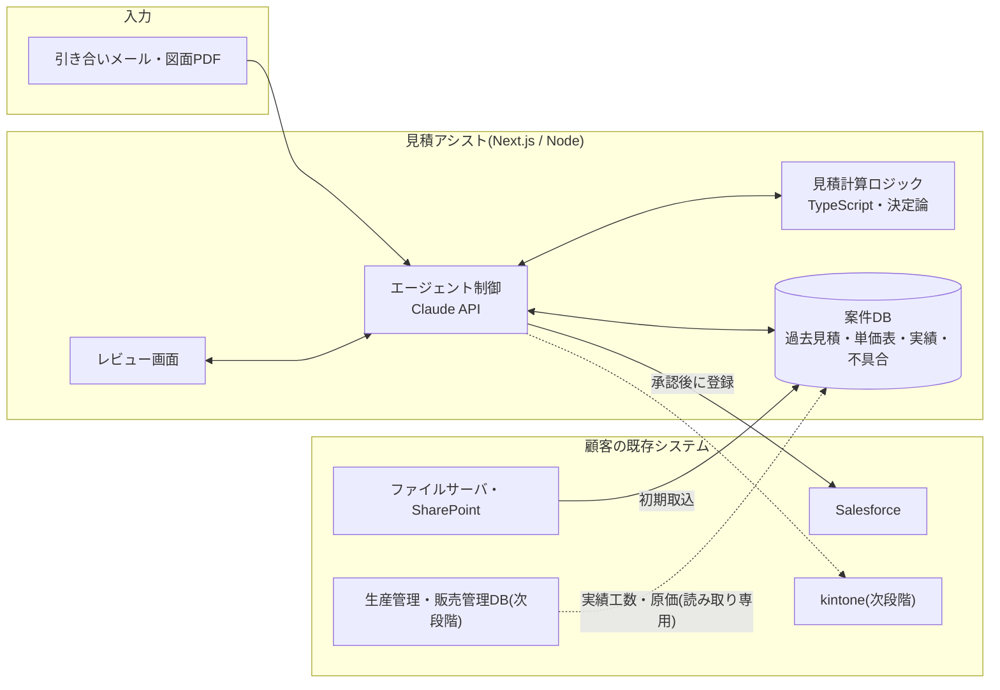

# 製造業向けAIエージェントパッケージ:AI化する業務の洗い出しと最優先業務の設計

- 作成日:2026-10-18(タスク9)
- 対象:日本の中小〜中堅製造業(BtoB、多品種少量、受注生産・部品加工・装置メーカー)
- この文書の使い方:1章だけ読めば結論と判断事項が分かります。2章以降は根拠と設計の詳細です。

---

## 1. 結論(要約)

**最優先は「引き合い対応・見積作成エージェント」(仮称:見積アシスト)。**
引き合いメールと図面・仕様書を受け取り、要件を整理し、不足している情報を洗い出し、似た過去案件を探して、見積根拠と見積書案・回答メール案を作ります。金額は単価表と工数に基づいてプログラムで計算し、AIには金額を作らせません。最後は人が確認して送ります。

選んだ理由は3つです。

1. **効果が経営に直結する。** 見積は社長やベテランなど少数の人に集中しやすく、回答が遅れると受注機会を逃します。2026年1月施行の取適法(改正下請法)と価格転嫁の流れで、原価の根拠を示した見積は価格交渉の材料にもなります(2.4節)。
2. **必要なデータが中小企業にもある。** 過去の見積書、図面PDF、単価の考え方は、形はばらばらでもほぼ全社にあります。ない場合も「社長への聞き取り+直近30〜50件のデジタル化」から始められます(5.4節)。
3. **ユーザーの強みがそのまま活きる。** Salesforceの商談・見積への登録、回答リードタイムや受注率などのKPI分析、生産管理DB(SQL)からの実績原価の取得は、汎用AIツールでは代替されにくい部分です。

次に優先する業務は「品質不良・クレーム対応」「保守サービス(装置メーカー)」「受注処理(注文書の読み取りと見積の照合)」です。いずれも見積アシストで作る案件DB(図番・顧客・工程)を共有できるため、順に追加できます(4章)。

### ユーザーに判断してほしい点

| # | 判断事項 | 筆者の推奨 |
|---|---|---|
| 1 | 最初の対象を「部品加工(切削・板金)の単品〜小ロット見積」に絞るか | 絞る。装置メーカーの一式見積は工程が多く、MVPでは精度を検証しにくい |
| 2 | 連携の主軸をSalesforceとkintone/Excelのどちらから作るか | Salesforce接点のある顧客で実証し、kintone/Excelは次段階で対応 |
| 3 | 提供形態(複数社で共用するSaaSか、顧客ごとの専用環境か)と、図面データの置き場所 | MVPは共用、機密要件の強い顧客には専用環境+国内リージョン処理を有償オプションで |
| 4 | 価格帯の仮説(PoC 30〜50万円、初期100〜250万円、月額5〜10万円)と補助金対応の要否 | 仮説のまま2〜3社に提示して反応を見る。補助金対応はIT導入支援事業者登録の負担と合わせて判断 |

---

## 2. 調査結果:中小製造業の課題と生成AI活用の動向(2026年時点)

> 調査方法の注記:今回の作業環境では官公庁サイトのPDFを直接開けなかったため、検索エンジン上の公式ページの要約と、報道・解説記事で内容を確認しました。白書の数値で原典未確認のものには「要原典確認」と付けています。営業資料に使う前に原典で確認してください。

### 2.1 人手不足:「労働供給制約」が前提になった

- 2026年版中小企業白書は「労働供給制約社会」を背景に、価格転嫁などで付加価値を増やすことと、省力化投資・AI活用・デジタル化で労働投入量を最適化することの両方を重要としています。2040年に生産年齢人口が約1,200万人減る見通しも示しています [S1]。
- 帝国データバンクの調査では、正社員が不足している企業は2026年7月時点で51.3%で、7月としては4年連続で半数を超えています [S10]。
- 2026年版ものづくり白書(5月29日閣議決定)は、経産省担当部分の分析の焦点を「AI」に移しています [S2]。

### 2.2 技能継承:3社に2社が苦戦し、文書化は進んでいない

- ものづくり白書2026の解説記事は、技能継承に苦戦している企業が3社に2社と報じています [S5]。主な対策は「高年齢の従業員に継続して働いてもらう」で、技能継承の取組を「見える化」している企業は約3割にとどまるとされます [S6](要原典確認)。
- 継承が必要な技能として「正確に作業する技」「状況に応じたカン・コツ」が上位で、手段としては電子マニュアルや動画マニュアルが多いとされます [S5]。
- **示唆:** 見積の考え方も「社長のカン・コツ」の一種です。見積アシストの導入時に行う聞き取りは、そのまま技能継承(見積ノウハウの文書化)になります。

### 2.3 生成AIの普及:文章作成では広がったが、製造の基幹業務はこれから

| 調査 | 主な結果 |
|---|---|
| 帝国データバンク(2026年3月、10,312社回答)[S8] | 生成AIを業務で活用している企業は34.5%(大企業46.5%、中小企業32.4%、小規模企業28.0%)。活用企業の86.7%が効果を実感。用途は文章の作成・要約・校正が最多(45.1%) |
| 中小機構「中小企業のAI等の利活用に係る実態調査」(2026年3月、1万社対象)[S7] | AI導入率20.4%(検討中18.6%)。導入企業の82.6%が生成AIを利用。導入は総務・管理部門が68.3%で最多、**製造・生産部門は遅れている**。効果は「業務効率化・作業時間の短縮」83.2%。導入後の課題は「ランニングコストが高い」44.0%。「成功事例・活用事例の情報」が不足しているとの回答が83.3% |
| 大同生命(2026年3月発表)[S9] | 中小企業の約6割が生成AIを業務で使ったことがない。障壁は「詳しい人材がいない」「ノウハウがない」「どの業務に使えるか分からない」 |
| ものづくり白書2026の解説 [S3][S4] | データ連携に「AIを活用していない」が71.8%。中小企業ではデジタル化を経営層が主導するケースが多い |

**示唆:**
- 汎用チャットでの文章作成は普及しつつありますが、見積・品質・保守といった製造業の中核業務への組み込みはまだ少ない状態です。
- 障壁は「価格」より「どこに使えばよいか分からない」「事例がない」「人がいない」です。業務を特定し、事例(デモ)を見せ、導入まで伴走するパッケージには需要があると考えられます。
- 中小企業では経営層が主導するため、社長が自分の時間の削減を実感できる業務(見積)は提案しやすいと考えられます。
- 導入後の課題の1位がランニングコストなので、月額は削減効果で説明できる水準に抑える必要があります。

### 2.4 見積・引き合い:属人化、回答スピード、価格交渉

- **属人化:** 見積が社長や一部のベテランの経験に依存し、過去図面や見積データが個人に偏っている状況は、ベンダーの解説で繰り返し取り上げられています [S16][S36]。九州経済産業局の支援事例でも、工業用ゴム製品メーカーで「定量的な指標が少なく、社長の経験をもとに金額を判断している」例が紹介されています [S39](個別事例のため一般化はしない)。
- **既存サービス:** 類似図面検索(CADDi DRAWER、テクノア「AI類似図面検索」、図面バンクなど)や図面からの自動見積(SellBOTなど)が出ています [S16][S17][S18][S19]。効果の数値(図面検索時間95%減、1件あたり4.4分短縮など)はベンダーの公表値です。
- **回答スピードへの期待:** ミスミのmeviyは3Dデータから約5秒で見積を出すとしており(2019年の発表時点)[S20]、調達担当者が期待する回答速度は上がっています。精密板金の共栄精機は、引き合いから1時間以内に回答する体制で新規顧客を増やしたと紹介されています [S21]。
- **価格交渉:** 2026年3月の価格交渉促進月間のフォローアップ調査では、価格転嫁率は54.2%(労務費は50.0%)で「道半ば」とされています [S11]。2026年1月施行の取適法(改正下請法)では、十分に協議せずに代金を一方的に決めることが禁止行為に加わりました [S12]。受注側の中小製造業にとって、**原価の根拠を示せる見積は交渉材料になります。**
- 製造業向けAIエージェントの解説でも、「新規図面から類似案件を探して見積とBOMの下書きを作る」業務はROIが出やすい領域として挙げられています [S36]。

### 2.5 その他の業務の動向

| 業務 | 動向 |
|---|---|
| 品質・クレーム対応 | 不具合報告書や8Dレポートの下書きを生成AIで作る取組が紹介されている。問題の定義(D2)や根本原因の分析(D4)は生成AIに向くが、恒久対策の決定は人が行うべきとされる [S25]。AIが示す要因候補は相関にすぎず、技術者の検証と組み合わせる必要があるとも指摘されている [S25] |
| 保守サービス | 日立システムズは年間約130万件の保守ナレッジを使って報告書作成などに生成AIを適用 [S24]。日立は設備の故障原因と対策を示すAIエージェントを発表(2026年2月)[S23] |
| 設計・仕様照合 | パナソニック コネクトが、図面と設計仕様の照合を支援するエージェントを社内展開したと報じられている(2026年2月)[S22] |
| 日報・作業記録 | 旭鉄工の音声入力による生産管理など、入力負荷を下げる取組がある [S26]。一方で、生成AIで日報を要約して効果を数値で示した中小企業の事例は今回の検索では見つからなかった |
| 翻訳 | 図面・仕様書の翻訳では、出力をそのまま取引先に出さず人が確認すること、NDAの範囲で扱うことが推奨されている [S27] |
| 紙の残存 | 従業員1,000名未満の製造業では、ペーパーレスに取り組む企業が80.9%ある一方、ほぼ全業務で完了しているのは8.9%(LINE WORKS調査、2026年3月)[S37] |

### 2.6 周辺環境(連携先と制度)

- **Salesforce:** Agentforceの製造業向け機能では、見積作成や調達の支援が打ち出されています [S28]。SalesforceのHosted MCP Serverは2025年10月にベータ公開され [S29]、2026年4月にGAになったと報じられています(二次情報。Enterprise Edition以上が対象とされる)。REST APIはEnterprise Edition以上で標準、Professional Editionではアドオンが必要です [S30]。
- **kintone:** サイボウズ公式のMCPサーバーが2025年8月に公開され、「kintone AI」が2026年6月に正式リリースされたと報じられています [S31]。
- **AIガバナンス:** 総務省・経産省の「AI事業者ガイドライン」第1.2版(2026年3月31日公表)で、AIエージェントが新たに定義され、人間の判断の介在や責任の整理が加わったとされています [S13]。
- **営業秘密:** 経産省の「秘密情報の保護ハンドブック」に生成AI利用時の注意が追記されています。NDAで受け取った技術データを外部AIに入力すると契約違反になるおそれがあると指摘されています [S14]。
- **補助金:** 「デジタル化・AI導入補助金」(旧IT導入補助金)が2026年も公募されています。対象にするには、ツールと支援事業者の登録が必要です [S15]。

---

## 3. AI化候補の業務と評価

### 3.1 評価の基準

各項目を5段階で評価し、**5が最も有利**です(導入難易度は易しいほど5)。点数は調査結果と想定顧客像に基づく筆者の仮説で、顧客へのヒアリングで見直します。

| 観点 | 5点の状態 |
|---|---|
| 効果 | 経営者・ベテランの時間か、売上・粗利に直接効く |
| 実現性 | 必要なデータが中小企業にも(形はばらばらでも)ほぼ存在する |
| 導入難易度 | 現場の運用変更が少なく、2〜3か月で稼働できる |
| 差別化 | 汎用チャットや既存SaaSで代替しにくい |
| 強みとの親和性 | Salesforce・KPI分析・C#/SQLが直接活きる |
| デモの作りやすさ | 架空データで5分以内に価値が伝わる |

### 3.2 評価表

| # | 業務(誰の作業か) | 効果 | 実現性 | 難易度 | 差別化 | 親和性 | デモ | 計(30) |
|---|---|---|---|---|---|---|---|---|
| A | **引き合い対応・見積作成**(営業、社長・工場長、営業事務) | 5 | 4 | 3 | 4 | 5 | 5 | **26** |
| B | 顧客仕様書の要求事項チェック(営業、設計) | 4 | 4 | 3 | 3 | 3 | 4 | 21 |
| C | **品質不良・クレーム対応**(品質保証) | 4 | 4 | 3 | 3 | 4 | 4 | **22** |
| D | 技能伝承(熟練者の知識の文書化)(現場リーダー) | 4 | 2 | 2 | 3 | 2 | 3 | 16 |
| E | **保守サービスの一次切り分け・報告書作成**(装置メーカーのサービス部門) | 4 | 3 | 3 | 4 | 5 | 4 | **23** |
| F | 作業日報の構造化と集計(現場作業者、工場長) | 3 | 3 | 3 | 2 | 4 | 4 | 19 |
| G | 図面・技術文書の検索(社内文書RAG)(設計、営業) | 3 | 3 | 4 | 1 | 2 | 4 | 17 |
| H | **受注処理(注文書の読み取りと見積の照合)**(営業事務) | 3 | 5 | 4 | 2 | 4 | 4 | **22** |
| I | 海外取引の翻訳(営業、購買) | 2 | 5 | 5 | 1 | 1 | 4 | 18 |
| J | 営業記録のCRM入力・フォロー提案(営業) | 3 | 4 | 4 | 2 | 5 | 4 | 22 |

### 3.3 各業務の評価メモ

- **A 見積:** 社長やベテランの時間が直接減り、回答速度は受注にも影響します。過去見積・図面・単価の考え方はほぼ全社にあります。難しいのは図面の読み取り精度と、会社ごとに違う見積ロジックの設定です。汎用チャットには過去実績や単価表に基づく計算はできず、類似図面検索SaaSは図面検索までが中心です。
- **B 仕様書チェック:** 装置メーカーでは効果が大きい一方、部品加工では仕様書が短く効果は限られます。Aの「確認事項の抽出」に機能を取り込みます。
- **C 品質・クレーム:** 不具合報告書はExcelで残っていることが多く、類似不具合の検索と報告書の下書きで回答日数を短縮できます。報告書の下書き自体は汎用AIでもできるため、差別化は過去不具合DB・図番・工程とのひも付けで出します。
- **D 技能伝承:** 長期的な効果は大きいものの、元になる文書がなく、聞き取りや動画が前提になります。効果が出るまで時間がかかり、測定も難しいです。単独商品にはせず、Aの導入時の聞き取りとして取り込みます。
- **E 保守:** 装置メーカーに限られますが、Service Cloud・Field Serviceとの親和性が最も高い業務です。保守記録の質にばらつきがあるため、実現性は3点としました。
- **F 日報:** KPI分析の入力源として価値がありますが、課題は現場が入力を続けられるかどうかで、音声日報SaaSなどの競合も多いです。Aの「実績工数のフィードバック」の入力源として後で検討します。
- **G 社内文書RAG:** 技術的には易しい一方、Microsoft Copilot・kintone AI・各種RAG製品と横並びになり、差別化がほぼありません。
- **H 受注処理:** 注文書(PDF・FAX)は必ず存在し、実現性は高いです。AI-OCR製品が多いため単独では差別化できませんが、「見積と注文書の差異チェック(単価・数量・納期・図番の版)」はAの直後の工程として付加価値があります。
- **I 翻訳:** 汎用翻訳ツールで十分な場合が多いので、パッケージ内の補助機能にとどめます。
- **J 営業記録:** Salesforceとの親和性は最大ですが、製造業に固有の業務ではなく、Agentforceなどの標準機能と競合します。Salesforce導入支援の付帯サービスとして扱います。

---

## 4. 優先する業務(3〜5業務)と理由

| 順位 | 業務 | 選んだ理由 | 位置づけ |
|---|---|---|---|
| 1 | **A 引き合い対応・見積作成**(Bの確認事項抽出を含む) | 総合点が最も高い。社長の時間と受注に直結し、デモで価値が伝わりやすい。案件DB(図番・顧客・工程・原価)を作るので、他業務の土台になる | MVP(タスク10) |
| 2 | C 品質不良・クレーム対応 | ほぼ全ての製造業に当てはまる。Aの案件DBに不具合履歴を加えるだけで「この図番は過去に寸法不良あり」と見積時にも警告でき、相乗効果がある | 第2弾 |
| 3 | E 保守サービス(装置メーカー) | Salesforce Service Cloud顧客への提案材料になる。対象は装置メーカーに限られるため3位 | 第3弾(Salesforce顧客向け) |
| 4 | H 受注処理(注文書と見積の照合) | Aの出力(見積)と突き合わせるだけで価値が出て、追加の開発量が小さい | Aの拡張オプション |

Jは点数ではCやHと並びますが、差別化が弱いため、パッケージの中核からは外しました。

---

## 5. 最優先業務の設計:引き合い対応・見積作成エージェント(見積アシスト)

### 5.1 解決する課題と対象ユーザー

**課題**
- 見積が社長・工場長などに集中し、その人の手が空くまで回答できない。
- 過去の類似品を探すのに時間がかかる(ファイルサーバ、Excel台帳、紙、担当者の記憶に分散している)。
- 見積の根拠が残らないため、価格交渉で説明しにくく、見積と実績原価の差(赤字案件)にも気付きにくい。
- 図面や仕様の不明点(熱処理の要否、検査成績書の要否など)に受注後に気付き、手戻りが起きる。

**対象範囲(MVP)**
- 部品加工業(切削・板金)の単品〜小ロット、2D図面(PDF)ベースの見積
- 装置メーカーの一式見積、3D形状の解析は対象外(5.5節)

**作業時間の変化(仮説)**

公的な統計は見つかりませんでした。下表は「2D図面1〜3枚、単品〜小ロット」の見積1件を想定した仮説です。PoCの前に、対象企業で2〜4週間実測して置き換えます(AI導入診断ツールの業務工数入力と同じ考え方)。

| 担当者 | 作業 | 現状(仮説) | 導入後(仮説) | 変化の中身 |
|---|---|---|---|---|
| 営業・営業事務 | 引き合い内容の整理、顧客への不明点の確認 | 10〜20分 | 3〜5分 | AIが要件と確認事項を整理し、人が確認する |
| 社長・工場長(見積担当) | 図面確認、類似品探し、工程・工数の見積、金額計算 | 45〜90分 | 10〜20分 | 類似案件と工数案が提示され、人はレビューと修正だけを行う |
| 営業事務 | 見積書作成、CRM登録、回答メール作成 | 10〜15分 | 2〜5分 | 見積書案・メール案・CRM登録を自動で用意する |
| 合計 | 1件あたり | 65〜125分 | 15〜30分 | |
| 顧客から見た回答 | 引き合い〜回答のリードタイム | 2〜5営業日 | 当日〜翌営業日 | 主な短縮要因は、見積担当の手待ち時間が減ること |

参考までに、ベンダー公表の事例には「図面検索時間95%減」「1件あたり4.4分短縮」などがあります [S16]。条件が違うため、上表の根拠には使っていません。

### 5.2 処理の流れ

基本は**決まった手順で進むワークフロー**とし、類似案件の探索と工数案の根拠づけだけをエージェント(AIが自分でツールを選んで繰り返す動き)にします。手順を固定することで、毎回同じ品質を保ち、どこで間違えたかを追えるようにします。

**入力**:引き合いメール(本文、添付の図面PDF・仕様書PDF・数量表)。MVPでは画面へのアップロードと、メール本文の貼り付けで受け付けます。

**出力**:
1. 構造化した引き合い情報(顧客、品名、図番・版、材質、数量、希望納期、表面処理、熱処理、主要公差、検査要求)
2. 顧客への確認事項(不足・矛盾している項目と、質問文の案)
3. 類似過去案件の上位3〜5件(類似の理由、当時の見積額、実績工数、受注・失注)
4. 見積根拠シート(材料費・工程別工数・外注費・管理費。各数値の出典として、どの単価表・どの過去案件・仕様書の何ページかを示す)
5. 見積書案、回答メール案、社内メモ(リスクや前提条件)
6. 承認後:Salesforceの商談・見積への登録

**設計の原則**(AI導入診断ツールの「計算はロジック、提案はAI」と同じ方針)

| 処理 | 担当 | 理由 |
|---|---|---|
| 図面・仕様書・メールからの項目抽出 | AI(Claude) | 非定型の文書を読むのはAIが得意 |
| 必須項目のチェック | ルール | 判定基準を顧客ごとに設定でき、説明もできる |
| 類似案件の検索 | SQL(属性)+AI(並べ替えと理由の説明) | 材質・サイズ・加工種別などの絞り込みは確実に行い、似ている理由の説明だけAIに任せる |
| 工数の案 | AI(類似案件の実績を根拠として必ず示す) | 経験則の部分。根拠のない数値は出さない |
| 金額の計算 | プログラム(TypeScript) | 同じ入力なら同じ金額になる。単価表を変えれば全体が変わる |
| 最終決定・送信 | 人 | 責任の所在を明確にする |

### 5.3 必要なツールと連携

**エージェントが使うツール(関数)**

| ツール | 内容 | 読み/書き |
|---|---|---|
| `find_customer` | 顧客マスタ(Salesforceの取引先、またはパッケージ内のマスタ)との照合 | 読み |
| `search_similar_cases` | 材質・外形寸法の範囲・加工種別・公差・表面処理・顧客・図番の版で過去案件を検索 | 読み |
| `get_case_detail` | 過去案件の見積明細・実績工数・不具合履歴・図面 | 読み |
| `get_rate_table` | 工程別チャージ、材料単価・比重、外注単価、管理費率、特急料金のルール | 読み |
| `check_required_fields` | 必須項目と矛盾のチェック(ルール) | 読み |
| `calculate_quote` | 見積金額の計算(ルール) | 計算のみ |
| `save_draft` | 見積根拠・見積書案の保存 | 書き(パッケージ内) |
| `register_crm_quote` | Salesforceへの商談・見積の登録 | 書き(**人の承認後のみ実行**) |

**外部システムとの連携**

| 連携先 | 用途 | MVP | 次段階 |
|---|---|---|---|
| メール(Microsoft 365 / Gmail) | 引き合いの受信、回答メールの下書き | 画面へのアップロードと本文の貼り付け | 専用アドレスへの転送で自動取込、下書きをメールボックスへ作成 |
| ファイルサーバ / SharePoint / Box / Google Drive | 過去図面・見積Excelの取込 | 一括取込(フォルダを指定) | 定期同期 |
| Excel見積台帳・見積用マクロ | 過去見積と計算ロジックの取込 | CSV/Excel取込 | ②Excel/VBA・Access棚卸しツールで既存マクロの計算式を抽出し、単価表に移す |
| Salesforce | 取引先照合、商談・見積・見積品目の登録、受注結果の取得 | 商談と見積の作成(一方向)。デモはDeveloper Edition | 受注・失注の取得、Hosted MCP Server経由の利用(Enterprise Edition以上) |
| kintone | 見積・案件アプリへの登録 | 対象外 | REST APIまたは公式MCPサーバー |
| 生産管理・販売管理(SQL Server、Access等) | 実績工数・実績原価の取得 | 対象外(合成データで代替) | 読み取り専用のビューやCSV出力から取込(C#/SQLの強みが活きる) |
| 類似図面検索SaaS(CADDi等) | 形状の類似検索 | 対象外 | 導入済みの顧客では検索結果を受け取って利用(競合せず連携する) |

**AI基盤(Claude API)**
- モデルは Claude Opus 5.5(`claude-opus-5-5`、入力100万トークンあたり4ドル、出力20ドル。2026年10月時点の公表価格)を基本とします [S35]。大量処理(過去図面の一括構造化)で下位モデルを使うかどうかは、タスク10で精度とコストを測ってから決めます。
- 図面・仕様書はPDFのまま入力できます [S32]。仕様書の要求事項には、引用元のページを示す機能(citations)で根拠ページを表示します。抽出結果は構造化出力(JSONスキーマ)で受け取ります。APIの仕様上この2つは同じ呼び出しで併用できないため、呼び出しを分けます。
- 単価表や指示文はプロンプトキャッシュで再利用し、過去図面の初期取込はBatch API(通常の半額)で処理します。
- **1件あたりのAPI費用(推定):** PDFは1ページあたり1,500〜3,000トークン程度に加えて画像分のトークンがかかります [S32]。図面2枚と仕様書10ページで、手順全体の入力を約15万トークン、出力を約1.5万トークンと仮定すると、約0.9ドル(1ドル150円換算で約140円)です。引き合いが月120件なら約1.7万円になります。実際の値はタスク10で計測します。

**MCPサーバー化の可能性**
- パッケージの中核機能(`search_similar_cases`、`get_rate_table`、`calculate_quote`、`check_required_fields`)は、**「見積ナレッジMCPサーバー」として切り出せる形**で作ります。そうすれば、顧客が使うClaudeやAgentforce(MCPクライアント機能。2026年時点ではベータとの情報あり)などからも同じ見積ロジックを呼べ、品質・保守エージェントとも案件DBを共有できます。
- MVPではMCPを使わず、内部の関数として実装します。ただし、入出力の形はMCPのツール定義と同じにしておきます。書き込み系のツールは、MCP化した後も人の承認を必須にします。

### 5.4 必要なデータと、データが整っていない企業への対処

| データ | 典型的な所在 | 重要度 | 整っていない場合の対処 |
|---|---|---|---|
| 過去の見積(品名・図番・材質・数量・金額・明細) | Excel台帳、見積書PDF、販売管理 | 必須 | 直近30〜50件の見積書をスキャンし、AIで一括構造化する(初期導入作業) |
| 単価の考え方(工程別チャージ、材料単価、外注単価、管理費率) | 社長の頭の中、Excelマクロ | 必須 | 社長への「見積の考え方」聞き取り(2時間×2回程度)からAIが単価表とルールの案を作り、社長が確認する。Excelマクロがあれば棚卸しツールで計算式を抽出する |
| 過去図面 | ファイルサーバのPDF、紙、CADデータ | 推奨 | リピート品と売上上位の顧客の図面から順にスキャンする。全量は求めない |
| 受注・失注の結果、失注理由 | Salesforce、kintone、Excel、記録なし | 推奨 | 導入後から記録を始める(回答時にワンクリックで記録できるようにする) |
| 実績工数・実績原価 | 生産管理、日報、なし | 任意(精度向上) | なければ後回し。将来は日報(業務F)や生産管理との連携で補う |
| 不具合履歴 | 不具合報告書Excel | 任意 | 第2弾(品質・クレーム対応)で整備する |

**データ整備度に応じた進め方**

| レベル | 状態 | 導入時の作業 |
|---|---|---|
| 0 | 見積は紙と社長の記憶だけ | 聞き取りで単価表とルールを作り、直近の見積書をデジタル化する。この作業が見積ノウハウの技能継承にもなる |
| 1 | Excelの見積台帳がある | 取込、表記ゆれ(材質名・顧客名)の統一 |
| 2 | Salesforce・kintoneに商談・見積がある | API連携で取込、受注結果も自動で取得 |
| 3 | 生産管理に実績工数・原価がある | 見積と実績の差を分析し、工数案の精度を上げる(KPI分析の強みが最も活きる) |

最低限必要なデータ量(過去見積30〜50件+単価表)は仮説です。タスク10の評価で、件数と類似検索の精度の関係を確かめます。

### 5.5 MVPの範囲(タスク10で実装する範囲)と、やらないこと

**MVPでやること**
1. 引き合いの入力:図面PDF(文字情報のあるPDFと、鮮明なスキャン)とメール本文のアップロード
2. 抽出:表題欄(図番・版・品名・材質・表面処理・熱処理・数量)、外形寸法、主要公差、注記、希望納期を構造化し、抽出の確からしさと根拠位置を表示する
3. 確認事項:必須項目ルールによる不足・矛盾の検出と、顧客への質問文の案
4. 類似検索:合成の過去案件DB(約200件)から属性で絞り込み、AIが並べ替えて理由を説明する
5. 見積計算:単価表に基づくTypeScriptの計算ロジックと、類似案件の実績を根拠としたAIの工数案
6. 出力:見積根拠画面(各数値の出典リンク付き)、見積書案(PDFまたはExcel)、回答メール案
7. レビュー:人による修正・承認と、修正内容の記録(AIの提案と人の最終値の差を記録する)
8. Salesforce連携:Developer Editionへの商談・見積の作成(一方向)
9. 評価:合成データの正解ラベルを使って、抽出精度・類似検索の的中率・処理時間・API費用を計測する

**MVPでやらないこと**

| やらないこと | 理由 |
|---|---|
| 見積の自動送信 | 責任の所在を明確にするため、送信は必ず人が行う |
| AIによる値付け(利益率や値引きの判断) | 価格判断は経営判断であり、AIは計算の根拠と過去の傾向の提示にとどめる |
| 3D CADの形状解析、形状による類似図面検索 | 既存SaaSの領域。必要なら連携で補う |
| 装置一式・組立品(多階層BOM)の見積 | 工程が多く、MVPでは精度を検証しにくい |
| 生産負荷を踏まえた納期の確約 | 生産スケジューラとの連携が必要。MVPでは標準リードタイムの表示のみ |
| メールボックスの常時監視・自動取込 | 権限設計が重く、まず手動アップロードで価値を検証する |
| kintone・生産管理DBとの連携 | 次段階(連携先ごとに個別開発が必要) |
| 実在企業のデータの利用 | MVPとデモは合成データのみで行う |
| 多言語対応 | 海外取引のある顧客が現れてから対応する |

### 5.6 デモシナリオ(5分)

**架空の設定**(実在の企業とは関係ありません)
- 自社:株式会社しらかば精工(架空)。従業員45名、マシニング・旋盤による金属部品加工。表面処理と熱処理は外注。見積は社長と工場長の2名が担当。営業3名がSalesforceを利用。
- 顧客:ミナモト装置工業株式会社(架空)。省力化装置メーカー。図面とメールで引き合いを送ってくる。

| 時間 | 画面・操作 | 伝えること |
|---|---|---|
| 0:00〜0:30 | 「見積待ち」一覧:引き合い12件のうち8件が社長の確認待ち、平均回答3.2日(架空データ) | 見積が社長に集中している現状 |
| 0:30〜1:30 | 引き合いメールと図面PDF2枚をドラッグ&ドロップ。AIが材質SUS304、数量50、無電解ニッケルめっき、最小公差±0.01などを抽出し、図面上の位置を示す。「熱処理の要否が不明」「検査成績書の要否が不明」を確認事項として表示し、質問メール案も出す | 図面を読むだけでなく、受注後の手戻りを防ぐ |
| 1:30〜2:30 | 類似案件3件を表示:同じ図番の旧版、同材質・同サイズ帯の2件。旧版は「見積工数1.2時間に対し実績1.6時間で赤字」と警告 | 過去の実績を根拠にした見積になる。汎用チャットにはできない |
| 2:30〜3:30 | 見積根拠シート:材料費(計算)、工程別工数(AI案)、外注費、管理費、合計。各数値をクリックすると単価表や過去案件が開く。社長役が工数を1.4時間に直すと合計が即座に再計算される | 金額はルールで計算し、人が最終判断する。根拠は価格交渉にも使える |
| 3:30〜4:15 | 見積書案、回答メール案を確認して承認。Salesforceの商談と見積が作成された画面に切り替える | 既存のSalesforce運用に乗る |
| 4:15〜5:00 | 効果ダッシュボード:回答リードタイム、社長の見積時間、AI案の採用率、見積と実績の差(架空データ) | 導入後に効果を数字で追える(KPI分析の強み) |

**用意する合成サンプルデータ**

| # | データ | 件数・内容 | 用途 |
|---|---|---|---|
| 1 | 会社プロフィール・設備リスト | 1社分(機械10台程度、工程ごとの対応可否) | 加工可否の判定 |
| 2 | 工程別チャージ表 | 段取り、マシニング、旋盤、研削、検査など8〜10工程(円/時間) | 金額計算 |
| 3 | 材料単価表 | SS400、S45C、SUS304、A5052、C3604など10種(円/kg、比重、最低購入単位) | 材料費の計算 |
| 4 | 外注単価表 | めっき、アルマイト、黒染め、熱処理など8種(単価、最低ロット料金、標準日数) | 外注費と納期の計算 |
| 5 | 見積ルール | 管理費率、数量別の段取り按分、特急料金、端数処理 | 金額計算 |
| 6 | 顧客マスタ | 架空の20社(業種、取引年数、支払条件) | 顧客照合 |
| 7 | 過去案件 | 約200件(図番・版、品名、材質、外形寸法、重量、最小公差、表面処理、数量、見積額、見積工数、実績工数、受注・失注、失注理由、回答日数) | 類似検索、KPIダッシュボード |
| 8 | 過去図面PDF | 30枚(プレート、シャフト、ブラケット、ブロックなど、表題欄付き)。うち10枚はスキャン風に劣化させる | 抽出精度の評価 |
| 9 | デモ用の新規引き合い図面 | 3枚(1枚は過去品の改訂版、1枚は情報不足、1枚は短納期) | デモ本番 |
| 10 | 引き合いメール | 10通(新規、リピート、改訂、短納期、情報不足、仕様書付きなど) | 抽出と確認事項の評価 |
| 11 | 顧客仕様書の抜粋 | 2〜3件(検査成績書・ミルシート・RoHS対応の要求、梱包指定) | 要求事項の抽出、根拠ページの表示 |
| 12 | 不具合履歴 | 10件(類似品の寸法不良、めっき不良など) | リスク警告 |
| 13 | 見積書テンプレート | Excel/PDFの1種 | 出力 |
| 14 | Salesforceの初期データ | Developer Editionの取引先、商談、商品、価格表 | CRM登録のデモ |
| 15 | 評価用の正解データ | 図面・メールごとの抽出項目の正解、類似案件の正解ラベル | タスク10の精度評価 |

### 5.7 価格・提供形態の仮説

**比較対象**(公開情報。時点や条件は各出典を参照)
- テクノア「AI類似図面検索」:発売時(2022年)の価格は初期費用100万円〜、月額3万円〜 [S17]
- 図面バンク:月額48,000円(定額)[S18]
- 製造業・建設業向けのオーダーメイド開発:数百万円〜(PoC含む)という解説がある [S18]
- Agentforce:発表時(2025年5月)はFlex Credits 10万クレジットが6万円、1アクションが約12円 [S28]

**提供メニュー(仮説)**

| メニュー | 内容 | 価格の仮説(税別) |
|---|---|---|
| AI導入診断(①のツール) | 見積業務の工数とデータ準備度の診断 | 無料(見込み客の獲得用) |
| PoC | 4〜6週間。実データ30〜50件で抽出精度と作業時間を実測し、効果を試算する | 30〜50万円 |
| 初期導入 | 単価表・ルールの整備(聞き取りを含む)、過去データ取込(〜500件)、Salesforce連携、研修 | 100〜250万円(データ整備度で変動) |
| 月額利用 | 〜5ユーザー、引き合い〜200件/月、API利用料込み、月1回の改善ミーティング | 5〜10万円 |
| オプション | 紙図面のデジタル化、生産管理DB連携(C#/SQL)、専用環境・国内リージョン処理、追加業務(品質・保守) | 個別見積 |

**月額の妥当性の確認(試算例)**
`月の削減時間 = 月の引き合い件数 × 1件あたりの削減時間`
- 例:引き合い120件/月 × 60分(5.1節の仮説では削減幅35〜110分。その中で控えめに置いた値)= 120時間/月。時給3,000円(診断ツールの初期値)で換算すると月36万円相当です。実現が半分でも月18万円相当になり、月額5〜10万円を上回ります。
- 金額換算に加えて、回答が速くなることによる受注増や、赤字案件の早期発見も効果になります。ただし、これらは事前の金額化が難しいため、KPIで追います。

**補助金について:** デジタル化・AI導入補助金の対象にするには、IT導入支援事業者の登録とツールの登録が必要です [S15]。登録の手間と、顧客の負担が下がる効果を比べて判断します(判断事項4)。

### 5.8 KPI(効果測定の指標)

導入前に2〜4週間、ベースラインを実測します。目標値は仮説で、PoCの結果を見て決めます。

| 区分 | KPI | 定義 | データ源 |
|---|---|---|---|
| 速さ | 見積回答リードタイム | 引き合い受付から回答送信までの営業日数(中央値) | パッケージのログ、Salesforce |
| 工数 | 見積1件あたりの作業時間 | 担当者別、特に社長・ベテランの時間 | パッケージのログ(画面の操作時間)と自己申告 |
| 属人化 | 見積担当者以外が作成した見積の割合 | 一次案を作成した人の分布 | パッケージのログ |
| 受注 | 見積受注率(ヒット率)と失注理由の構成 | 受注件数 ÷ 回答件数 | Salesforce |
| 精度 | 見積と実績原価の差 | (実績原価 − 見積原価)÷ 見積原価。赤字案件の割合 | 生産管理(レベル3の顧客) |
| AI品質 | AI案の採用率・修正率 | 人が修正せずに採用した項目の割合、工数案の修正幅 | 修正ログ |
| 手戻り | 受注後の仕様確認・手戻りの件数 | 受注後に発生した仕様の問い合わせ件数 | 営業の記録 |

### 5.9 リスクと注意点

| リスク | 内容 | 対策 |
|---|---|---|
| 機密図面・技術情報 | 顧客(発注者)から受け取った図面はNDAの対象であることが多く、外部AIへの入力が契約上許されるか分からない [S14] | 導入前に、主要顧客とのNDAで外部クラウド・AI利用が認められるかを確認する手順を組み込む。AnthropicのAPIは商用利用のデータを標準ではモデル学習に使わず、標準の保存期間は30日。データを保存しない契約(ZDR)は個別の合意が必要 [S33]。国内で処理する必要がある顧客には、Amazon BedrockのJP(東京・大阪)の推論経路を選べるようにする(料金は約10%高い)[S34]。顧客ごとのデータ分離、閲覧権限、操作ログ、保存期間の設定を備える |
| 誤った見積 | 図面の読み違い(公差、版、数量の単位)、工数案のずれ、単価表の古さ | AIは案と根拠を示し、金額はルールで計算し、最終決定と送信は人が行う。読み取りの確からしさが低い項目は必ず人が確認する画面にする。過去実績から大きく外れた金額は警告する。単価表に更新日を持たせ、古い場合は警告する。契約・画面上で「参考情報」と明記する |
| 図面読み取りの精度 | スキャン図面、手書きの修正、幾何公差の読み取りは難しい。2024年の研究では、汎用の大規模モデルが図面の公差抽出で専用の小型モデルに劣った例もある [S38] | MVPでは、文字情報のあるPDFと鮮明なスキャンに限定する。タスク10で抽出精度を項目別に測り、精度の低い項目は「人が入力する欄」に回す |
| 現場の受け入れ | 社長・ベテランが「自分のノウハウを取られる」「AIの見積は信用できない」と感じる | 「社長の分身」として位置づけ、承認権は社長に残す。修正するほどAIの提案が社長の考え方に近づく仕組みにして、それを見せる。最初はリピート品・類似品から使い始める |
| AIガバナンス | AIエージェントの判断に人がどう関わるか、責任をどう分担するか | AI事業者ガイドライン第1.2版 [S13] に沿って、人の承認点・ログ・責任分担を利用規約と運用手順に明記する |
| コストとモデルの変更 | API料金やモデルの更新で、品質や費用が変わる | 評価用の正解データで回帰テストを行う。月額に含めるAPI利用量の上限を設ける |
| ベンダーロックイン | 顧客がデータを持ち出せなくなる懸念 | 案件DBと単価表をCSV/Excelで出力できるようにする |

---

## 6. 汎用チャットボット・社内文書RAGとの差別化

| 比較対象 | できること | 見積アシストとの違い |
|---|---|---|
| 汎用チャット(ChatGPT、Copilot、Geminiなど) | 図面を読んで、もっともらしい説明や金額を返す | 自社の過去実績と単価表に基づく計算ができず、金額の根拠を示せない。業務の流れ(承認、CRM登録、結果の記録)に組み込まれていない |
| 社内文書RAG | 社内文書を検索して質問に答える | RAGが返すのは「文書」。見積アシストは、構造化データ(SQL)と図面・仕様書を組み合わせて「見積」という成果物を作る。製造業のデータ構造(材質・公差・表面処理・工程・チャージ)を最初から持っている |
| 類似図面検索SaaS(CADDiなど) | 形状や文字で過去図面を探す | 図面検索で勝負せず、引き合いの受付から確認事項、見積根拠、CRM登録、受注結果まで一連の流れを扱う。導入済みの顧客とは連携する |
| Agentforce(Salesforce) | Salesforce上でエージェントを作る基盤 | 製造業の見積ロジックや図面の読み取りは、利用者が自分で作る必要がある。見積アシストは「製造業向けの完成品」で、見積担当者はSalesforceのライセンスがなくても専用画面で使える。将来はMCP経由でAgentforceから呼ばれる部品にもなりうる |

**差別化の要点(5つ)**
1. **根拠のある数字:** 金額はルールで計算し、各数値の出典(単価表、過去案件、仕様書のページ)を示す。価格交渉の資料にそのまま使える。
2. **業務フローへの組み込み:** 受付から確認事項、レビュー、CRM登録、結果の記録まで一つの流れで扱い、使うほど案件DBが育つ。
3. **成果をKPIで示す:** 回答リードタイム、社長の見積時間、見積と実績の差を導入前後で比べられる。KPI分析を本業とするユーザーの強みそのもの。
4. **データが整っていない企業でも始められる:** 聞き取りと少量のデジタル化から始める導入手順と、Excel/VBA棚卸しツール・AI導入診断ツールとの組み合わせ。
5. **製造業の共通データ基盤:** 図番・顧客・工程・原価・不具合を軸にした案件DBを、品質・保守・受注処理エージェントで共有する(MCPサーバー化)。

---

## 7. 今後の進め方

1. **タスク10:** 5.5節の範囲でMVPを実装し、5.6節の合成データで抽出精度・類似検索の的中率・処理時間・API費用を測る。
2. **検証:** Salesforce接点のある製造業2〜3社に、デモと価格の仮説を見せてヒアリングする(見積件数、担当者、データの所在、NDAの制約)。
3. **第2弾:** 品質不良・クレーム対応(案件DBに不具合履歴を追加)。
4. **第3弾:** 保守サービス(装置メーカー、Service Cloud連携)。受注処理はオプションとして随時追加する。

---

## 出典

アクセス日はいずれも2026-10-18です。「要原典確認」の数値は、営業資料に使う前に原典PDFで確認してください。

| ID | 出典 | URL |
|---|---|---|
| S1 | 中小企業庁「2026年版 中小企業白書の概要」/ RIETI BBL(2026年6月) | https://www.chusho.meti.go.jp/pamflet/hakusyo/2026/chusho/gaiyo.html / https://www.rieti.go.jp/jp/events/bbl/26061101.html |
| S2 | 経済産業省・厚生労働省・文部科学省「2026年版ものづくり白書 概要」/ RIETI BBL 経産省資料 | https://www.meti.go.jp/report/whitepaper/mono/2026/pdf/gaiyo.pdf / https://www.rieti.go.jp/jp/events/bbl/26062601_arakawa.pdf |
| S3 | MONOist「データは取れるがつながらない ものづくり白書に見る製造業DXの課題」(2026年6月) | https://monoist.itmedia.co.jp/mn/articles/2606/12/news066.html |
| S4 | MONOist「『IT部門主導』ではDXは成功しない? ものづくり白書が示す意外な結果」(2026年6月) | https://monoist.itmedia.co.jp/mn/spv/2606/19/news067_2.html |
| S5 | MONOist「技能継承は3社に2社が苦戦 ものづくり白書が示す製造業の人材危機」(2026年7月) | https://monoist.itmedia.co.jp/mn/articles/2607/03/news055.html |
| S6 | 労働新聞「技能継承へ継続雇用 『見える化』は3割」(ものづくり白書関連記事一覧) | https://www.rodo.co.jp/news/news_tag/%e3%82%82%e3%81%ae%e3%81%a5%e3%81%8f%e3%82%8a%e7%99%bd%e6%9b%b8/ |
| S7 | 中小企業基盤整備機構「中小企業のAI等の利活用に係る実態調査」(2026年3月)/ 解説記事 | https://www.smrj.go.jp/research_case/questionnaire/fbrion0000002pjw-att/202603_AI_report.pdf / https://www.hanbaishi.com/news/22532 |
| S8 | 帝国データバンク 生成AI活用調査(2026年3月実施)の報道 | https://aismiley.co.jp/ai_news/teikoku-databank-ai-202603report/ / https://www.sbbit.jp/article/cont1/185433 |
| S9 | 大同生命の調査「中小企業の6割がAI活用せず」(共同通信配信、2026年3月) | https://www.oanda.jp/lab-education/market_news/kn_2026031101001102/ |
| S10 | 帝国データバンク「人手不足に対する企業の動向調査」(2026年7月、4月)の報道 | https://www.sbbit.jp/article/cont1/186562 / https://prtimes.jp/main/html/rd/p/000001341.000043465.html |
| S11 | 経済産業省「価格交渉促進月間(2026年3月)フォローアップ調査の結果」(2026年6月26日) | https://www.meti.go.jp/press/2026/06/20260626003/20260626003.html |
| S12 | freee「取適法(中小受託取引適正化法)とは」(解説記事。条文は公正取引委員会・中小企業庁の資料で確認) | https://www.freee.co.jp/kb/kb-deals/toritekihou/ |
| S13 | AI事業者ガイドライン第1.2版(2026年3月31日公表)の解説 | https://www.pwc.com/jp/ja/knowledge/column/ai-governance/ai-guideline-03.html / https://www.travelvoice.jp/20260331-159520 |
| S14 | 生成AIと営業秘密・秘密保持契約に関する解説(秘密情報の保護ハンドブックへの生成AI追記に言及) | https://monolith.law/corporate/ai-policy-defense-strategy / https://www.ohebashi.com/jp/newsletter/03_202401_Gujima.pdf |
| S15 | デジタル化・AI導入補助金(公式)/ 補助金ポータル | https://it-shien.smrj.go.jp/about/ / https://hojyokin-portal.jp/subsidies/82026 |
| S16 | CADDi 導入事例(川崎重工業)/ AI見積の解説 | https://caddi.com/ja-jp/case-studies/khi2/ / https://caddi.com/ja-jp/resources/library/16108/ |
| S17 | MONOist「テクノア AI類似図面検索」(2022年4月)/ テクノア導入事例(フォーバンド) | https://monoist.itmedia.co.jp/mn/articles/2204/19/news022.html / https://www.techs-s.com/case/show/112 |
| S18 | AI類似図面検索システムの比較(図面バンク)/ 製造業向け自動見積ソフトの比較 | https://zumen-bank.com/column/1782 / https://www.aspicjapan.org/asu/article/19330 |
| S19 | SellBOT(図面からの自動見積) | https://www.sellbot.jp/ |
| S20 | ミスミ meviy(3Dデータからの即時見積)のプレスリリース・報道 | https://kyodonewsprwire.jp/release/201903224555 / https://monoist.itmedia.co.jp/mn/articles/1904/10/news005.html |
| S21 | MONOist「製造業が見直すべき、Webアクセスからの受注率の低さを改善するポイント」(共栄精機の事例) | https://monoist.itmedia.co.jp/mn/articles/2305/16/news002_3.html |
| S22 | 製造業のAIエージェントの解説(パナソニック コネクトの図面・仕様照合エージェントに言及) | https://www.ai-souken.com/article/manufacturing-ai-agent-guide |
| S23 | MONOist「日立が設備故障診断を支援するAIエージェント」(2026年2月) | https://monoist.itmedia.co.jp/mn/articles/2602/04/news053.html |
| S24 | 日立システムズ「年間130万件のナレッジを活用し、保守業務で生成AIの実用化を開始」 | https://www.hitachi-systems.com/news/2024/20241009.html |
| S25 | 8DレポートのAI生成の解説 / 製造業の生成AI活用ガイド | https://renue.co.jp/posts/manufacturing-8d-report-ai-prompt-design-2026 / https://cloudpack.jp/column/generative-ai/manufacturing-genai-guide.html |
| S26 | ニュースイッチ「旭鉄工、音声・ボタン入力でAI生産管理」 | https://newswitch.jp/p/13885 |
| S27 | 製造業の翻訳AI活用の注意点 | https://aipicks.jp/industries/manufacturing/translation |
| S28 | Salesforce「Agentforceが切り開く製造業の5つの変革ストーリー」/ Manufacturing Cloud / Agentforce価格の発表(2025年5月) | https://www.salesforce.com/jp/blog/jp-ai-agents-and-manufacturing-industry/ / https://www.salesforce.com/jp/manufacturing/cloud/ / https://www.salesforce.com/jp/news/press-releases/2025/05/15/agentforce-flexible-pricing-news/ |
| S29 | Salesforce Developers Blog「Salesforce Hosted MCP Servers are in Beta Today」(2025年10月)/ GAに関する二次情報 | https://developer.salesforce.com/blogs/2025/10/salesforce-hosted-mcp-servers-are-in-beta-today / https://truto.one/blog/best-mcp-server-for-salesforce-hosted-mcp-vs-unified-api-2026/ |
| S30 | Salesforce REST API「Supported Editions and Required Permissions」 | https://developer.salesforce.com/docs/platform/api-rest/guide/intro-rest-compatible-editions.html |
| S31 | kintone公式MCPサーバーへの言及(コミュニティ版のREADME)/ kintone AIの解説 | https://glama.ai/mcp/servers/@macrat/mcp-server-kintone/blob/5b9528c95d8767dc7e257e6efdf69853b063394b/README.ja.md / https://admina.moneyforward.com/jp/blog/kintone |
| S32 | Claude Docs「PDF support」 | https://docs.claude.com/en/docs/build-with-claude/pdf-support |
| S33 | Claude Docs「Data usage」(商用の保存期間、ZDR) | https://docs.claude.com/en/docs/claude-code/data-usage |
| S34 | Claude Docs「Claude in Amazon Bedrock」(東京リージョン、JPエンドポイント、地域エンドポイントの料金) | https://platform.claude.com/docs/build-with-claude/claude-in-amazon-bedrock |
| S35 | Anthropic 料金(2026年10月時点のモデル一覧と価格) | https://www.anthropic.com/pricing |
| S36 | 製造業のAIエージェントの解説(見積・図面がROIの出やすい領域、引き合い対応の構成例) | https://www.ai-souken.com/article/manufacturing-ai-agent-guide |
| S37 | LINE WORKS 製造業のペーパーレス実態調査(2026年3月実施) | https://line-works.com/pr/20260601/ |
| S38 | Fine-Tuning Vision-Language Model for Automated Engineering Drawing Information Extraction(arXiv, 2024) | https://arxiv.org/pdf/2411.03707 |
| S39 | 九州経済産業局 DX支援事例(2024年度、工業用ゴム製品メーカーの見積業務) | https://www.kyushu.meti.go.jp/seisaku/jyoho/jirei/dx_quest/2024/3.pdf |
