# 中小企業のAI導入を支援するツール群 ポートフォリオ

Salesforce の初期導入・運用支援と KPI 分析を本業とし、C#/SQL の開発も手がける IT コンサルタント【氏名】(【会社名】)が、
中小企業の AI 導入支援のために企画・設計・実装した 3 つのツールと、その共通部品をまとめたポートフォリオです。

> **掲載している画面・会社名・人名・図面・数値は、すべて架空のデモデータです。** 実在の企業・人物とは関係ありません。
> 削減時間や削減額などの効果を表す数字は、決まった計算式による**試算・想定**で、導入実績に基づくものではありません。
> 画面の流れは想定事例(デモシナリオ)で、導入事例ではありません。

## 3つのツール

| | ツール | 誰の | どの課題を | どう解くか |
|---|---|---|---|---|
| ① | [AI導入診断](#1-ai導入診断) | AI 導入を考え始めた中小企業の経営者・管理部門 | 「AIで何ができて、どれだけ効果があるのか」が分からず、相談の手前で止まってしまう | 業務ごとの月間時間と IT 環境の準備度(約3分の入力)から、削減見込み(試算)・優先施策・3ヶ月のロードマップを出す。PDF で持ち帰れ、そのまま無料相談を申し込める |
| ② | [マクロ棚卸し](#2-マクロ棚卸し) | 「作った人が辞めて中身が分からない」Excel マクロ・Access を抱える会社と、その移行を支援する人 | 仕様書がなく、改修や移行の見積もりができない。顧客のファイルを外部に出したくない | ファイルを**ブラウザの中だけで**解析し、マクロの一覧・処理の流れ図・外部とのつながり・リスク・移行の難しさの目安をまとめた仕様書を作る |
| ③ | [見積アシスト](#3-見積アシスト) | 部品加工(切削・板金)の中小製造業。見積を社長・工場長が抱えている会社 | 図面とメールを読み、過去の似た案件を思い出し、単価表で計算する見積が特定の人に集中し、回答が遅れる | 引き合いメールと図面 PDF から要件と確認事項を整理し、類似案件と単価表から根拠つきの見積案を作る。人が修正・承認した見積だけを Salesforce に登録する |

### 全体の流れ(想定している導線)

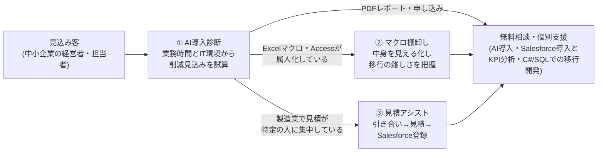

3 つに共通する設計方針は次のとおりです。

- **数字と判定はプログラム、文章と読み取りは AI、最終判断は人。** 金額や削減額を AI に決めさせず、同じ入力なら同じ数字が出るようにしています。
- **AI が使えなくても止まらない。** API キーがない・失敗した・1日の上限に達したときは、AI を使わない標準の結果で続けます(デモも API キーなしで動きます)。
- **送るものを最小にし、送る前に見せる。** 何がブラウザに留まり、何がサーバーや外部の AI に行くかを設計で決めています([architecture.md](architecture.md))。

---

## 1. AI導入診断

### 課題

AI 導入を考え始めた会社は、「どの業務に効くのか」「いくら減らせるのか」が分からないまま止まりがちです。
一方で、汎用の AI に聞くと、根拠の説明できない数字が返ってきます。

### 解決策

業務カテゴリ 10 種の月間時間(全員分の合計)、平均人件費、IT 環境の準備度 6 問に答えると、
年間の削減見込み額(試算)、業務別の内訳、準備度スコア、優先して取り組む施策 5 件、3ヶ月のロードマップを表示します。
結果は PDF でダウンロードでき、同じ画面から無料相談を申し込めます(申し込みは、設定に応じて Salesforce のリードや Slack などに届きます)。

### 画面

| 入力(業務にかかる時間) | 結果(削減見込み・準備度) |
|---|---|
| 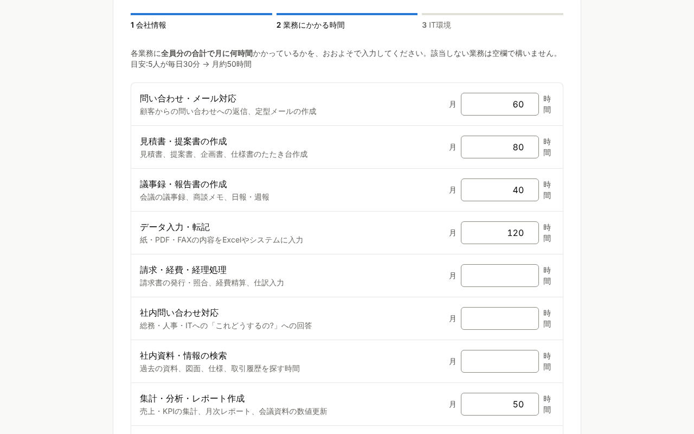 | 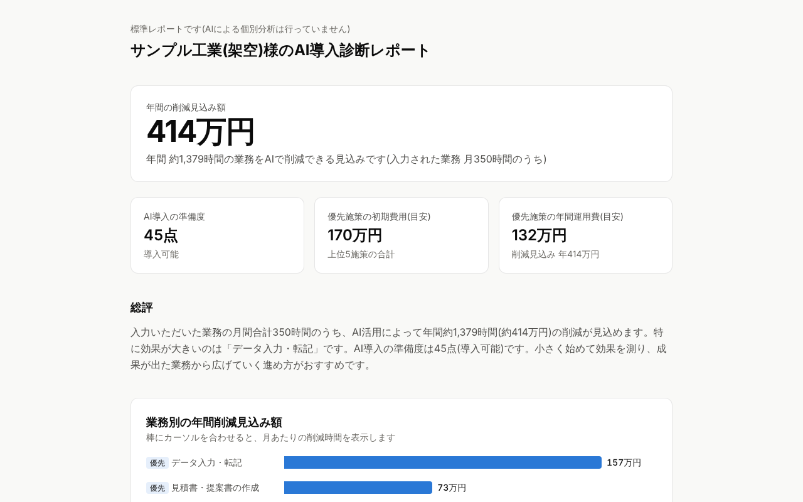 |
| **結果(業務別の内訳・優先施策)** | **PDFレポート(1ページ目)** |
| 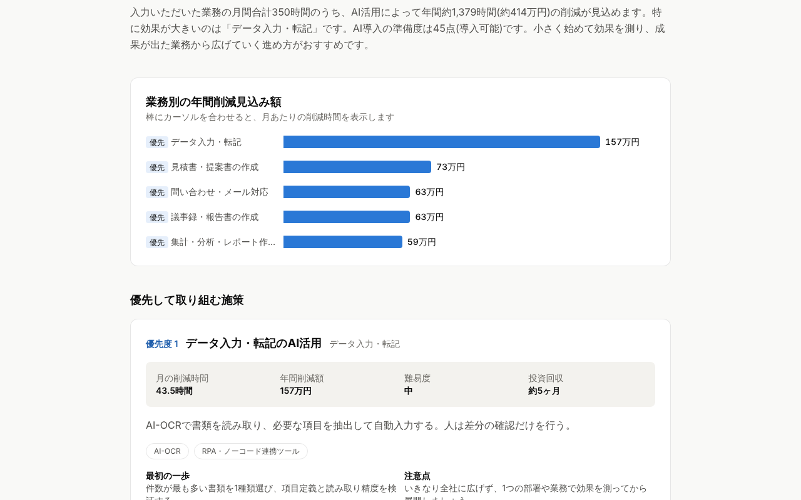 | 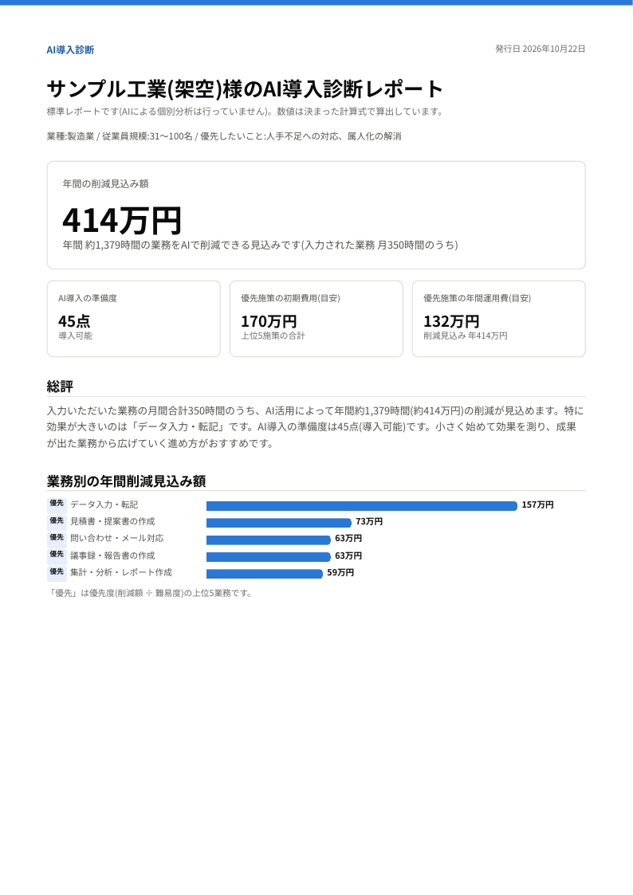 |

(API キーなしで動かしたときの「標準レポート」の画面です。AI を使うと、施策の進め方などの文章が会社に合わせたものになります。数字は同じです。)

### 技術的な工夫

- **数字はプログラム、文章は AI。** 削減時間・削減額・準備度・投資回収の月数は、すべて決まった計算式で出します(係数は1か所に集約)。
  Claude には計算結果を渡し、施策の進め方・注意点・ロードマップの文章だけを構造化出力で書かせます。
- **AI が使えなくても同じ数字。** API キーがない・呼び出しに失敗した・1日の上限を超えたときは、標準の文面でレポートを組み立てます。画面にはその理由を表示します。
- **改ざんできない PDF。** PDF を作るときは、送られてきた結果を使わずサーバーで入力から計算し直します。AI の文章は、診断時にサーバーが付けた署名(HMAC-SHA256、24時間有効)が一致したときだけ使います。
- **日本語の PDF。** `@react-pdf/renderer` と Noto Sans JP で、サーバーだけで PDF を作ります。句読点・括弧の禁則や「216万円」のような数字と単位を分けない改行を自前で実装しました。
- **生成途中のフォールバックでも出力を失わない。** 生成の途中でサーバー側のモデル切り替えが起きた応答では、SDK の自動解析だと途中までの文で例外になり、正しい出力まで失われます。
  これを偽の応答で再現したうえで、切り替え後のテキストを優先して自前で検証する方式にしました(共通部品として 3 ツールで共有)。
- **プロンプトインジェクション対策。** 自由記入欄はタグで囲み、山かっこを全角にしてタグを閉じられないようにしています。指示はシステムプロンプトだけに書きます。会社名は AI への入力に含めません。
- **費用と乱用への対策(公開フォームから有料 API を呼ぶため)。** ハニーポット → 本文と各欄の文字数の上限 → 送信元ごとの回数制限(Upstash Redis でインスタンスをまたいで数え、IP アドレスは鍵つきハッシュにして保存)
  → Cloudflare Turnstile → AI の1日の呼び出し上限(日本時間。数えられないときは費用を優先して AI を呼ばない)の順に止めます。
- **申し込みの連携。** Salesforce の Web-to-Lead で、診断結果の値をカスタム項目に対応付けられます(アプリに API の認証情報を置かずに済む)。Webhook には本文の署名を付けられます。
  ログに個人情報は出しません。本番環境では、受信内容をメールで送る確認用の設定を無効にします。
- **公開サイトとしての整備。** OGP 画像、robots.txt・sitemap.xml、CSP などのセキュリティヘッダー、個人情報や入力値を送らない計測(GA4 / Vercel Web Analytics を切り替え)。

---

## 2. マクロ棚卸し

Excel/VBA・Access の棚卸しツールです。解析エンジンと、それをブラウザで動かす画面アプリからなります。

### 課題

業務が Excel マクロや Access に依存しているのに、作った人が辞めて仕様書もなく、改修や移行の見積もりができない。
しかも顧客のファイルには機密情報が含まれるため、外部のサービスに渡せない、という状況はよくあります。

### 解決策

.xlsm / .xlsb / .xls / .xlsx / .accdb / .mdb などを読み込むと、マクロの一覧、起動のきっかけ、呼び出し関係図、
外部とのつながり(ファイルパス・DB 接続・他のブック・Windows API など)、リスク、移行の難しさの目安をまとめた仕様書を作ります。
HTML・印刷(PDF)・Markdown・JSON で保存できます。

- **標準の仕様書(AI なし)**:ブラウザの中だけで完結し、ファイルも解析結果もサーバーに送りません。
- **AI 版(詳しい解説)**:送信内容を画面で確認して同意したときだけ、抽出済み・伏せ字済みのデータを運営者のサーバー経由で Claude に送ります。

### 画面

| 選択画面(サンプルで試せる) | 結果:概要 |
|---|---|
| 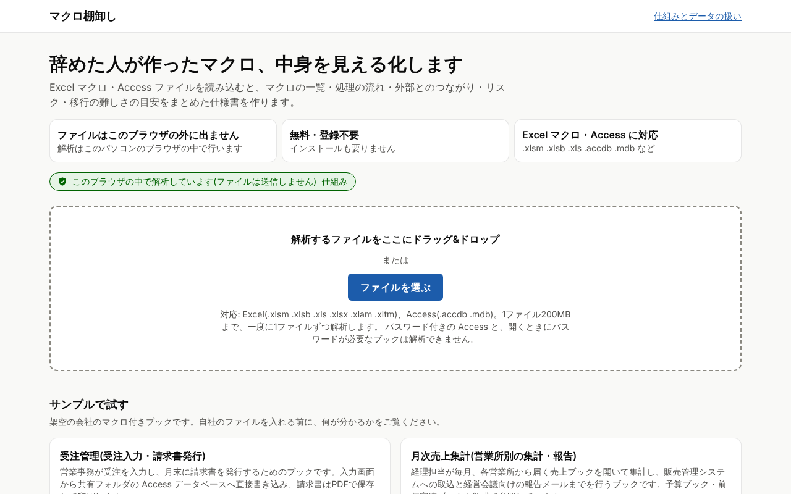 | 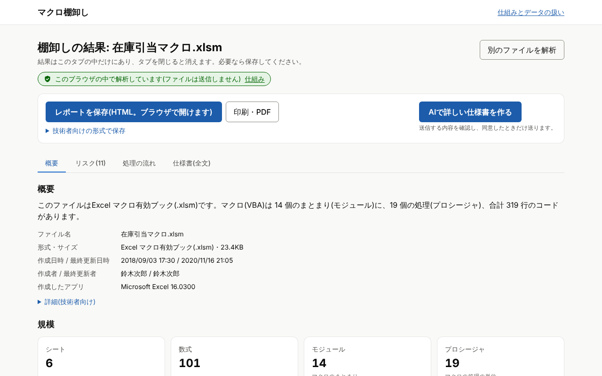 |
| **結果:リスク** | **結果:処理の流れ(呼び出し関係図)** |
| 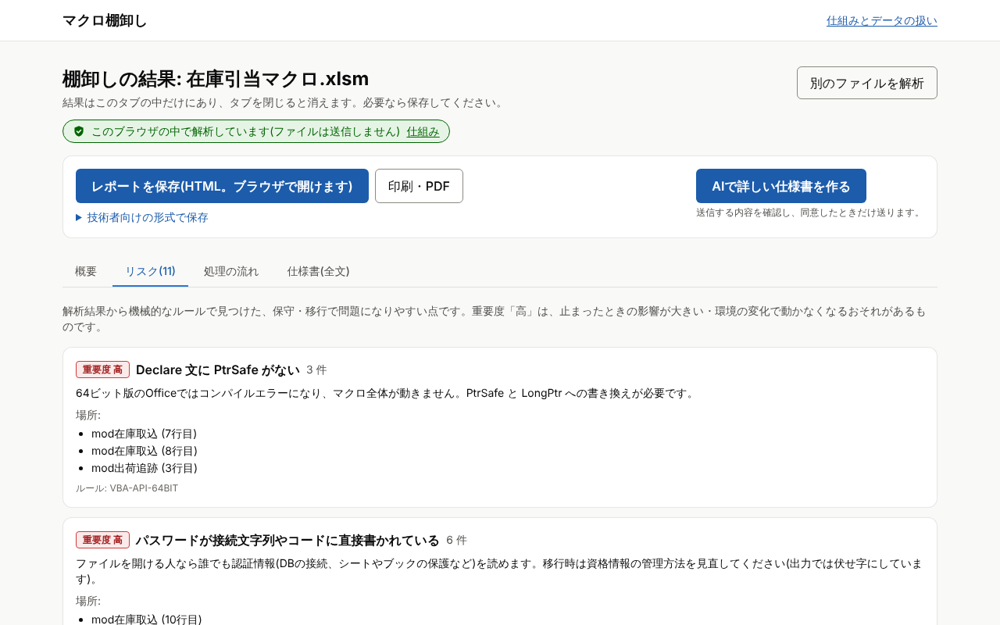 | 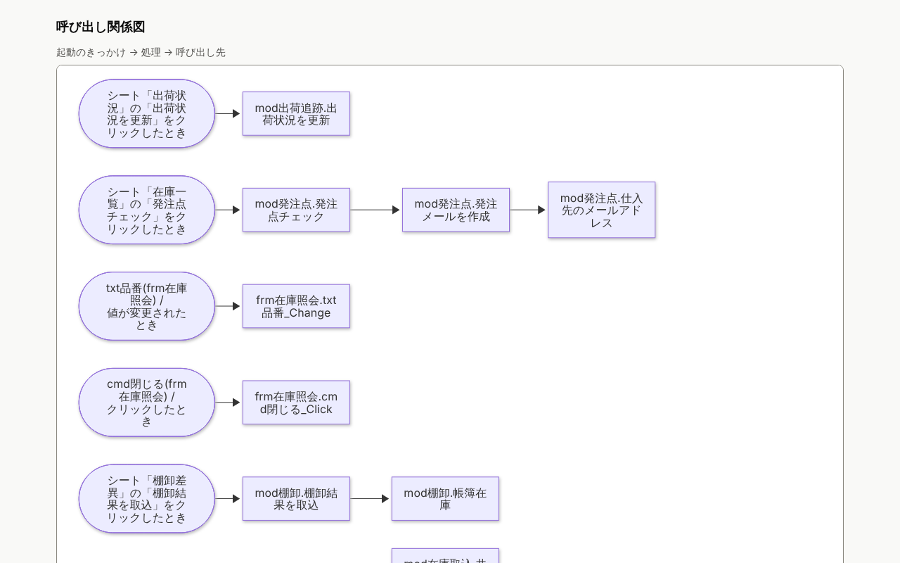 |
| **AI 版の同意画面** | |
| 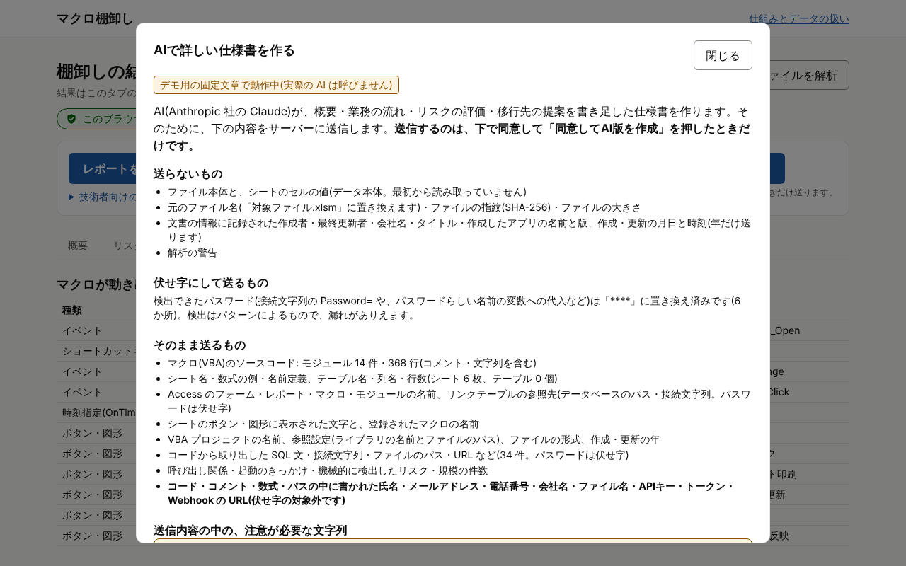 | |

(架空の会社のサンプル「在庫引当マクロ」を解析した画面です。同意画面はデモ用の固定文章で動かしており、実際の AI は呼んでいません。)

### 技術的な工夫

- **VBA の取り出しを仕様書から自前で実装。** Microsoft の公開仕様 MS-OVBA(VBA プロジェクトの圧縮・レコード・暗号化)と MS-CFB(OLE 複合ファイル)に沿って実装し、
  .xlsb・.xls のバイナリ形式も直接読みます(表計算ライブラリに頼らない)。日本語の VBA はコードページ(主に cp932)に従ってブラウザ標準の `TextDecoder` でデコードし、
  従来のライブラリと全文字で一致することを Node.js とブラウザの両方で確認しています。Node.js・ブラウザの両方で動く1つのエンジンです。
- **「送らない」を説明ではなく仕組みで保証。**
  - ファイルを読むのは Web Worker だけ。Worker のスクリプトには `connect-src 'none'` などの CSP を付け、同じサーバー宛てでも通信をブラウザが止めます。
  - 加えて、Worker の起動時に通信・保存に使える API を無効化し、ビルド時にもバンドルに通信の書き方がないことを検査します(三重の守り)。
  - 画面側で通信を書ける場所は 2 か所だけに ESLint で制限。外部のオリジンは CSP で 1 つも許可せず、計測タグ・外部フォント・CDN も使いません。
  - 結果はタブのメモリにだけ置き、URL・localStorage・Cookie に保存しません。ページを開いた後は機内モードでも解析できます。
  - **E2E テストで毎回**、解析を始めた後に新しいリクエストが 0 件であること、CSP 違反が 0 件であること、オフラインで解析できることを確かめています。
- **AI 版の同意画面と伏せ字。** 送らないもの/伏せ字にして送るもの/そのまま送るものを示し、プレビュー・「送信内容を保存」・実際の送信は同じ文字列です。
  パスワードは解析の前に `****` に置き換え、伏せ字にできない注意が必要な文字列(メールアドレス・API キーの形など)は一覧で警告します。元のファイル名や作成者は送りません。
- **信頼できないファイルへの対策。** zip 爆弾、セクタチェーンやディレクトリの循環、異常な宣言サイズなどに上限を設け、壊れたファイルでも「結果を返すか、理由のわかるエラーで止まる」ようにしています。
  シードを固定したファジング(バイト反転・切り詰め・挿入など)で確かめています。
- **事実は機械的に、文章は AI に。** 件数・依存・リスク・図の構文は抽出結果から作り、AI には要約・業務フロー・移行先の提案だけを書かせます。大きなファイルはモジュール単位で要約してから統合し、省いた部分は仕様書に明記します。
- **プロンプトインジェクション対策。** ファイル由来の文字列(コメント・シート名など)はデータ用のタグに入れて区切りを無害化し、命令文のような文は「気になる点」として記録させます。
  仕様書の Markdown はエスケープし、HTML・リンク・画像として動かないようにしています。
- **費用と乱用への対策。** AI 版は既定でアクセスコード(16 文字以上)が必要で、誤入力の回数も制限します。送信元ごとの1時間の回数、サイト全体の1日の回数と推定入力トークンに上限があり、
  サーバーレス環境では共有ストアがなければ AI 版を使いません(接続できないときも受け付けない)。

---

## 3. 見積アシスト

製造業(部品加工)向けの、引き合い対応・見積作成のアシスタントです。

### 課題

部品加工の見積は、図面とメールを読み、過去の似た案件を思い出し、単価表で計算する作業です。これが社長や工場長に集中し、回答が遅れます。
過去に実績工数が見積を超えた案件や不具合の教訓も、担当者の記憶にしか残っていません。

### 解決策

引き合いメールと図面 PDF から、品名・図番・材質・数量・公差・表面処理などを確信度と根拠つきで読み取り、顧客への確認事項と確認メール案を作ります。
過去案件から類似案件を探し、単価表と工数から見積根拠・数量段階別の単価・見積書案・回答メール案を作ります。
人が修正・承認した見積だけを、Salesforce に商談+見積として登録します。

### 画面

| 抽出結果(確信度と根拠つき) | 類似案件(実績と警告つき) |
|---|---|
| 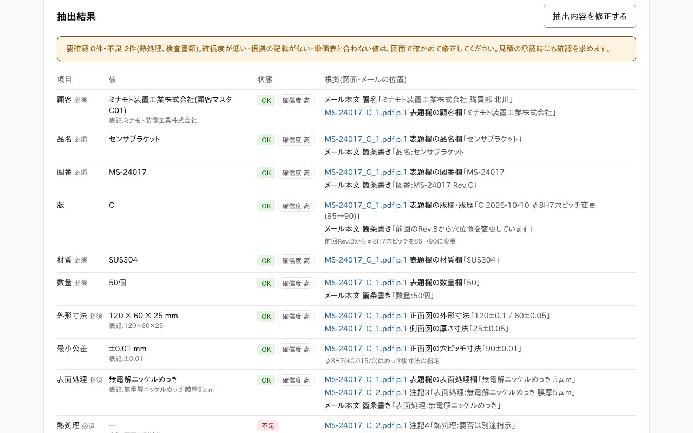 | 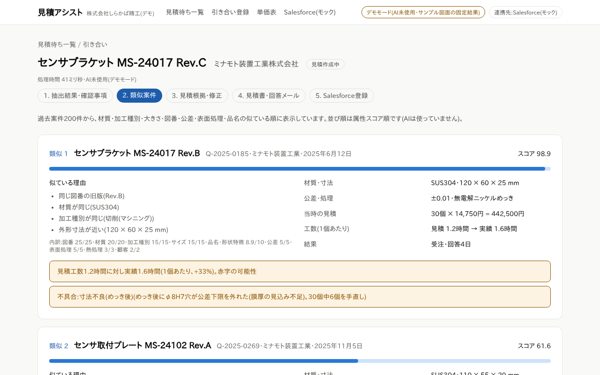 |
| **見積明細(計算式と出典つき)** | **承認(未確認項目の確認つき)** |
| 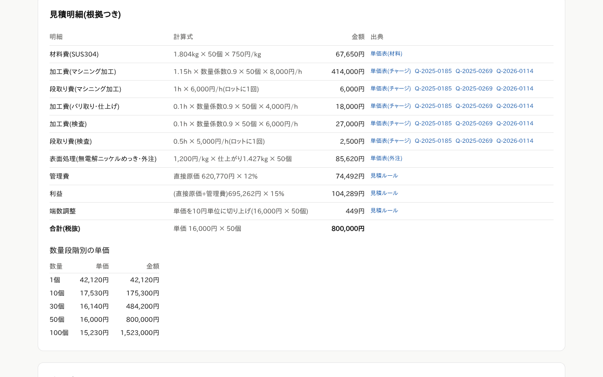 | 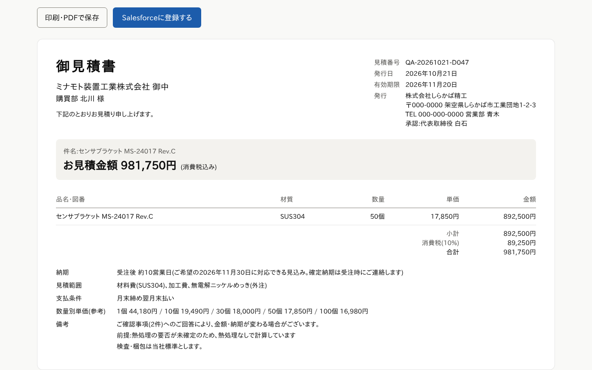 |

(デモモードの画面です。AI の代わりに、AI が返すのと同じ形の決まった読み取り結果を表示しています。会社・人物・図面・金額はすべて架空です。)

### 技術的な工夫

- **読み取りと文章は AI、計算と判定はプログラム、最終決定と送信は人。**
- **根拠を見せる読み取り。** 抽出項目ごとに確信度と根拠(図面のファイル名・ページ・位置・原文の引用、メールのどの文か)を表示します。確信度が低い・根拠がない・単価表と合わない値は「要確認」、読み取れない必須項目は「不足」にします。
- **金額は AI に決めさせない。** 材料費・工程別の加工費と段取り費・外注費・特急料金・管理費・利益を純粋関数で計算し、明細ごとに計算式と出典(単価表・過去案件)を表示します。
  10 進の整数演算で計算し、浮動小数点の誤差で明細の式と手計算が 1 円ずれることを防いでいます。
- **AI の提案は検証してから使う。** 工程別の工数案には根拠となる過去案件の id を必須にし、存在しない工程・候補にない案件・範囲外の値は捨てて、類似案件の実績からの計算値で置き換えます。
- **類似案件検索。** 図番・材質・加工種別・サイズ・文字 2-gram・公差などの配点で過去案件を全件採点します(外部のベクトル DB を使わない)。実績工数が見積を超えた案件・金額が合わずに失注した案件・不具合履歴を警告します。
- **承認ゲート。** 未確認の項目が残る承認は確認のチェックを必須にし、サーバーでも断ります(409)。承認時の合計金額が今の単価表での計算と違えば承認しません。
  Salesforce への登録は承認済みだけで、二重登録は断り、送信後に通信が切れたときは自動で再送しません。
- **Salesforce 連携。** OAuth 2.0 クライアントクレデンシャルフローと Composite API(全件成功か全件取り消し)で、商談と見積を 1 回のリクエストで作ります。送る内容は純粋関数で組み立てて単体テストしています。デモはモックです。
- **機密情報の扱い。** 図面 PDF は自社が管理する保存先にだけ置き、Claude API にはリクエスト本文で送ります(Files API は使わない)。ログには引き合い id・処理時間・トークン数・エラーの種類だけを出します。
  PDF は先頭のバイトで形式を確かめ、大きさ・件数・メール本文の長さに上限を設けています。
- **プロンプトインジェクション対策。** 図面・メールに書かれた指示には従わないよう指示し、メール本文とファイル名は山かっこを全角にしてタグの中に入れます。AI には道具(tool)を渡さず、出力はスキーマと正規化で検証します。
- **誤公開の防止。** 利用者ごとの認証はまだないため、本番ビルドは Basic 認証の設定がなければすべてのリクエストを 401 にします。AI の呼び出しには1日の上限があります。
- **効果を数字で追える。** 引き合いごとに処理時間・トークン数・AI の概算費用・登録から承認までの時間・AI 案の採用率・修正の記録を残します(導入後の KPI 分析の材料)。
- **合成データとデモの自動化。** 架空の加工会社の過去案件 200 件・顧客 20 社・単価表・図面 PDF を、乱数の種を固定して生成します。5 分デモの台本どおりに画面を操作し、スクリーンショットと録画を作るスクリプトもあります。

---

## 共通部品と品質

### 共通部品(packages/shared)

3 つの Web アプリと解析エンジンで重複していた部品を 1 か所にまとめ、各アプリが TypeScript のソースのまま取り込んでいます。

- セキュリティヘッダー(CSP など)、送信元の判定と上限つきの本文の読み取り
- 回数制限、日本時間の 1 日の上限の数え方、Upstash Redis のクライアント
- 例外の種類の取り出し(本番ビルドでクラス名が短くなってもログで種類が分かる)
- Claude の構造化出力の検証(生成途中のフォールバックへの対応)

実行時の依存(npm パッケージ)を持たず、Claude SDK や zod はアプリから引数で受け取ります(別の実体になって `instanceof` や設定が合わなくなるのを防ぐため)。

### テストと CI

件数は 2026年10月22日時点のものです。単体テストは `vitest run` を実行して通った件数、E2E は `playwright test --list` で数えた件数です(E2E は CI で本番ビルドに対して実行)。

| 対象 | 単体テスト(Vitest) | E2E(Playwright) | CI(GitHub Actions)で実行すること |
|---|---:|---:|---|
| ① AI導入診断 | 276 | 17 | 型チェック → リント → 単体テスト → ビルド → E2E |
| ② 解析エンジン | 159 | — | 型チェック → 単体テスト(ファジング含む) → ブラウザ用バンドル → ブラウザでの解析結果が Node.js と一致するかの確認 |
| ② 棚卸しの画面 | 94 | 24 | 型チェック → リント → 単体テスト → ビルド → E2E |
| ③ 見積アシスト | 228 | 6 | 型チェック → リント → 単体テスト → ビルド → E2E |
| 共通部品 | 74 | — | 型チェック → 単体テスト |
| **合計** | **831** | **47** | |

- 外部への接続(Claude API・Salesforce・Upstash・Turnstile など)は、単体テストではすべてモックし、E2E では外部に接続しない設定で動かします。
- 共通部品を変えると、それを使うすべてのアプリの CI が動きます。
- E2E では、通常の操作のほか、スマホ幅・キーボード操作・ダークモードの表示、費用の上限に達したときの動き、通信が 0 件であることなども確かめています。

---

## 技術スタック

| 区分 | 使っているもの |
|---|---|
| 言語・実行環境 | TypeScript、Node.js 22 |
| Web | Next.js 16(App Router)、React 19、Tailwind CSS v4、zod |
| AI | Claude API(`@anthropic-ai/sdk`、モデル `claude-opus-5-5`)、構造化出力、サーバー側フォールバック |
| PDF・図 | `@react-pdf/renderer` + Noto Sans JP(診断レポート)、pdf-lib(デモ用図面の生成)、Mermaid(処理の流れ図) |
| ファイル解析 | 自前の MS-OVBA / MS-CFB / BIFF の読み取り、fflate、fast-xml-parser、mdb-reader、esbuild(Web Worker のバンドル) |
| 外部サービス | Salesforce(Web-to-Lead、REST・Composite API)、Upstash Redis、Cloudflare Turnstile、Slack などの Webhook、GA4 / Vercel Web Analytics |
| テスト・CI | Vitest、Playwright、GitHub Actions |
| 公開先の想定 | Vercel(見積アシストは社内・専用環境) |

構成とデータの流れ、セキュリティ設計の要点は [architecture.md](architecture.md) にまとめています。

---

## デモの見方

### 1. スクリーンショット

このリポジトリの [screenshots/](screenshots/) にあります(1280px 幅・ライトモード・すべて架空データ)。

### 2. オンラインで試す

- AI導入診断:【デモURL(公開している場合)】
- マクロ棚卸し:【デモURL(公開している場合)】(「サンプルで試す」で架空の会社のマクロを解析できます)
- 見積アシスト:認証のない MVP のため公開していません。オンラインでの画面共有か録画でご覧いただけます。

### 3. 手元で動かす(ソースコードの閲覧をご希望の方向け)

ソースコードは現在非公開です。閲覧をご希望の場合は【連絡先】までご相談ください。共有したソースでは、次の手順で **API キーなしのデモモード** で動きます(Node.js 22 以上)。

リポジトリのルートから、それぞれ次のように起動します。

```bash
# ① AI導入診断(API キーがなければ標準レポートで動く)
cd apps/diagnosis
npm install
cp .env.example .env.local   # すべて空のままでよい
npm run dev                  # http://localhost:3000
```

```bash
# ② マクロ棚卸し(AI 版なし。「サンプルで試す」から解析できる)
cd apps/inventory-web
npm install                  # 解析エンジンの依存は初回の起動時に自動で入る
npm run dev                  # http://localhost:3400

# AI 版の同意画面まで見るときは本番ビルドで(デモ用の固定文章。外部には送らない)
npm run build
INVENTORY_AI_MODE=mock npm start   # http://localhost:3401
```

```bash
# ③ 見積アシスト(API キーがなければデモモード。Salesforce はモック)
cd apps/quote-assist
npm install
cp .env.example .env.local   # ANTHROPIC_API_KEY は空のままでよい
npm run dev                  # http://localhost:3300

# 本番ビルドは Basic 認証の設定がないと 401 になる。手元で確かめるときだけ解除する(社外に公開しない)
npm run build
QUOTE_ASSIST_ALLOW_NO_AUTH=true npm start   # http://localhost:3000
```

テストは各アプリで `npm test`(単体)と `npm run test:e2e`(E2E。Playwright の Chromium が必要)です。

---

## そのほかの成果物(非公開)

- 各ツールの技術設計書、5 分デモの台本、読み取り精度の評価スクリプト(ソースコードと同じ非公開リポジトリにあります)
- 営業資料一式あり(非公開)

## 連絡先

- 会社名:【会社名】
- 氏名:【氏名】
- メール:【メールアドレス】
- Web サイト:【WebサイトURL】
- お問い合わせ:【問い合わせフォームURL】

## 著作権・ライセンス

- このリポジトリの文章・画像の著作権は【著作権者(会社名または氏名)】に帰属します。© 【発行年】 【著作権者】
- 利用条件:【ライセンス(例:無断転載を禁じます / CC BY 4.0 など)】
- このリポジトリにはソースコードは含まれていません。
- PDF レポートの画面には Noto Sans JP(SIL Open Font License 1.1)を使っています。
- 記載している会社名・製品名(Salesforce、Claude、Excel、Access など)は、各社の商標または登録商標です。
