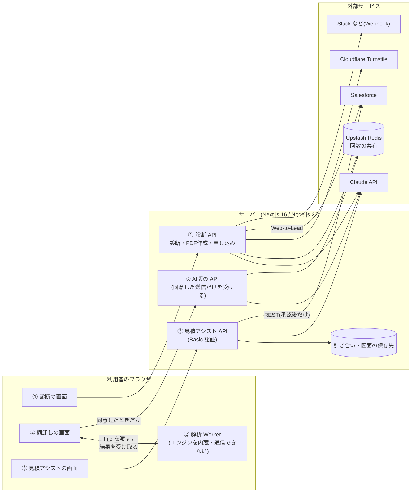
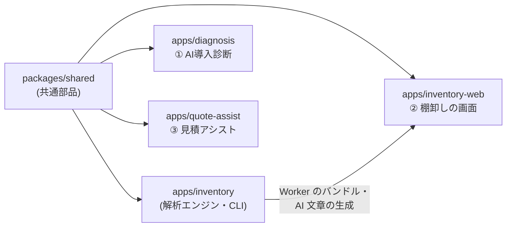

# 構成とセキュリティ設計

3 つのツール(AI導入診断・マクロ棚卸し・見積アシスト)と共通部品の構成、データの流れ、セキュリティ設計の要点をまとめます。
ツールごとの説明と画面は [README.md](README.md) を参照してください。

## 1. 構成図

### 実行時の構成

### コードの構成

| 部品 | 役割 |
|---|---|
| ① AI導入診断 | 公開の診断サイト。入力から削減見込みを計算し、AI でレポートの文章を作る。PDF の作成と無料相談の申し込みを受ける |
| ② 解析エンジン | Excel/VBA・Access の解析ライブラリと CLI。Node.js 固有の API を使わず、ブラウザでも同じコードで動く |
| ② 棚卸しの画面 | 解析エンジンをブラウザの Web Worker で動かす画面アプリ。AI 版の生成だけサーバーを使う |
| ③ 見積アシスト | 社内・専用環境向けのアプリ。引き合いの読み取りから見積・承認・Salesforce 登録までを扱う |
| packages/shared | 上の 4 つで共通の部品。ビルドせず、TypeScript のソースのまま各アプリが取り込む。実行時の依存を持たない |

各アプリは独立した `package.json` とロックファイルを持ち、別々にビルド・デプロイできます。CI もアプリごとに分かれ、共通部品を変えると関係するすべてのアプリの CI が動きます。

## 2. データの流れ(何がどこへ行くか)

### ① AI導入診断

| データ | ブラウザ | サーバー | 外部の AI(Claude) | そのほかの外部 |
|---|---|---|---|---|
| 業種・従業員規模・優先したいこと | 入力 | 検証して計算に使う | 送る | 申し込み時に要約を送る |
| 業務ごとの月間時間・人件費・準備度 | 入力 | 決まった式で計算 | 計算結果として送る | 申し込み時に要約を送る |
| いま困っていること(自由記入) | 入力(外部の AI に送ることを画面で注記) | タグを無害化 | 送る | — |
| 会社名 | 入力 | PDF の宛名に使う | **送らない** | 申し込み時だけ |
| 申し込みの連絡先 | 入力 | 検証して転送。ログには伏せ字でしか出さない | **送らない** | Salesforce(Web-to-Lead)・Webhook |
| 計測 | イベント名と付加情報 | — | — | GA4 / Vercel Web Analytics(個人情報・入力した数値は送らない) |

PDF を作るときは、ブラウザから送られた計算結果を使わず、サーバーで入力から計算し直します。AI の文章は、診断時にサーバーが付けた署名が一致したときだけ使います。

### ② マクロ棚卸し

| データ | ブラウザ(Worker) | サーバー | 外部の AI(Claude) |
|---|---|---|---|
| ファイル本体 | Worker だけが読む | **送らない** | **送らない** |
| セルの値(データ本体) | 最初から読まない | — | — |
| 元のファイル名・作成者・会社名などの文書情報 | 画面に表示 | **送らない**(ファイル名は置き換え) | **送らない** |
| パスワード | 解析の前に `****` に置き換え | 伏せ字のものだけ | 伏せ字のものだけ |
| VBA のソース・SQL・シート名・列名・依存などの抽出結果 | Worker で抽出 | 利用者が送信内容を確認して**同意したときだけ** | 同意したときだけ |
| 解析結果 | タブのメモリだけ(URL・localStorage・Cookie に保存しない) | — | — |

標準の仕様書(AI なし)の作成は、ページを開いた後はネットワークを切っても完結します。
サーバーのログは 1 リクエスト 1 行で、結果・件数・処理時間・推定トークン数・エラーの種類だけを出します。

### ③ 見積アシスト

| データ | ブラウザ | サーバー | 外部の AI(Claude) | Salesforce |
|---|---|---|---|---|
| 引き合いメール・図面 PDF | アップロード | 自社が管理する保存先に保存 | リクエスト本文で送る(Files API は使わず、Anthropic 側にファイルを置かない) | — |
| 抽出結果・類似案件の候補 | 表示・修正 | 正規化・検証・保存 | 類似案件の並べ替えと工数案のために送る | — |
| 見積の金額 | 表示・修正・承認 | **プログラムで計算** | 金額は作らせない | 承認後だけ商談+見積として登録 |
| ログ | — | 引き合い id・処理時間・トークン数・エラーの種類だけ | — | — |

## 3. セキュリティ設計の要点

### 共通

- **セキュリティヘッダー。** 全ページに CSP・`X-Frame-Options`・`X-Content-Type-Options`・`Referrer-Policy`・`Permissions-Policy`・HSTS を付けます(共通部品)。許可する送信先は、その機能を設定してビルドしたときだけ足します。
- **AI の出力を信用しない。** 構造化出力はスキーマで検証してから使います。辞退や出力上限での途中切れは、解析エラーではなく理由のわかる例外にして、AI を使わない処理に切り替えます。
  生成の途中でサーバー側のモデル切り替えが起きた応答でも、切り替え後の出力を検証して使います。
- **プロンプトインジェクション対策。** 指示はシステムプロンプトだけに書き、利用者やファイル由来のデータはタグで区切って、タグを閉じられないように無害化します。AI に道具(tool)は渡しません。
- **費用と乱用への対策。** 送信元ごとの回数制限、サイト全体の 1 日の上限(日本時間)、本文の大きさの上限を共通部品で実装しています。
  回数は Upstash Redis で全インスタンス共通に数え、キーには IP アドレスをそのまま置かず鍵つきの HMAC-SHA256 にします。送信元は Vercel が付けるヘッダーなど偽装できないものだけで判定します。
- **ログ。** 個人情報・入力の本文・ファイルの中身・API キーは出しません。例外はクラスで照合して種類だけを記録します。

### ① AI導入診断

- ハニーポット、各欄の文字数の上限、Cloudflare Turnstile(入力の検証の後・AI を呼ぶ前に確認)。
- AI の 1 日の上限は、呼ぶ前に数えます(失敗した呼び出しも数える)。数えられないときは費用を優先して AI を呼びません。
- PDF の数値は計算し直し、AI の文章は HMAC 署名(24 時間有効)で改ざんを検出します。利用者が入力した文字は文字として描くだけで、リンクや HTML にしません。
- 申し込みは、本番で送信先が未設定なら受け付けず(誰にも届かないまま受け付けたことにしない)、Slack 宛てでは一斉通知の記法を無効にし、Webhook には署名を付けられます。

### ② マクロ棚卸し

- 解析 Worker のスクリプトに `default-src 'none'; connect-src 'none'; script-src 'none'; worker-src 'none'` の CSP を付け、Worker からの通信・スクリプトの読み込み・入れ子の Worker をブラウザに止めさせます。
- Worker の起動時に通信・保存の API をプロトタイプまで含めて無効化し、ビルド時にバンドルに通信の書き方がないことを検査します。画面側で通信を書ける場所は ESLint で 2 か所に限ります。
- E2E で、解析を始めた後のリクエストが 0 件であること、CSP 違反が 0 件であること、オフラインで解析できることを毎回確かめます。
- 信頼できないファイルに対して、入力・展開後のサイズ・エントリ数・時間に上限を設け、循環する構造を検出します。壊れた入力は理由のわかるエラーで止めます(ファジングで確認)。
- 仕様書の Markdown では、ファイル由来の文字列と AI の文章をエスケープし、図のラベルも無害化します。
- AI 版は、同意画面のプレビューと実際の送信が同じ文字列です。サーバーでも送らない項目を外し直します。アクセスコード(16 文字以上)を既定で必須にし、誤ったコードの試行回数も制限します。
  サーバーレス環境では、共有ストアがない・接続できないときは AI 版を受け付けません(フェイルクローズ)。

### ③ 見積アシスト

- 利用者ごとの認証がない MVP のため、本番ビルドは Basic 認証の設定がなければすべてのリクエストを 401 にします(手元・社内で使うときだけ明示的に解除できる)。
- 受け付ける PDF は先頭のバイトで形式を確かめ、1 ファイル・合計の大きさ・件数・メール本文の長さに上限を設け、上限を超えたら読みながら打ち切ります。ファイル名は保存先のパスに使いません。
- 承認ゲート:未確認の項目が残る承認は確認を必須にし、承認時の金額が今の単価表での計算と違えば断ります。CRM 登録は承認済みだけで、同じ引き合いへの操作は 1 件ずつ順番に処理し、二重登録を防ぎます。
- 上流のエラーの内容は画面に返さず、定型文だけを返します。

## 4. 制約と、まだ確かめていないこと

- 見積アシストの、実際の Claude API での読み取り精度・処理時間・費用は未計測です(評価用のスクリプトと正解ラベルは用意済み)。
- 見積アシストの Salesforce 本番接続は、通信をモックした単体テストだけで、実際の組織への接続は未検証です。
- マクロ棚卸しは、Access のフォーム・レポートの画面定義とマクロの中身は解析しません(名前の一覧のみ)。パスワードの伏せ字はパターンによる検出のため、漏れがありえます(同意画面にもそう表示しています)。
- ブラウザの拡張機能はページの内容を読める場合があります。機密性の高いファイルは、拡張機能を無効にしたウィンドウで使うよう画面で案内しています。
