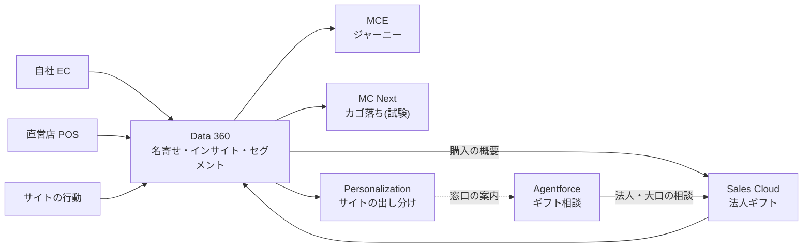

# Salesforce ポートフォリオ:データ統合から配信・営業・AI エージェントまで(架空の茶葉 D2C)

【氏名】の Salesforce のポートフォリオです。
約 3 年間、Marketing Cloud Engagement(MCE)・Data 360・Marketing Cloud Next(MC Next)・Salesforce Personalization・Sales Cloud・Agentforce の導入と運用に携わってきました。

実案件は守秘義務があるため載せていません。代わりに、架空の茶葉 D2C「しずく茶舗(架空)」を題材に、
6 つの製品をつないだ顧客基盤を、課題の整理から設計・実装・効果の測り方まで作り直しました。

> **会社・人物・商品・数値はすべて架空です。** KPI の目標値も架空で、実績ではありません。
> 勤務先や顧客の組織・データは使っていません。実在の企業・人物・案件とは関係ありません。

## このポートフォリオで示していること

- **製品をまたいだ設計**:誰のデータをどこに置き、どの製品で何を判断するかを決め、その理由を書いています
- **日本の B2C ならではの論点**:異体字の名寄せ、家族で同じ電話番号、総務部の共有アドレス、特定電子メール法・景品表示法・薬機法
- **確かめられる成果物**:Apex(単体テストつき)・メタデータ・MCE のコード、それに架空データと「名寄せ後の人数」「セグメントの人数」の期待値
- **効果の測り方**:すべての施策に対照群を残し、必要な期間を事業の規模から逆算しています

## 製品ごとの経験と成果物

| 製品 | 実務での経験(約 3 年) | このポートフォリオの成果物 | 形式 |
|---|---|---|---|
| Data 360 | 【例:データストリーム・ID 解決・セグメントの設計と構築、〇社】 | 取り込み・DMO の対応・名寄せのルール・インサイト・セグメント・同意の設計、期待値で検算できる架空データ | 設計書+組織で構築 |
| MCE | 【例:ジャーニー〇本、AMPscript・SQL・CloudPage の開発と運用】 | ジャーニー・DE の設計、SQL 5 本、AMPscript のメール 3 通、配信設定ページ(SSJS) | コードと設計書 |
| MC Next | 【例:MCE からの移行の検討・構築】 | MCE との違い、移行の順番の決め方、カゴ落ちの試験設計 | 設計書 |
| Personalization | 【例:サイトの出し分け〇か所、サイトマップの実装】 | 出し分け 4 か所の判断ロジック、イベント設計、サイトマップ、必要な期間の計算 | コードと設計書 |
| Sales Cloud | 【例:初期導入・運用支援、レポートと KPI 分析】 | 法人ギフトの商談・リード・自動化・ダッシュボードの設計、項目と権限のメタデータ | 設計書+組織で構築 |
| Agentforce | 【例:エージェントの設計・アクションの開発】 | ギフト相談エージェント:トピックと指示、Apex のアクション 2 つ(テストつき)、プロンプトテンプレート、テストケース 20 件 | コード+組織で構築 |

MCE と Personalization は個人で使える無料の環境がないため、動く画面ではなくコードと設計書で示しています。

## 題材:しずく茶舗(架空)

自社 EC・直営店 2 店舗・法人ギフトで茶葉を売る D2C ブランドです。

| いまの課題 | 目指す姿 | 主な製品 |
|---|---|---|
| 店舗と EC の顧客が別々で、同じ人か分からない | 1 人ずつにまとめ、購買を合算して見る | Data 360 |
| メールが全員に同じ内容 | 好みと購入の段階で、内容と頻度を変える | MCE → MC Next |
| 初回購入で終わる人が多い(2 回目購入率 約 30%) | 2 回目までの流れをメールとサイトで設計する | MCE・Personalization |
| 法人ギフトが Excel 管理で、毎年の再提案が漏れる | 商談として管理し、リピートを仕組みで提案する | Sales Cloud |
| 繁忙期にギフトの相談への返信が遅れる | 24 時間答え、法人・大口は担当者につなぐ | Agentforce |

## 全体の構成



詳しい図とデータの流れは [docs/01-scenario.md](docs/01-scenario.md) にあります。

## 設計で判断したこと(抜粋)

1. **B2C の顧客は Sales Cloud に入れない。** 個人の顧客は Data 360 で扱い、Sales Cloud は法人ギフトだけにしました。法人の担当者が個人として EC でも買っていれば、名寄せで分かるので、営業の画面には購入の概要だけをコピーします。→ [01](docs/01-scenario.md)・[03](docs/03-sales-cloud.md)
2. **電話番号だけでは名寄せしない。** 店舗の会員カードは家族で同じ電話番号を書くことが多いので、「氏名+電話番号」にしました。異体字(髙/高、﨑/崎)は取り込み時に正規化し、総務部の共有アドレスはメールの一致に使いません。架空データには正解を埋め込んであり、ルールを誤るとどうずれるかを数字で示しています(電話番号だけで統合すると 68 人少なくなる)。→ [02](docs/02-data360.md)
3. **MCE の購読者キーに統合 ID を使わない。** 統合 ID は名寄せをやり直すと変わることがあり、配信停止の状態が別の人に付いてしまうためです。EC会員ID にそろえました。→ [02](docs/02-data360.md)・[04](docs/04-mce.md)
4. **集計は Data 360、送る直前の調整は MCE。** 購買の合算は Data 360、1 人ずつのおすすめと送りすぎの除外は配信の直前に MCE の SQL で作ります。SQL・AMPscript の時刻が米国中部標準時であることも設計に入れています。→ [04](docs/04-mce.md)
5. **MC Next へは、Data 360 とのつながりが強い新しい施策から。** カゴ落ちを対照群つきで試し、AMPscript への依存が強いジャーニーは後にします。並べて使う間は、送りすぎの判定を Data 360 に置きます。→ [05](docs/05-mc-next.md)
6. **出し分けは必ず対照群で測り、期間は規模から逆算する。** 相対 10% の改善を見分けるには 1 群 約 77,000 件が要るので、対照群を 20% にし、件数の多いカート追加率を主な指標にしました。→ [06](docs/06-personalization.md)
7. **エージェントの「数字と判定」はプログラム、文章は AI、約束は人。** 商品の候補・価格・重複の判定は Apex が行い、エージェントは説明するだけです。注文状況は本人確認ができないので扱わず、健康効果(薬機法)は言わせません。→ [07](docs/07-agentforce.md)
8. **法人の見込み客(S6)に営業電話をしない。** 個人として買った情報を本人の知らないところで営業に回さず、窓口があることをメールとサイトで案内し、本人からの相談でリードにします。→ [02](docs/02-data360.md)

## KPI(目標は架空)

| KPI | 現状(架空データ) | 目標(架空) |
|---|---:|---:|
| 2 回目購入率(初回から 90 日以内) | 30.2% | 35% |
| 出し分け枠のクリック率(対照群との差) | — | +10%(相対) |
| 前年の受注先へのリピート提案の漏れ | 不明(Excel 管理) | 0 件 |
| 法人の相談への 2 営業日以内の初回連絡 | — | 95% 以上 |
| 法人の相談のうちエージェント経由 | 0% | 30% |
| 名寄せ後の人数と期待値の一致 | — | 一致(差は理由を説明できる) |

## 成果物

```
salesforce/
├── docs/
│   ├── 01-scenario.md          題材・課題・全体の構成・役割分担・KPI・進め方
│   ├── 02-data360.md           取り込み・データモデル・名寄せ・インサイト・セグメント・同意
│   ├── 03-sales-cloud.md       法人ギフトの商談・リード・フロー・ダッシュボード・権限
│   ├── 04-mce.md               DE・ジャーニー・オートメーション・法令・配信設定ページ
│   ├── 05-mc-next.md           MCE との違い・移行の順番・カゴ落ちの試験
│   ├── 06-personalization.md   出し分け 4 か所・イベント設計・必要な期間の計算
│   ├── 07-agentforce.md        ギフト相談エージェント(トピック・アクション・安全・テスト)
│   └── 08-build-guide.md       自分の組織での再現手順・スクリーンショット・公開前の確認
├── force-app/                  項目・グローバル値セット・権限セット・Apex(アクション 2 つとテスト)
├── mce/                        SQL 5 本・AMPscript のメール 3 通・フッター・配信設定ページ
├── personalization/sitemap.js  サイトマップ(イベントと出し分けの枠)
├── agentforce/                 プロンプトテンプレート・テストケース 20 件
├── data360/                    Ingestion API のスキーマ(生成)
├── data/                       架空データ(EC・店舗・行動・メール・法人)と期待値(生成)
└── scripts/                    架空データの生成スクリプト(乱数の種と基準日を固定)
```

## 確かめ方

```bash
npm install
npm run check-data   # 架空データ・スキーマ・期待値が、生成スクリプトの出力と一致しているか
npm run lint:apex    # Apex の構文と書式
```

Apex の単体テストは、自分の組織にデプロイして実行します(手順は [docs/08-build-guide.md](docs/08-build-guide.md))。

## 画面

【組織で構築した後に、`screenshots/` の画像を差し込む(一覧は docs/08-build-guide.md の 6)】

## 連絡先

【メールアドレス・LinkedIn など】
