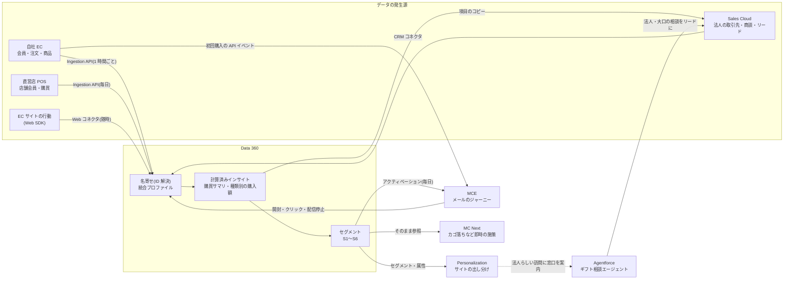

# 01. 題材と全体の設計

> 会社・人物・数値はすべて架空です。KPI の目標値も架空で、実績ではありません。

## 1. 題材:しずく茶舗(架空)

静岡の茶葉を扱う D2C(自社で作って自社で売る)ブランドです。

| 項目 | 内容(架空) |
|---|---|
| 売り方 | 自社 EC(売上の約 70%)、直営店 2 店舗(約 20%)、法人ギフト(約 10%) |
| 会員 | EC 会員 約 12 万人、店舗会員 約 4 万人(架空データはその 1/100 の規模で作っています) |
| 商品 | 煎茶・玉露・抹茶・ほうじ茶・和紅茶・茶器・ギフトセット(29 品) |
| 季節性 | お中元(6〜7 月)・お歳暮(11〜12 月)にギフトの注文が集中する |
| 体制 | マーケティング 3 名、法人営業 2 名、お客さま窓口 2 名、情報システムは兼任 1 名 |
| 既存の仕組み | EC は外部の EC 基盤、店舗は POS、メールは MCE で全員に週 1 回、法人ギフトは Excel とメール |

## 2. いまの課題

| # | 課題 | 困っていること |
|---|---|---|
| 1 | 店舗と EC の顧客が別々で、同じ人か分からない | 店舗の常連に EC の初回クーポンを送ってしまう。誰が本当の上得意か分からない |
| 2 | メールが全員に同じ内容 | 開封・クリックが下がり、配信停止が増えている。好みに合わない案内が多い |
| 3 | 初回購入で終わる人が多い | 2 回目購入率(初回から 90 日以内)が約 30%。2 回目までの接点が設計されていない |
| 4 | 法人ギフトの管理が Excel | 前年にお歳暮を受注した会社への再提案が漏れる。担当者が休むと状況が分からない |
| 5 | ギフトの相談が繁忙期に集中する | 予算・のし・日持ちの質問への返信が遅れ、その間に他社で買われてしまう |

## 3. 目指す姿と、使う製品

| # | 目指す姿 | 主に使う製品 |
|---|---|---|
| 1 | EC・店舗・法人の顧客を 1 人ずつにまとめ、購買を合算して見られる | Data 360 |
| 2 | 好み・購入の段階に合わせて、送る内容と頻度を変える | Data 360 → MCE(現行)/ MC Next(段階的に移行) |
| 3 | 初回購入から 2 回目までの流れを設計し、サイトでも同じ方針で出し分ける | MCE のジャーニー、Salesforce Personalization |
| 4 | 法人ギフトを商談として管理し、毎年のリピートを仕組みで提案する | Sales Cloud |
| 5 | ギフトの相談に 24 時間答え、法人・大口は担当者につなぐ | Agentforce |

## 4. 全体の構成

## 5. 役割分担の原則

製品が増えるほど「同じ判断をあちこちでしている」状態になりやすいので、先に決めておきます。

| 何を | どこで決めるか | 理由 |
|---|---|---|
| 「この人は誰か」(名寄せ) | Data 360 だけ | ほかの製品で別の名寄せをすると、人数や同意の状態が製品ごとに違ってしまう |
| 購買の集計(回数・金額・最終購入日) | Data 360 の計算済みインサイト | EC と店舗を合算できるのは Data 360 だけ |
| 誰に送るか(セグメント) | Data 360 | MCE・MC Next・Personalization で同じ定義を使うため |
| 送る直前の調整(おすすめ商品・送りすぎの除外) | MCE(SQL)/ MC Next | 配信の直前の状態で決めたいもの。送信履歴は配信側にある |
| 法人の商談 | Sales Cloud | 営業担当者が日々使う画面に置く |
| 金額・在庫・条件の判断 | プログラム(Apex・SQL・ルール) | 同じ条件なら同じ答えにする。AI には決めさせない |
| 文章(案内文・文案) | AI(Agentforce・プロンプトテンプレート) | 最終的な約束(価格・納期)は含めない |
| 配信の同意 | EC の同意フラグと MCE の配信停止を、Data 360 で 1 つの状態にまとめる | 特定電子メール法の同意の記録を、どこか 1 か所で説明できるようにする |

## 6. 全顧客を Sales Cloud に入れない

B2C の顧客(EC・店舗の会員)は Sales Cloud に入れず、Data 360 で扱います。Sales Cloud に置くのは法人ギフトの取引先・担当者・リード・商談だけです。

- 個人の顧客は営業担当者が 1 人ずつ対応する相手ではなく、Sales Cloud の画面や商談の流れが合わない
- 12 万件の個人取引先を置くと、データの容量とライセンスの費用がかかり、重複の管理も増える
- 法人の担当者が個人として EC でも買っている場合は、Data 360 の名寄せで同じ人と分かるので、営業の画面には購入の概要だけをコピーして見せる([03-sales-cloud.md](03-sales-cloud.md))

## 7. KPI(目標は架空)

| 区分 | KPI | 現状(架空データ) | 目標(架空) | 見る所 |
|---|---|---:|---:|---|
| EC | 2 回目購入率(初回から 90 日以内) | 30.2% | 35% | Data 360 → ダッシュボード |
| EC | 休眠予備軍(購入 2 回以上で最終購入から 120〜240 日)の復帰率 | — | 15% | MCE のジャーニーの目標 |
| EC | 出し分け枠のクリック率(対照群との差) | — | 対照群より +10%(相対) | Personalization |
| メール | 配信停止率(販促メール 1 通あたり) | — | 0.2% 以下 | MCE |
| 法人 | 前年受注した取引先へのリピート提案の漏れ | Excel 管理で不明 | 0 件 | Sales Cloud のレポート |
| 法人 | 相談から 2 営業日以内の初回連絡 | — | 95% 以上 | Sales Cloud のレポート |
| AI | 法人・大口の相談のうちエージェント経由の割合 | 0% | 30% | Sales Cloud(相談の経路) |
| AI | エージェントの回帰テストの合格率 | — | 100%(金額・法令に関わるケース) | Agentforce のテスト |
| 基盤 | 名寄せ後の人数が期待値と一致 | — | 一致(差が出たら原因を説明できる) | Data 360 と `data/README.md` |

効果は施策ごとに対照群(配信しない・出し分けしない群)を残して測ります。前後比較だけで「効果があった」とはしません。

## 8. 進め方

| 段階 | 期間(想定) | やること | 終わりの条件 |
|---|---|---|---|
| 1. 基盤 | 3 か月 | Data 360 の取り込み・名寄せ・インサイト・セグメント、MCE への連携、ウェルカムのジャーニー | 名寄せの人数が期待値と一致し、ジャーニーが動いている |
| 2. 出し分けと法人 | 2 か月 | Personalization の 4 か所、Sales Cloud の法人ギフト(商談・自動化・ダッシュボード) | お歳暮の時期の前に、前年の受注先へのリピート商談ができている |
| 3. AI と移行 | 3 か月 | ギフト相談エージェント、MC Next でカゴ落ちを試す | エージェントの回帰テストが合格、カゴ落ちを対照群つきで測れている |

この順にしたのは、名寄せとセグメントが土台で、ほかのすべてがそれを使うからです。Agentforce は目立ちますが、商品データと相談の受け皿(Sales Cloud)が先に整っていないと、答えられることが少なくなります。

## 9. 対象外にしたこと

- 決済・在庫・物流の仕組み、EC 基盤の入れ替え(Commerce Cloud の導入など)
- お問い合わせ全般の管理(Service Cloud のケース管理)。エージェントは注文状況や返品を扱わず、窓口を案内する
- LINE などメール以外の配信(段階 3 以降に MC Next で検討)
