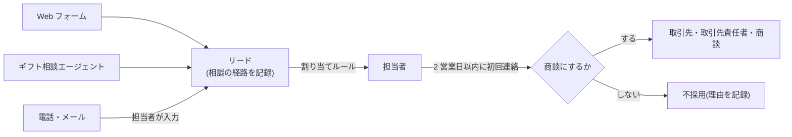

# 03. Sales Cloud の設計(法人ギフト)

Sales Cloud は、法人ギフト(お中元・お歳暮・周年記念・ノベルティ)の営業に使います。個人の顧客は入れません(理由は [01-scenario.md](01-scenario.md) の 6)。

## 1. オブジェクトと項目

| オブジェクト | 使い方 | 追加した項目 |
|---|---|---|
| リード | 法人・大口ギフトの相談 | ギフトの個数、1件あたりの予算、ギフトの用途、希望のお届け日、相談の経路、相談日、相談の要約 |
| 取引先・取引先責任者 | 法人ギフトを発注する会社と担当者 | (Data 360 からコピー)個人での購入回数・最終購入日 |
| 商談 | 1 回のギフト手配(例:「あさひ精機 2026お歳暮」) | ギフトの用途、ギフトの個数、お届け日、リピート |
| 商品・価格表 | ギフトセット・茶葉・茶器 | 茶の種類、ギフト対応、のし対応、対応する用途(複数選択)、カフェインの区分、賞味期限の目安 |

- 用途(お中元・お歳暮・内祝い・周年記念・ノベルティ)は**グローバル値セット**にして、リード・商談・商品で同じ値を使います。
  レポートで用途ごとに集計するときに、表記の揺れが起きません。
- カフェインの区分の「カフェインレス」は、カフェインレス加工をした商品だけに使います。体への効果の説明には使いません(エージェントの指示でも禁止)。
- 項目の定義は [`../force-app/main/default/objects/`](../force-app/main/default/objects/) にあります。

## 2. 商談のフェーズ

標準の値(API 名)を使い、表示ラベルだけを法人ギフトの言葉に変えます。データの取り込みやほかのツールとの連携で、API 名が組織ごとに違う状態を避けるためです。

| API 名 | 表示ラベル | 完了の条件(次に進めてよい状態) | 確度 |
|---|---|---|---:|
| Prospecting | 引き合い | 相談の内容(用途・個数・時期)が分かっている | 10% |
| Qualification | ヒアリング | 予算・届け先リスト・のし・名入れの要否を確認した | 30% |
| Proposal/Price Quote | 提案・見積 | 商品の組み合わせと見積を送った | 60% |
| Negotiation/Review | 条件調整 | 数量・納期・支払い条件を調整中 | 80% |
| Closed Won | 受注 | 注文書を受け取り、届け先リストがそろった | 100% |
| Closed Lost | 失注 | 失注の理由(価格・納期・他社・見送り)を入力した | 0% |

## 3. リードの流れ

| 決めごと | 内容 |
|---|---|
| 割り当て | 個数 100 件以上は営業 A、それ未満は営業 B(リードの割り当てルール)。エージェントからの登録も同じルールを通す |
| 初回連絡 | 2 営業日以内(エージェントがお客さまにそう案内するので、守れる体制で運用する) |
| 重複 | 同じメールアドレスで 30 日以内の相談があれば、エージェントは新しく作らない(Apex 側で判定)。それ以外は標準の重複ルール |
| 変換時の項目 | リードの「ギフトの用途・個数・希望のお届け日」を商談の「ギフトの用途・個数・お届け日」に対応付ける |

## 4. 自動化(フロー)

フローは画面で作ります。ここでは仕様とテストの観点を書きます。

### F1 リピート商談の自動作成(スケジュールトリガ)

法人ギフトは、去年送った会社が今年も送ることが多く、「去年の受注先に今年も声をかける」ことが売上のほとんどを占めます。これを人の記憶に頼らず仕組みにします。

| 項目 | 内容 |
|---|---|
| 起動 | 毎年 4 月 1 日(お中元向け)・9 月 1 日(お歳暮向け)の朝 |
| 対象 | 前年の同じ用途で「受注」になった商談がある取引先 |
| 作るもの | 今年の商談(フェーズ「引き合い」、リピート = オン、個数は前年の値、名前は「〈会社〉 〈年〉〈用途〉」)と、担当者への ToDo(期日 = 2 週間後) |
| 二重作成の防止 | 同じ取引先・同じ年・同じ用途の商談がすでにあれば作らない |
| テスト | 前年受注あり → 1 件作成/前年失注のみ → 作らない/今年分を手で作成済み → 作らない/取引先 200 社でも制限に当たらない |

### F2 受注後の発送準備(レコードトリガ)

| 項目 | 内容 |
|---|---|
| 起動 | 商談のフェーズが「受注」になったとき |
| 作るもの | ToDo「届け先リストの最終確認」(お届け日の 14 日前)、「のし・名入れの確認」(お届け日の 10 日前) |
| テスト | お届け日が空 → ToDo は作らず、担当者に入力を促す/お届け日が 10 日以内 → 期日を今日にする |

### F3 エージェント経由の相談の通知(レコードトリガ+スケジュール済みパス)

| 項目 | 内容 |
|---|---|
| 起動 | リードの作成時、相談の経路 = ギフト相談エージェント |
| すること | 担当者へ通知。2 営業日後にリードの状況が「未対応」のままなら、上長にも通知 |
| テスト | 状況を変えたリード → 上長への通知は飛ばない |

## 5. Data 360 の情報を営業の画面で使う

法人の担当者が、個人としても EC で買っていることがあります(架空データでは取引先責任者 88 人のうち 23 人が EC会員と同じ人)。
営業は「いつもご愛用いただいている方」と分かれば、提案の入り方を変えられます。

| 見せるもの | 方法 | 見せないもの |
|---|---|---|
| 個人での購入回数・最終購入日 | Data 360 の「項目のコピー」で取引先責任者に入れる | 個々の注文の明細・金額・住所 |

個人としての購買を法人営業が見ることになるので、**概要だけ**にし、権限セット(法人ギフト営業)を持つ人だけが見られるようにします。
利用目的の範囲はプライバシーポリシーと照らして確認します。

## 6. レポートとダッシュボード

| レポート | 見ること | 使う人 |
|---|---|---|
| 用途・年ごとのパイプライン | お歳暮・お中元の見込みがどこまで積み上がっているか | 営業・経営 |
| リピート率 | 前年の受注先のうち今年も受注した割合 | 営業 |
| 相談の経路別の商談化率・受注率 | Web フォーム・エージェント・電話のどこから良い相談が来ているか | マーケティング |
| 初回連絡までの日数 | 2 営業日以内の割合 | 営業の責任者 |
| 失注の理由 | 価格・納期・他社のどれが多いか | 営業・商品企画 |

ダッシュボードでは、季節の比較ができるよう「前年の同じ時期」と並べます。法人ギフトは季節で大きく波があるので、前月比では判断を誤ります。

## 7. 権限

| 権限セット | 誰に | できること |
|---|---|---|
| 法人ギフト営業(`CorporateGiftSales`) | 営業担当者 | 法人ギフトの項目の参照・編集 |
| ギフト相談エージェント(`GiftConcierge_Agent`) | エージェントのユーザー | 商品を読む、リードを作る(編集・削除はできない)、2 つの Apex アクションを実行する |

エージェントのユーザーには、必要なことだけをできる権限を与えます。Apex は `with sharing` と `USER_MODE` で、このユーザーの権限の範囲で動きます。
