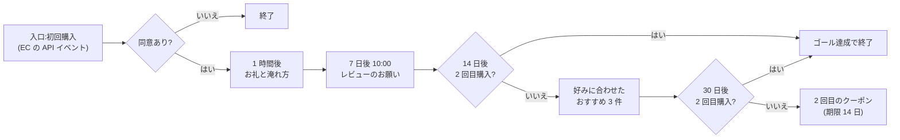

# 04. Marketing Cloud Engagement(MCE)の設計

MCE は、メールの配信とジャーニーを担います。「誰に送るか」は Data 360 のセグメントで決め、MCE では「送る直前の調整」(おすすめ商品・送りすぎの除外・反応の度合い)と配信そのものを行います。

コード:[`../mce/`](../mce/)(SQL・メール・コンテンツブロック・CloudPage)

## 1. 前提

| 項目 | 決めごと |
|---|---|
| ビジネスユニット | 1 つ(ブランドが 1 つのため) |
| 購読者キー | **EC会員ID**(店舗だけの会員は店舗会員番号)。理由は [02-data360.md](02-data360.md) の 7 |
| 送信のドメイン | 送信者認証パッケージで自社のサブドメインを使い、SPF・DKIM・DMARC を設定する。1 クリックで配信停止できるヘッダー(List-Unsubscribe)を有効にする |
| 時刻 | 画面の設定は日本時間。**SQL の `GETDATE()` と AMPscript の `Now()` は米国中部標準時(UTC−6、夏時間なし)** なので、日本時間が要る所では +15 時間する |

## 2. データエクステンション

| 名前 | 送信可能 | 主キー | 主な列 | 更新元 | 保持 |
|---|---|---|---|---|---|
| `DS_S2_SecondPurchase` など(セグメントごと) | ○ | SubscriberKey | EmailAddress, LastName, FavoriteCategory, OrderCount, LastOrderDate | Data 360 のアクティベーション | 上書き |
| `Journey_FirstPurchase_Entry` | ○ | SubscriberKey | EmailAddress, LastName, OrderId, MainCategory, OptIn | EC からの API イベント | 90 日 |
| `Order_Lines_13M` | × | OrderId + LineNo | SubscriberKey, ProductId, Quantity, Amount, OrderedAt(日本時間), IsGift | EC からの毎朝のファイル(SFTP) | 13 か月 |
| `Product_Catalog` | × | ProductId | ProductName, Category, CategoryLabel, Price, IsActive, ProductUrl, ImageUrl | EC からの毎朝のファイル | 上書き |
| `Customer_FavoriteCategory` | × | SubscriberKey | FavoriteCategory, FavoriteCategoryLabel, CategoryAmount | SQL 01 | 上書き |
| `Reco_PerSubscriber` | × | SubscriberKey + Rnk | ProductId, ProductName, Price, ProductUrl, ImageUrl | SQL 02 | 上書き |
| `Reco_Bestsellers` | × | ListName + Rnk | 同上 | SQL 03 | 上書き |
| `Exclusion_Fatigue7d` | × | SubscriberKey | Sends7d | SQL 04 | 上書き |
| `Engagement_Tier` | × | SubscriberKey | Tier, LastClick, LastOpen | SQL 05 | 上書き |
| `Preference_Center` | × | SubscriberKey | Frequency, Interests, UnsubscribedAt, UpdatedAt | 配信設定ページ | 無期限 |
| `Coupon_Pool_2nd` | × | CouponCode | IsClaimed, SubscriberKey | クーポンのコードを取り込み | 期限後に削除 |

購買の集計は Data 360 で行い、MCE には**配信に必要な分だけ**を置きます。
注文明細を MCE にも持つのは、「その人がまだ買っていない商品」を送る直前に選ぶためで、期間は 13 か月(前年の同じ季節を含む)に絞っています。

## 3. ジャーニー

| # | 名前 | 入口 | 目的(ゴール) | 終了条件 |
|---|---|---|---|---|
| J1 | ウェルカム | EC の API イベント(初回購入の直後) | 30 日以内の 2 回目購入 | 2 回目購入・配信停止 |
| J2 | 2回目購入の後押し | S2(Data 360、毎日) | 90 日以内の 2 回目購入 | 2 回目購入・配信停止 |
| J3 | 休眠予備軍 | S3(Data 360、毎週) | 60 日以内の購入 | 購入・配信停止 |
| J4 | 法人ギフト窓口の案内 | S6(Data 360、毎週) | 法人窓口ページの閲覧・相談 | 相談(リード作成)・配信停止 |
| — | お歳暮の早期案内 | S5(10 月に 1 回) | 11 月中の予約 | 1 回の配信 |

### J1 ウェルカム

| ステップ | メール | 内容のポイント |
|---|---|---|
| 1 時間後 | [`welcome-d0-thanks.html`](../mce/emails/welcome-d0-thanks.html) | 買った茶の種類(入口のイベントの `MainCategory`)に合わせて淹れ方を変える。広告は入れない |
| 7 日後 | レビューのお願い | 届いてから数日たった頃に聞く |
| 14 日後 | [`welcome-d14-reco.html`](../mce/emails/welcome-d14-reco.html) | SQL で作ったおすすめ 3 件。作れない人は売れ筋に切り替え、それも空なら送らない |
| 30 日後 | [`welcome-d30-coupon.html`](../mce/emails/welcome-d30-coupon.html) | `ClaimRow` でクーポンのコードを 1 人 1 つ割り当てる。在庫切れなら送らずログに残す |

- 入口を Data 360 のセグメントではなく EC の API イベントにしたのは、「買った直後」に届けたいからです(セグメントの更新を待つと半日以上遅れる)
- 1 時間後のお礼は広告を含まない案内ですが、法務の確認が済むまでは、全ステップを同意のある人だけにしています
- クーポンは 30 日後にだけ出します。早く出すと「クーポンを待てば安く買える」と学習され、定価での 2 回目購入が減るためです(効果は対照群で確かめる)

### 送りすぎの防止(全ジャーニー共通)

- 直近 7 日に販促メールを 3 通以上受け取った人は、販促の送信から外す([`04_send_fatigue_exclusion.sql`](../mce/sql/04_send_fatigue_exclusion.sql))
- 反応のない人(Cold)はメールマガジンを月 1 回に減らす([`05_engagement_tier.sql`](../mce/sql/05_engagement_tier.sql))。開封は Apple のメールのプライバシー保護で多めに数えられるので、クリックを重く見る
- 配信設定ページで選んだ頻度(週 1・2 週に 1・月 1)を優先する

## 4. オートメーション(毎朝)

| 順 | アクティビティ | 内容 |
|---|---|---|
| 1 | ファイルの取り込み | `Order_Lines_13M`・`Product_Catalog`(EC が 3:00 に SFTP へ置く) |
| 2 | 検証 | 取り込み件数が 0 件、または前日の 50% 未満なら止めて通知(壊れたデータでおすすめを作らない) |
| 3 | SQL | [01](../mce/sql/01_favorite_category.sql) 好きな茶の種類 → [02](../mce/sql/02_recommendations.sql) おすすめ → [03](../mce/sql/03_bestsellers.sql) 売れ筋 |
| 4 | SQL | [04](../mce/sql/04_send_fatigue_exclusion.sql) 送りすぎの除外 → [05](../mce/sql/05_engagement_tier.sql) 反応の度合い |
| 5 | ファイルの書き出し | 前日に配信停止した人(データビュー `_Unsubscribe`)を EC へ。EC の同意フラグに反映する |

開始は日本時間の 4:30(画面上は日本時間で設定できるが、SQL の中の日付計算は米国中部標準時である点に注意)。
ジャーニーの送信は、この処理が終わった後の 9:00 以降にします。

## 5. メールの作り

- 共通部分(フッター)はコンテンツブロック [`footer-legal.html`](../mce/content-blocks/footer-legal.html) を 1 か所で管理し、`ContentBlockByKey` で読み込む
- 差し込みの値が空のときの代わり(「お客さま」など)を必ず決める
- リンクには `alias` を付け、どのリンクが押されたかをレポートで見分けられるようにする
- 画像には代わりの文(alt)を入れる。画像が表示されない環境でも内容が分かるようにする

## 6. 法令と社内ルールの確認

| 法令など | このメールでの対応 |
|---|---|
| 特定電子メール法 | 事前の同意(取得日時・経路を記録)、送信者の名前・住所・問い合わせ先・配信停止の方法をすべての販促メールに表示(フッター) |
| 景品表示法 | クーポンの条件(割引率・対象・期限・併用の可否)を本文に書く。「必ず」「最安」などの言い方をしない |
| 医薬品医療機器等法(薬機法) | お茶の健康効果・効能を書かない(「風邪予防」「痩せる」など)。カフェインレスは加工の事実だけを書く |
| 大手メールサービスの送信者のガイドライン | SPF・DKIM・DMARC、1 クリックの配信停止、迷惑メールの報告率の監視 |

## 7. 配信設定ページ(CloudPage)

[`preference-center.html`](../mce/cloudpages/preference-center.html)(AMPscript + SSJS)

| 決めごと | 内容 |
|---|---|
| 誰の設定か | メールのリンク(`CloudPagesURL`)が付ける暗号化された情報からだけ取る。URL やフォームに購読者キーを書かない |
| 選べる値 | 頻度 3 種類、興味 6 種類。決めた一覧にない値は保存しない。画面に出す値もその一覧から作る(入力をそのまま表示しない) |
| 全配信停止 | All Subscribers の状態を「配信停止」にする。注文確認などの取引メールは届くことを画面で伝える |
| エラー | 例外の内容を画面に出さない |
| 反映 | Data 360 へは MCE コネクタで、EC へは翌朝のファイルで反映する |

## 8. テスト

| 対象 | 確かめること |
|---|---|
| SQL | 架空データを入れた DE で実行し、件数と数人分の結果を手で計算した値と比べる(例:おすすめに購入済みの商品が出ないこと) |
| メール | テスト用の購読者(好きな茶の種類ごと・おすすめなし・姓なし)でプレビューし、すべての分岐を表示する |
| ジャーニー | テストモードで、2 回目購入がある人・ない人がそれぞれ正しい道を通ること |
| クーポン | 同じ人に 2 回送ってもコードが 1 つしか消費されないこと、在庫 0 で送信されないこと |
| 配信設定ページ | リンクなしで開くと案内が出ること、一覧にない値を送っても保存されないこと、停止後に販促メールが届かないこと |
